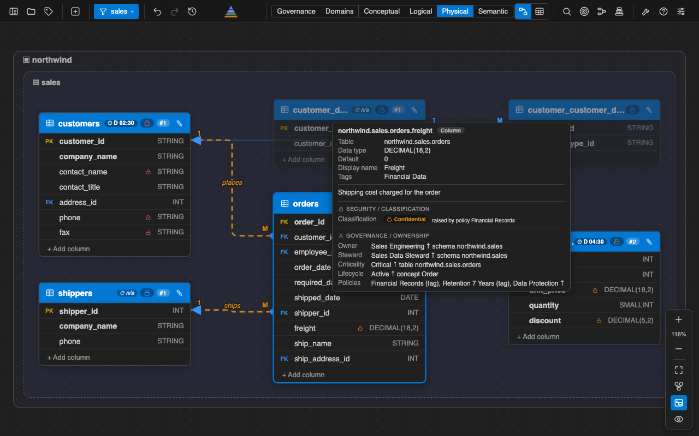
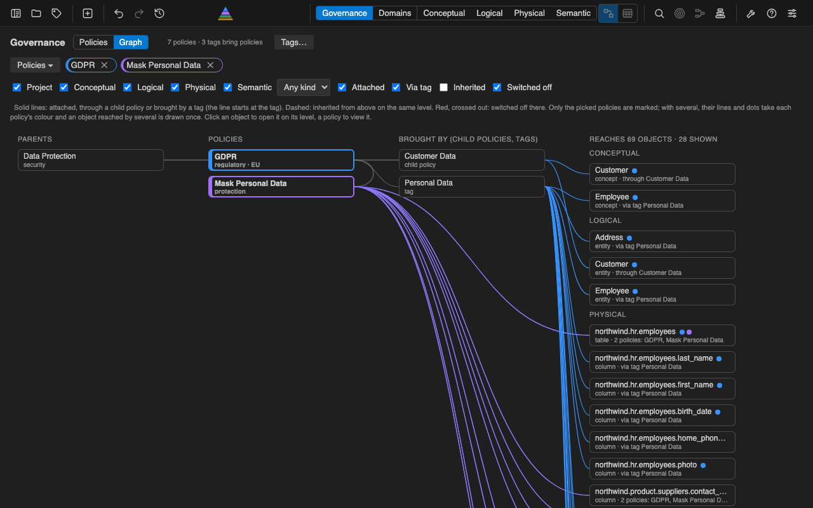
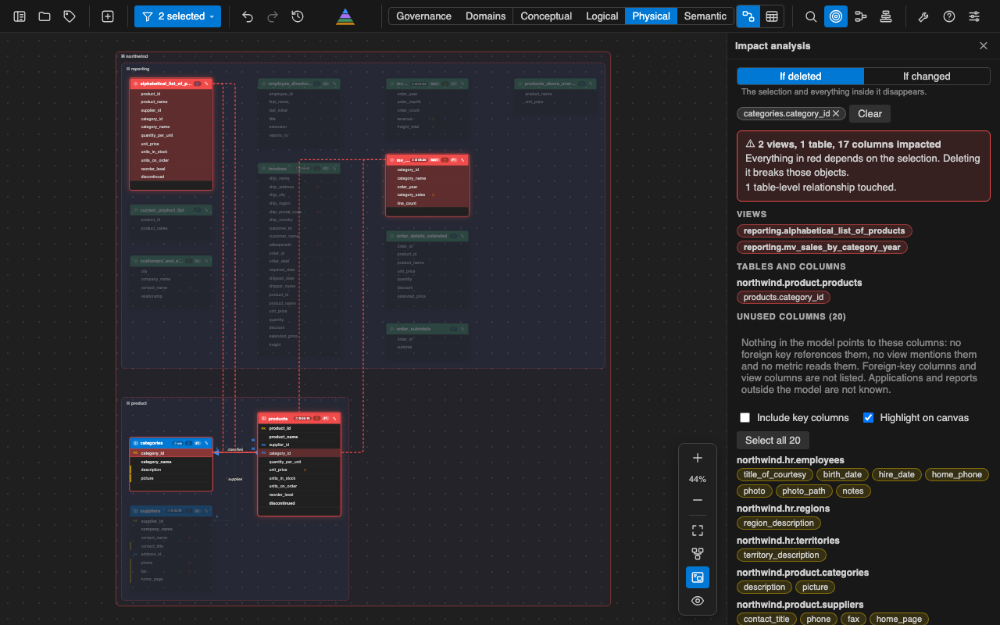
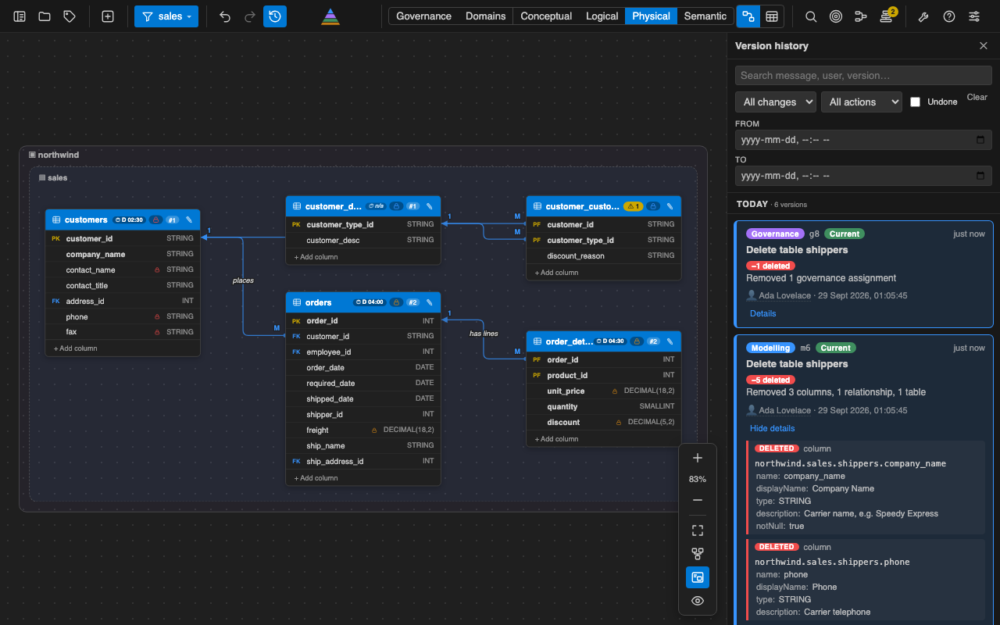
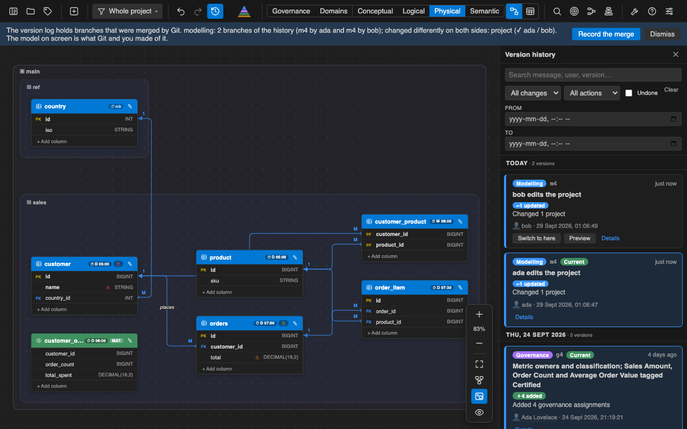

<h1>
  <a href="https://stratasql.com"></a>
  <a href="https://stratasql.com">Strata SQL</a>
</h1>

**Model, govern and version your data as plain files in Git.**

[](https://marketplace.visualstudio.com/items?itemName=strata-sql.strata-sql)
[](https://www.npmjs.com/package/@stratasql/strata-sql)
[](LICENSE)

- **See it.** A visual canvas of your database at four linked levels: business concepts, logical entities, physical tables, and the metrics built on them.
- **Start from what you have.** Import a dbt project or SQL scripts, or open a sample (Northwind, FpML, a star schema).
- **Govern it.** Owners, stewards, classification and policies on every level, with impact analysis and load order.
- **Keep it in Git.** The model is one readable `.model.json`; its version history is a hash-chained log that Git merges without conflicts.
- **Use it anywhere.** In VS Code, in your browser, in Docker, and readable by AI assistants.



## Try it in 30 seconds

**In VS Code:** install the extension, open the Command Palette (⇧⌘P / Ctrl+Shift+P) and run **Strata SQL: Open Sample Model**.

**Without VS Code** (Node.js 20 or newer):

```
npx @stratasql/strata-sql live --demo
```

It opens the sample models in your browser. Nothing is saved: your changes, and the versions they create, stay in the browser tab and are discarded when you close it.

**On your own data:** *Strata SQL: New Project* (Command Palette), or `npx @stratasql/strata-sql init`, then start from a blank model, a sample, a **dbt project** or **SQL scripts**.

## What you get

### Governance on every level


Tags and policies with parents, owners, stewards, criticality and lifecycle that flow down from project to column, and classification that rolls up from columns to tables. A graph shows exactly what each policy reaches.

### Know what breaks before you change it


Select tables, columns or schemas and see, in red, everything that depends on them. Find unused columns. See which tables load first and which can load in parallel, with optional data-availability SLAs.

### A history you can trust in Git


Three streams (modelling, governance, metrics), undo and redo, point-in-time preview. Every entry is hash-chained, so an edited or removed entry is reported. After a Git merge, Strata SQL lists the objects both branches changed.

### Work as a team, through Git


There is no live co-editing: you collaborate the way you do on code, with branches and pull requests.

1. **Branch, model, commit.** The model is sorted, compact JSON, so a new table or column is a few added lines in the diff.
2. **Review in the pull request.** Read the JSON diff, or open the History drawer to see each version with who made it, when, and exactly what changed. Governance changes sit in their own stream, so their owners can review them separately.
3. **Merge.** Different tables edited on different branches merge cleanly, and each history file merges without conflict markers (`history/*.jsonl merge=union`, which *New Project* and `strata-sql init` write for you).
4. **Both branches changed the same object?** Strata SQL names it and **Record the merge** joins the two histories into one version.

Commit `data_models/`, `history/`, `strata.project.json` and `.gitattributes`; keep `.strata/` (your window layout, settings and caches) out. For a big model, split it into one file per domain: each domain gets an owner and a generated `CODEOWNERS` file for GitHub or GitLab. The [collaboration guide](help.md#collaboration) has the full list.

## More

- **Four linked levels:** conceptual, logical, physical and a semantic layer of metrics, in one file; a concept has entities, an entity has tables.
- **Ten database technologies:** PostgreSQL, SQL Server, MySQL, Oracle, SQLite, Snowflake, Google BigQuery, Databricks, Trino/Presto, DuckDB (two- and three-part names, platform types).
- **Import:** dbt (`target/manifest.json`, columns also read from the models' SQL, lineage, starter metrics) and SQL scripts in eleven dialects (tables, views, keys, foreign keys, comments, queries), both re-syncable without overwriting your work.
- **Export:** an Airflow DAG, Dagster assets or a Jupyter notebook from the load order; one self-contained interactive HTML file to share.
- **AI-ready:** the model file is compact and readable, and optional vector embeddings let an assistant look up just the parts of a model a question needs.
- **Teams:** split a large model into one file per domain, with owners; the history of each part merges on its own.
- **Anywhere:** the same editor in VS Code, in your browser (`strata-sql live`), and in Docker.

## Command line

```
npm install -g @stratasql/strata-sql        # the command is strata-sql
```

| Command | What it does |
|---|---|
| `strata-sql live --demo` | Try the sample models in your browser; nothing is saved |
| `strata-sql init [--template northwind\|fpml\|star]` | Create a project (never overwrites anything) |
| `strata-sql live` | Open your project's editor in the browser |
| `strata-sql import-dbt --from <dbt project>` | Import (and later re-sync) a dbt project |
| `strata-sql import-sql --ddl <files or folders>` | Import (and later re-sync) CREATE TABLE scripts and queries |
| `strata-sql split` / `join` | One file per domain, or back to one |

`strata-sql --help` and `strata-sql <command> --help` list every option. A Docker image runs the same command; see [CONTRIBUTING.md](CONTRIBUTING.md).

## Your files

A project is a folder you commit:

| File | What it is |
|---|---|
| `data_models/<name>/<name>.model.json` | The model: concepts, entities, tables, relationships, governance, metrics |
| `history/<name>.history.jsonl` | Its version log: append-only, one entry per line, merges in Git without conflicts |
| `strata.project.json` | The manifest: which models the project has, domains, the dbt and SQL sources |
| `.gitattributes` | One line, `history/*.jsonl merge=union`, that lets Git merge each version log without conflicts |
| `data_models/<name>/<name>.model.layout.json` | Where the cards sit on the canvas (commit it or ignore it) |
| `.strata/` | Your own settings and caches (git-ignored) |

The full list, with sample data and embeddings, is in the [user guide](help.md#the-files-strata-sql-uses).

## Shortcuts

| Key | Action |
|---|---|
| Cmd/Ctrl + F1 | Help (the [user guide](help.md)) |
| Cmd/Ctrl + F | Search the model |
| Cmd/Ctrl + Y | Version history |
| Cmd/Ctrl + L | Navigator |
| Cmd/Ctrl + Alt + G / C / L / P / S | Governance, Conceptual, Logical, Physical, Semantic |
| Cmd/Ctrl + 1 | Auto layout |

## Help and links

- [User guide](help.md): quick start, every feature, shortcuts, tips, collaboration.
- [stratasql.com](https://stratasql.com) · [Report an issue](https://github.com/stratasql/strata-sql/issues) · [Contributing](CONTRIBUTING.md)

## License

Apache License 2.0, see [LICENSE](LICENSE). It covers the extension, the `@stratasql/strata-sql` npm package and the Docker image, which all carry the same file and the same `Apache-2.0` identifier in `package.json`. The two bundled libraries keep their own licences, shipped next to them: `node-sql-parser` (Apache-2.0) and `big-integer` (Unlicense); the optional local-embeddings library `@huggingface/transformers` (Apache-2.0) is installed by `npm ci` and not shipped in any build. The sample models are original examples.
