# Strata SQL Help

> Open this page any time with **Cmd/Ctrl + F1** or the **?** button in the Strata SQL toolbar.

**Contents:** [What is Strata SQL](#what-is-strata-sql) · [Quick start](#quick-start) · [New project](#new-project) · [Import from dbt](#import-from-dbt) · [dbt limitations](#dbt-integration-limitations-concerns-and-what-to-do) · [Import from DDL and SQL scripts](#import-from-ddl-and-sql-scripts) · [Sample models](#sample-models) · [User guide](#user-guide) · [Levels and alignment](#levels-and-alignment) · [Governance](#governance) · [Semantic layer](#semantic-layer) · [Impact analysis](#impact-analysis) · [Load order](#load-order) · [ETL / ELT code](#export-etl--elt-code) · [Live view](#live-view-in-the-browser) · [HTML export](#export-as-interactive-html) · [Vector embeddings and AI assistants](#vector-embeddings-and-ai-assistants) · [Shortcuts](#shortcuts) · [Tips and tricks](#tips-and-tricks) · [Collaboration](#collaboration)

---

## What is Strata SQL

Strata SQL lets you **model, govern and version your data as plain files in Git**: a visual canvas, in VS Code or in your browser, for **physical data models**, linked to their logical and conceptual models and to a semantic layer of metrics, with governance on every level. A model lives in a plain file, `<name>.model.json`, and Strata SQL shows it as an interactive canvas where you add catalogs, schemas, tables, views and columns, draw relationships, govern and classify data, define metrics and keep a full version history.


What you get:

- **Four linked levels** – Conceptual (business concepts), Logical (entities with attributes, keys and cardinality), Physical (tables, columns and platform data types) and Semantic (metrics: what a number means and how it is calculated from the columns). A concept has one or more entities, an entity one or more tables; descriptions, tags and properties are inherited downwards, and the **Alignment** panel warns about anything that does not line up.
- **Ten database technologies** – SQL Server, PostgreSQL, MySQL, Oracle, SQLite, Databricks, Snowflake, Google BigQuery, Trino/Presto, DuckDB. Technologies with catalogs use three-part names (`catalog.schema.table`); the others use two-part names (`schema.table`).
- **Methodologies** – ER (1NF, 2NF, 3NF), Dimensional Modelling, Data Vault, One Big Table (recorded on the project; you model as you like).
- **Relationships** with cardinality (1..1, 1..M, M..M), a label and a description; M..M can create its bridge table.
- **Views** – plain, temporary and materialized, with their SQL definition.
- **Governance** – its own **Governance** tab: **policies** (GDPR, "Mask personal data", "Retention 7 years") with parents, attached anywhere or brought by a **tag**; a list with filters and a graph of what each policy reaches. Owner, steward, criticality and lifecycle are set **per level** and flow down; **classification** works the other way round: columns own it and tables, schemas, entities and concepts show the highest of what they hold. Warnings flag gaps such as personal data without a masking policy. Optional **domains** (Sales, Finance) have their own **Domains** tab next to it: named groups of concepts with a shared owner, and the unit a project splits into files.
- **ETL / ELT code** – boilerplate **Airflow DAG**, **Dagster** assets or a **Jupyter notebook** generated from the load order and SLAs.
- **Live view** – the whole tool in your default browser, full page. **Export** the model as one interactive, read-only HTML file to share.
- **Load order** – see which tables must load first, which can load in parallel and what waits for what, as stages, a pipeline drawn as a DAG (with arrows between tables) or a tree, also full screen. Add optional **data availability SLAs** to see when each table, and the whole pipeline, has its data ready. Export the sequence to JSON.
- **Impact analysis** – select tables, views, columns, schemas or catalogs and see, in red, everything that would break if they were deleted or changed; find unused columns.
- **Version history** – three separate streams (modelling, governance, semantic), undo/redo, point-in-time preview, filters; a log that Git merges without conflicts and that shows if anyone edited it afterwards.
- **Sample data** – one CSV per table shown next to the schema.
- **LLM friendly** – the model file is compact and readable, and **vector embeddings** (OpenAI, Gemini, Claude via Voyage AI, Gemma) let an AI assistant look up just the parts of the model a question needs.
- **Almost no dependencies** – plain files; the only library is the open-source `@huggingface/transformers`, used solely to create embeddings on your machine (installed by `npm install`).

### The files Strata SQL uses

A project is a folder. Even with one model it has the same shape, so adding models later, or several teams working in one project, means adding folders, never moving files:

```
sales-warehouse/
├── strata.project.json                       the project manifest (its name, the models in it)
├── data_models/
│   └── sales-warehouse/                      one folder per model (a "part"); named like the project
│       ├── sales-warehouse.model.json        the model
│       ├── sales-warehouse.model.layout.json diagram positions
│       └── data/                             sample data, one CSV per table
├── history/
│   └── sales-warehouse.history.jsonl         the version log of that model
├── .gitattributes   .gitignore
└── .strata/                                  personal settings and caches (never commit)
```

(Paths are relative to the manifest, which is the source of truth: a model that lives elsewhere in the project, or whose log the manifest names, is found there.) Below, `orders` stands for the model's name. A project split into domains (see [Domains](#domains)) has several parts, each nested one level deeper, under the *project's own* folder — `data_models/orders/sales/sales.model.json`, `data_models/orders/catalog/catalog.model.json`, and so on, so that everything about one project still groups under its own name — plus `history/<part>.history.jsonl` per part (version logs stay flat at the project root, not nested), a `governance.json` and `governance.history.jsonl` at the root, and, once a domain has an owner, a `CODEOWNERS` file — and, at the exact path the pre-split model used to have (`data_models/orders/orders.model.json`, not nested: it was already inside the project's own folder before the split), an **archived copy** of it (`<name>.archived.model.json`, read-only) and a small **project-index file** (`<name>.model.json`) that opens the whole project assembled (see [Domains](#domains)).

| File | Purpose |
|---|---|
| `data_models/orders/orders.model.json` | The model, including the optional conceptual, logical and semantic levels, governance values and policies. Small, sorted, human- and LLM-readable. It holds the model only: no diagram positions and no version pointers. Keys Strata SQL does not know are kept as they are. Once a project has been split into domains, the model at the *pre-split* project's own path is instead a small **project-index file** — see below. |
| `strata.project.json` | The project manifest: the project's name, its models (`parts`, each with the path of its model file), after an [import from dbt](#import-from-dbt) a `dbt` block (where the dbt artifacts are and when they were last synced), after an [import from SQL scripts](#import-from-ddl-and-sql-scripts) a `sql` block (the script files, the dialect and when they were last synced), optionally named **domains** grouping concepts (see [Domains](#domains), edited on the Domains tab, next to Governance in the level switch — you rarely need to touch this file by hand), and, once split, `index` (the path of the project-index file). A few lines, made by *New Project* (or at an older model's first save). Strata SQL looks for it in the model's folder and the folders above it. |
| `governance.json` | Only once a project has more than one part (a split project, see [Domains](#domains)): the tags, policies and allowed property keys shared by every part, moved out of the one model file. |
| `governance.history.jsonl` | The version log of `governance.json`, at the project root (not under `history/`, since it is not one part's log) — its own stream, alongside the modelling and semantic streams of every part. |
| `CODEOWNERS` | Only once a split project has domains with an owner: `/data_models/<project>/<domain>/ @owner`, one line per domain, generated by *Split into Domains*. Not enforced by Strata SQL; it is a plain GitHub/GitLab CODEOWNERS file for the platform to act on. |
| `data_models/orders/orders.archived.model.json` | Only after *Split into Domains*: the pre-split model, renamed in place, byte-for-byte what it was. Strictly read-only (opening it shows a banner naming the parts it split into); never re-added as a live part, never scanned for cross-part checks. Its own version log and layout file are unaffected — see the next two rows. |
| `data_models/orders/orders.model.json` (project-index file) | Only after *Split into Domains*: a small, regenerable file at the pre-split model's own path — `{"strata": "project-index/1", "name", "parts": [...]}` — that is not a model at all. Opening it assembles every part into one view of the whole project (the same view *Strata SQL: Open Project View* shows) — tables, columns, relationships, catalogs, schemas, concepts, entities and metrics can be added, edited and deleted here, each routed to the correct part; Project settings, per-domain embeddings and creating/editing a tag or policy work here too, and the Model Navigator's reveal (click an item to jump to it on the canvas) works from this tab too; saving anything refreshes the tab at once. The Version history drawer shows every part's own log merged into one list, with its own cross-part Undo/Redo — see [Seeing the whole project](#seeing-the-whole-project-project-view). It also opens in the browser (Live view, same editing), see [Live view in the browser](#live-view-in-the-browser). *Strata SQL: Join Parts* turns it back into a real model, at the same path. |
| `data_models/orders/orders.model.embeddings.json` | Generated search vectors for AI assistants (Tools → Generate / refresh embeddings). Regenerable; never edit or read it by hand. |
| `history/orders.history.jsonl` | The version log of that model, in the project's `history/` folder: one entry per line, only ever added to (a first full state, then changes), each chained to the one before by a SHA-256 hash. Never edit by hand; Git merges it without conflicts (see [Collaboration](#collaboration)). |
| `data_models/orders/orders.model.layout.json` | Where the tables sit on the diagram (per level). Not versioned; commit it if you want everyone to see the same picture, or keep it personal. Moving a card writes only this file, so the model stays unchanged. (*Split into Domains* renames this to `orders.archived.model.layout.json` alongside the archived model, so the two stay paired in the Explorer; its own `history/orders.history.jsonl` keeps its name, since it was never reachable through the manifest either way.) |
| `orders.html` | Optional: the model exported as a self-contained interactive HTML file (Tools → Export interactive HTML). A read-only snapshot to share; Strata SQL never reads it back. (From the Project View or the project-index file, this exports the whole assembled project instead, and a save dialog asks where — there is no single model to sit next to.) |
| `orders.load-order.json` | Optional: the load sequence exported from the Load order panel (⭳ JSON). A snapshot for pipelines and documentation; Strata SQL never reads it back. |
| `data_models/orders/data/` | Sample data: one `catalog.schema.table.csv` per table, per model; an [import from SQL scripts](#import-from-ddl-and-sql-scripts) can write the first rows of `INSERT ... VALUES` here, on request and never over a file that is already there. (A project converted from an older layout keeps using its `orders_model_data/` folder beside the model.) |
| `.strata/cache/` | A rebuildable cache that makes long histories open faster. Safe to delete; never commit it. |
| `.strata/settings.json` | Workspace settings: your name and e-mail, timezone, theme, arrows and animation (View settings), versioning mode. |
| `.strata/layout.json` | Where you left each model: the level you were on and, for each level, its view scope, panels, selection and zoom, whether the mini-map is on, plus the navigator's collapsed sections (and, in the live view, whether the navigator is open). Personal, written automatically; the live view reads and writes the same entries. |

---

## Quick start

1. **Run the extension.** Open the Strata SQL folder in a terminal and run `npm install` once (needed for local embeddings), then open it in VS Code and press **F5** (a new window opens with Strata SQL loaded).
2. **Create a project, or play with a sample.** Run **Strata SQL: New Project** from the Command Palette: a few answers (folder, name, blank or a template) and you have a project with a first version, ready for Git (see [New project](#new-project)). To explore first, open a ready-made model: [Northwind (retail)](vscode://strata-sql.strata-sql/openSample?northwind) or [FpML (banking)](vscode://strata-sql.strata-sql/openSample?fpml) (see [Sample models](#sample-models)). A bare `x.model.json` you made yourself opens too: any file ending in `.model.json` opens in the Strata SQL editor (use *Reopen Editor With… → Text Editor* to see the raw JSON), and it gets a project manifest the first time you save.
3. **Describe the project.** A blank project starts with its name, database technology and methodology; open **Project** (folder icon) to add a description, naming (three-part is offered for technologies that support it) and stakeholders. (A model with no project yet shows the *New project* dialog.)

   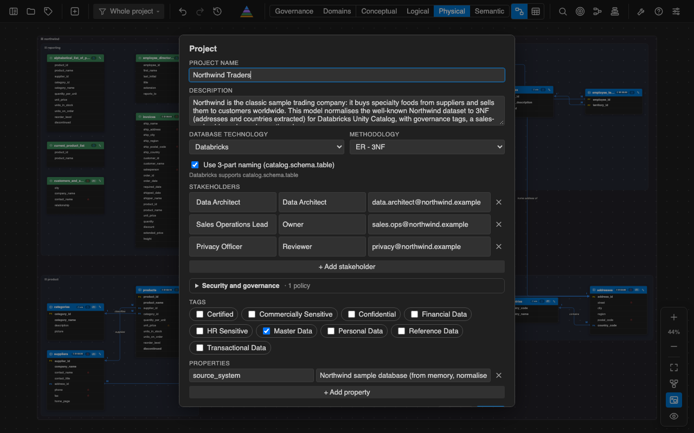

4. **Add structure.** The **+** menu in the toolbar: add a catalog (three-part technologies), a schema, a table, a view, a table-level relationship. One schema always exists.
5. **Add columns.** Click **+ Add column** at the bottom of a table card. Pick a data type from the list for your technology, tick *Primary key / Non null / Unique*, add a description.
6. **Relate tables.** Drag from a column row and drop on another column (or on a table to point at its primary key). A foreign key with cardinality `1..M` is created.
7. **Tag, govern and describe.** The tag icon creates **tags** (labels such as Personal Data). The **Governance** tab (first button of the level switch) creates **policies** and attaches them; each object's dialog has a collapsed **Security and governance** box: classification (what the data is) and owner, steward and the rest (how it is managed), see [Governance](#governance).
8. **Optional – add the business view.** Open **Alignment** (the stacked-layers icon) → **Generate logical and conceptual levels**, then merge what belongs together (see [Levels and alignment](#levels-and-alignment)).
9. **Optional – add metrics.** Switch to the **Semantic** level and add a metric such as *Revenue* = `SUM(order_details.unit_price * order_details.quantity)` (see [Semantic layer](#semantic-layer)).
10. **Save.** **Cmd/Ctrl + S** saves the model and its version log together (the log first). Every change is already recorded in the version history. Moving tables on the diagram is not a model change: it is written to the layout file straight away, without a save.
11. **Find your way.** **Cmd/Ctrl + F** searches the model, **Cmd/Ctrl + L** opens the navigator, **Cmd/Ctrl + 1** tidies the layout, and the [canvas controls](#moving-around-canvas-controls-and-the-mini-map) in the bottom-right corner zoom, fit and lay out the diagram.
12. **Optional – prepare for AI assistants.** **Tools → Generate / refresh embeddings** works out of the box with local models, no API key needed (see [Vector embeddings](#vector-embeddings-and-ai-assistants)).

---

## New project

**Strata SQL: New Project** (Command Palette, right-click a folder in the Explorer, or the *New project wizard* button on the empty-state screen) sets a project up in a few questions. On a small team, or on your own, press **Enter** through it: nothing else is needed.

1. **Folder.** Your workspace folder (press Enter), or choose another one.
2. **Name.** For example `Sales Warehouse`; it also names the model's folder and files (`data_models/sales-warehouse/sales-warehouse.model.json`, and `history/sales-warehouse.history.jsonl`). A name with spaces or odd characters becomes a folder-safe form (`Sales Warehouse!` -> `sales-warehouse`); the project keeps the name you typed. Strata SQL tells you while you type if something with that name is already there: **nothing is ever overwritten**.
3. **Starting point.** **Blank** (a project with one schema), or a template copied and renamed as *your own*: **Northwind** (retail), **FpML** (banking) or **Dimensional star** (a small sales star: `fact_sales` with customer, product, date and store dimensions, surrogate keys, described, no sample data). **From a dbt project…** imports an existing dbt project (see [Import from dbt](#import-from-dbt)); it asks for the dbt folder or its `manifest.json`, and the platform comes from the dbt adapter, so there is no platform question. **From DDL / SQL scripts…** imports `.sql` files (see [Import from DDL and SQL scripts](#import-from-ddl-and-sql-scripts)); it asks for the DDL files or folders, optionally for query files, and for the SQL dialect (detected, you confirm it), and the platform comes from the dialect, so there is no platform question.
4. **Blank only: platform and methodology.** A template brings its own (Databricks and 3NF for the samples, PostgreSQL and Dimensional Modelling for the star), a dbt import takes the platform from the dbt adapter and a SQL import from the dialect.
5. **Create project**, or **Team setup...** first (optional).

Strata SQL then writes, in this order: the first **history entry** (`history/<name>.history.jsonl`), the model (`data_models/<name>/<name>.model.json`), its layout (templates), sample data into `data/` (Northwind, FpML), the manifest `strata.project.json`, and two small Git helper files: `.gitattributes` (`history/*.jsonl merge=union`, so the history merges without conflicts) and `.gitignore` (`.strata/` stays personal). Existing `.gitattributes` and `.gitignore` files are added to, never replaced. A template copy carries the template's own versions plus one more, *Created from the ... template as "Your name"*, recorded under your name. The new model opens in Strata SQL.

**Team setup** (optional, one extra step): tick or untick **Git files** (the two files above) and **Commit the layout file** (unticked, `*.model.layout.json` is added to `.gitignore` so diagram positions stay personal). If the folder already holds a project, the new model is added to it as one more model (its own folder and history file); nothing existing is touched..

**From a terminal**, the same thing: `node cli.js init --name "Sales Warehouse" --template star --dir ./sales` (options: `--template blank|northwind|fpml|star`, `--platform`, `--methodology` for blank projects, `--no-git`, `--ignore-layout`; `--dir` defaults to the current folder and `--name` to its name). The package declares one command, `strata-sql`, so once it is installed it is `strata-sql init ...`. It writes exactly what the wizard writes and refuses to overwrite. `strata-sql --help` lists the commands (`init`, `live`, `import-dbt`, `import-sql`, `split`, `join`); `strata-sql <command> --help` explains one. Long lists are cut after a few lines; add `--verbose` to see everything. Running the extension from source (F5), the Extension Development Host's terminal does not have `strata` on PATH by itself: run `npm link` once in the Strata SQL repo folder, or call `node cli.js` by its full path.

Every project has a manifest, even with one model: a few lines (`{"strata": "project/1", "name": ..., "parts": [{"name": ..., "model": ...}]}`) that you never need to read or edit. Creating a second project in the same folder adds it as another part.

---

## Import from dbt

Already have a dbt project? Strata SQL can start from it instead of from a blank page, and stay in step with it afterwards.

**What you need:** dbt's compiled artifacts, `target/manifest.json` and, for the real column types, `target/catalog.json`. Run `dbt parse` in the dbt project (it needs no warehouse connection; enough for a first import) or `dbt docs generate` (also writes the catalog and needs the warehouse) and Strata SQL reads them. Without a catalog Strata SQL still fills in the columns by reading the models' SQL (below); the catalog adds the real types. Manifests from dbt 0.19 up to today's dbt Core and dbt Fusion are read (see [dbt versions](#dbt-versions)); the first note of the import names the schema it read. Strata SQL does **not** read `dbt_project.yml` or the `models/**/*.yml` files on their own: the schema and database a model is built into come from your profile and macros, so a reader of the YAML files would have to guess them. A dbt folder without a `target/manifest.json` is told to run `dbt parse`.

**What is imported**

| From dbt | In Strata SQL |
|---|---|
| database, schema, name (or `alias`) of a model, seed, snapshot or source | catalog, schema and table (three-part names when the platform has catalogs or dbt uses several databases). The platform comes from the dbt adapter (Snowflake, Postgres, BigQuery, Databricks, ...) |
| a model materialized as `view` / `materialized_view` | a view; its definition is dbt's compiled SQL when there is one, otherwise the model's own SQL with `ref()` / `source()` replaced by the table names (a note says so) |
| other models, seeds, snapshots, sources | tables; the dbt `unique_id` is kept on the table (`"dbt": {"id": ...}`) |
| columns | columns, with the type from `catalog.json` (else `data_type` from the properties file, else `STRING` and a note), description, and columns only the warehouse has. **No catalog and no declared columns** (a project that only ran `dbt parse`): the columns the model's SQL selects, in order; `select *` takes them from what the model reads, and a column a model reads from another is a column of that one |
| a table a model reads by its plain name (`select * from orders`) that dbt does not know as a source | a table too (marked `"type": "undeclared"` in its `dbt` key, described as *read by ... but not declared in dbt*), so the physical tables under your raw models are in the model. Declare it as a source in dbt and the next re-sync adopts it |
| what each model reads (`ref()`, `source()`, tables in its SQL) | `"dbt": {"depends_on": [...]}` on the table: the tables it is built from (replaced at each re-sync) |
| `unique` + `not_null` tests, `unique_combination_of_columns`, contract `primary_key` constraints | primary key (composite too); a lone `not_null` / `unique` sets those flags |
| `relationships` tests (also `dbt_utils.relationships_where`, dbt_constraints `foreign_key`, and contract `foreign_key` constraints with `to` / `to_columns`) | foreign-key relationships (`ref()` and `source()` both), cardinality `1..M` |
| joins in a model's SQL (`... join stg_orders o on o.customer_id = c.customer_id`) and foreign / primary entities of dbt semantic models | a relationship between the two tables, **marked as inferred** in its description (*Inferred from join in the dbt model ...*). The parent is the side that is a key; if neither is, the table named after the column (`region` -> `regions.region_id`); if that is unclear, nothing is imported. A column that already has a parent (from a test, or yours) is left alone |
| dbt `semantic_models` (entities, dimensions, measures) and `metrics` (simple, ratio, derived, cumulative, older-style) | metrics on the Semantic level: `aggregation(calculation)` for a simple metric or measure (columns written as the table's full ref), `{Metric} / {Metric}` for ratio and derived ones; a filter or a cumulative window is written into the description (not modelled). Entities and dimensions are kept on the table (`"dbt": {"semantic": ...}`) |
| aggregates in model SQL (`sum(price * qty) as total`) and numeric columns of tables with a foreign key, where dbt defines no metric | **starter metrics** (see below) |
| `tags` on a model or column | tags (a definition *Imported from dbt* is created for each new one) |
| `meta` (also from the model's dbt `group`) | `owner`, `steward`, `classification`, `criticality`, `lifecycle` become the object's governance values when they match; every other key is kept as a property `dbt_<key>` |
| descriptions | descriptions |

**Starter metrics** are a guess to review, not something dbt or you wrote: each one carries the tag `dbt-derived` and says in its description where it came from (the SQL of which model, or which numeric column). The same calculation in several models is one metric; the models that repeat it are listed in its description. Numeric columns count only when the column type is known (catalog) and the table has a foreign key (a fact-like table); keys, ids and codes are skipped. Starters are made **once per table**: edit, rename or delete one and a later re-sync neither changes nor recreates it. dbt's own metrics are different: they are added once and never changed after that, but a deleted one returns at the next re-sync (delete it in dbt).

Not imported, and reported in the summary: ephemeral models (never built), nodes of installed packages, disabled nodes, exposures, unit tests, conversion metrics and saved queries. dbt tests other than the ones above are ignored. Reading SQL is a best effort: model SQL is read with a real SQL parser in your adapter's dialect (every branch of a `UNION` / `INTERSECT` / `EXCEPT` is read: columns from the first branch, tables, joins and aggregates from all), but only `ref()`, `source()` and `config()` are understood as jinja, so anything a model does through another macro can give fewer columns (never invented ones); types stay `STRING` (or the type of the column it is passed through from, or of a `cast`) until a catalog is read. **Where it can go wrong, how you can tell and what to do about it: [dbt integration: limitations, concerns and what to do](#dbt-integration-limitations-concerns-and-what-to-do).**

**A new project from dbt.** *Strata SQL: New Project* → starting point **From a dbt project…** → the dbt project folder (or the `manifest.json`). Or in a terminal: `node cli.js import-dbt --from ./analytics --dir . --name "Analytics"` (`--dry-run` lists what would be created and writes nothing). The project starts with one history entry, *Import from dbt: 11 tables added, ...*, and the manifest `strata.project.json` gets a `dbt` block (paths of the artifacts relative to the manifest, and when they were last synced).

**Staying up to date.** Run `dbt parse` (or `dbt build` / `dbt docs generate`) again, then **Strata SQL: Re-sync from dbt** (Command Palette, with the model open and saved). It uses the paths stored in the manifest, lists what would change in a dialog (new tables, changed descriptions and types, new relationships, ...) and only writes when you click **Apply**. **Strata SQL: Import from dbt…** does the same but asks for the dbt folder again, which is also how you bring dbt into a model you already built by hand. From a terminal: `node cli.js import-dbt --dir .` in a project of one model (or `--model <path>`), with `--from` when it should read something other than the stored paths, and `--dry-run` to preview.

What a re-sync may and may not do:

- **dbt owns** a table's description, kind and view definition, a column's type and description, the `dbt_*` properties, the tags that came from dbt, and the `dbt` key. If dbt has a description, it replaces yours; if dbt has none, yours stays. Change it in dbt to change it here.
- **dbt only adds** tables, columns, relationships (a relationship you delete comes back at the next re-sync), metrics, tag definitions, catalogs and schemas, primary key / not null / unique flags, and governance values from `meta` (only on an object that has none of its own, so a later change of `meta.owner` in dbt does not overwrite an owner you set).
- **Yours, never deleted or overwritten:** display names, SLAs, concepts, entities and their links, metrics, your own tags and properties, tables and columns dbt does not know, relationships you drew, governance you added, diagram positions. A table that left dbt is kept and listed (*no longer in dbt, kept in Strata SQL*). A table dbt moved to another schema or renamed stays where it is and is listed too: rename it in Strata SQL to follow (matching is by the dbt `unique_id`; a table you made by hand with the same schema and name is adopted the first time).
- **One version per stream** with the same message (*Sync from dbt: ...*): the model changes in the modelling stream, the new tags in the governance stream, the new metrics in the semantic stream. Undo works as for any other change. Strata SQL refuses when the model differs from its version log (record the change first) and for a project split into domains (it works on a project of one model).
- Nothing changes when nothing changed in dbt: no version, no file touched.

**A Strata SQL project in or next to the dbt project.** Put the project in the dbt project folder (choose it in the wizard, or `--dir .`) or in the folder above it (a repository with `dbt/` inside). Strata SQL only adds its own files (`strata.project.json`, `data_models/`, `history/`, `.gitattributes`, `.gitignore`; existing Git files are added to) and never touches a dbt file; `data_models/` was named so it cannot clash with dbt's `models/`. The `dbt` block in the manifest names the project (`"project": "."` or `"dbt"`) and the artifacts, so a teammate's re-sync finds them. Commit the manifest and the model files; `target/` is dbt's and usually git-ignored, so each person runs `dbt parse` before a re-sync.

---

## dbt integration: limitations, concerns and what to do

The import reads what dbt wrote down (`manifest.json`, `catalog.json`) and the SQL of your models. It is fast and never deletes your work, but it is a **reader**, not dbt: anything that only exists once dbt has *run* (compiled macros, real warehouse types, dynamic SQL) can be missing or approximate. Strata SQL says so in the **Notes** of the preview (the dialog before you click Apply, the terminal output of `strata-sql import-dbt`, and the last lines of the summary): *wrong and silent* is the thing this integration tries never to be; *absent and reported* is what you get instead. The first note always names what was read, for example `read: manifest v12 (dbt 1.9.4, postgres) and catalog v1`.

**The short version: for the best import run `dbt docs generate` (writes `manifest.json` with compiled SQL and `catalog.json` with the real types) with the target you want to model, then import.** `dbt parse` alone works, with the limits in the table.

### dbt versions

| | |
|---|---|
| **Read** | Manifest schemas v1 to v12 (dbt 0.19 up to today's dbt Core: v12 is what dbt 1.8 and later write, as far as we know) and dbt Fusion (2.x) manifests; catalog schema v1. It looks for both spellings of what changed over time (`raw_sql` / `raw_code`, `compiled_sql` / `compiled_code`, the three metric shapes of dbt 1.0-1.2, 1.3-1.5 and 1.6+, model versions, groups, contracts) and treats a missing section as empty. |
| **Newer than the reader** | A manifest with a schema newer than v12 (or a catalog newer than v1) is still read: what it recognises is imported, a note says the schema is newer, and unknown resource types and keys are ignored. Check the counts and tell us what is missing. |
| **Older than dbt 1.0** (schema v1 to v3) | Tables, columns, tags and SQL are read; tests, metrics and semantic models may be missing, and a note says so. Without `project_name` in the manifest the package that owns most models is taken as your project (a note names it). |
| **How well is this tested?** | Against one real project (dbt 1.12, Postgres, `dbt parse` only) and against **hand-built** fixtures, one per era (v2, v4, v7, v9, v11, v12, a future v13 and a Fusion-style manifest). The fixtures are written from knowledge of each version's shape, not produced by real dbt runs of those versions, and the Fusion one in particular is our best reconstruction. If a real manifest of a version reads wrongly, that is a bug we want to hear about. |

### What can go wrong, how you can tell, what to do

| Situation | What breaks or may be wrong | How you can tell | What to do |
|---|---|---|---|
| **Only `dbt parse`** (no `catalog.json`) | Column **types** are `STRING` unless the properties file has `data_type` or the type passes through from a column with a known type (also from a `cast(x as numeric(10,2))`). Columns come from the models' SQL and the properties files only | Notes *no catalog.json ...* and *N columns had no type* | Run `dbt docs generate` and re-sync; types are dbt-owned and are replaced by the real ones |
| **No compiled SQL** (`compiled_code` empty: `parse`, or an older `compile`-less run) | The SQL is read as you wrote it: **macros** (`dbt_utils.star`, `pivot`, your own), `` / `` / `` blocks are not understood; columns that only exist through them are missing (a macro call with an alias still gives its column). View definitions are your SQL with `ref()` / `source()` replaced | Notes *N models call macros ...*, *N models use jinja control flow ...*, *no compiled SQL ...* | `dbt compile` (or `dbt docs generate`) and re-sync; the compiled SQL replaces the raw SQL |
| **Dynamic SQL**: `run_query`, `dbt_utils.get_column_values`, pivots over data | Columns generated from data values do not exist until dbt runs against the warehouse | as above; the model has fewer columns | `dbt docs generate` (the catalog lists the real columns of built models), or declare the columns in the properties file |
| **`select *` from a source without catalog** | Only the columns declared in the source's YAML, plus the columns models read from it, are known; unread columns of the source never appear | fewer columns on a source table | `dbt docs generate`, or declare the source's columns |
| **Seeds** | The CSV is not read: a seed has the columns declared in YAML, in the catalog, or read by models | few columns on a seed | catalog, or declare the columns |
| **Ephemeral models** | Not imported (never built). A model that does `select *` from one gets no columns from it, and tests / relationships into it are dropped | count in *not imported: N ephemeral models* | materialize it as a view while you model, or accept the gap |
| **Python models** | No SQL to read: columns only from YAML and the catalog | Note *N Python models ...* | catalog |
| **Snapshots** | The `` wrapper is removed and the query read; the columns dbt adds (`dbt_scd_id`, `dbt_valid_from`, ...) exist only in the catalog | missing `dbt_*` columns | catalog |
| **Incremental models** | Imported as tables; `is_incremental()` blocks are dropped from raw SQL (harmless), a read of `{{ this }}` is not a table; `unique_key` and the strategy are not imported | the `dbt` key shows `materialized: incremental` | none needed |
| **Hard-coded table names** (`select * from orders`, no `source()`) | Imported as tables marked `undeclared`, with the columns models read from them; the schema is the one dbt builds into unless the name is qualified | Note *N tables are read by plain name ... but not declared in dbt* | declare them as sources in dbt: the next re-sync adopts them |
| **Cross-project refs, dbt Mesh, installed packages** | Nodes of other projects and of installed packages are **not imported** (counted as *nodes of installed packages*); lineage and relationships that point at them are left out | the count in *not imported* | import each project separately; the CLI flag `--all-packages` imports everything in the manifest into one model |
| **More than one target or adapter** | A manifest is the result of one `dbt parse` with **one target**: a dev target gives dev schemas (`dbt_alice_staging`) and dev database names, and that is what Strata SQL records. Two adapters in one repository are two manifests | the schema names in the preview | `dbt parse --target prod` (or the target you want to model) before importing; one Strata SQL project per adapter |
| **Stale manifest** | If you edited SQL or YAML after the manifest was written, the import shows the old shape | Note *manifest.json is older than <file>* (only a hint: it compares file dates, which a Git checkout or a copy changes) | run `dbt parse` again before every re-sync |
| **Stale catalog** | Types from an older `docs generate` | Note *catalog.json (...) is older than manifest.json* | `dbt docs generate` |
| **Very large projects** | Import time is not the problem (see *Performance*); a model with thousands of tables is heavy to draw | none | use the scope filter to look at part of it |
| **Quoted vs unquoted names, case** | Names are matched **case-insensitively** and keep the spelling of the manifest / SQL. Two objects whose names differ only by case (`"Orders"` and `orders` in Postgres) are treated as one; Snowflake catalogs spell columns in upper case (columns declared in YAML keep dbt's spelling) | duplicate-looking columns, or one where you expect two | rename one in dbt |
| **Inferred relationships** | A join in SQL (`on a.x = b.y`) or a foreign semantic entity becomes a relationship; the parent is the side that is a key, else the table named after the column. It can be wrong (a join on a non-key, a role-playing dimension) | the relationship's description says *Inferred from ...* | review them; delete or correct what is wrong (it comes back at the next re-sync, so add a `relationships` test in dbt for the right one) |
| **Starter metrics** | Guesses from SQL aggregates and numeric columns of fact-like tables, not authored definitions | tag `dbt-derived`, description says where from | review them; delete what you do not want (never recreated once your table was processed) |
| **Add-only, and the description trade-off** | What you delete but dbt still has (relationships, dbt metrics, tables, columns) returns at the next re-sync. A description you edit in Strata SQL is replaced by dbt's when dbt has one | listed in the preview | change it in dbt; write the description in dbt, or leave it empty there |
| **Semantic layer versions** | Legacy metrics (dbt 1.0-1.5) and MetricFlow metrics and semantic models (1.6+) are imported (simple, ratio, derived, cumulative); **conversion metrics and saved queries are not**, and the newer semantic-layer YAML spec of the latest dbt Core and Fusion may be written in a shape the reader has not seen | *not imported: N saved queries or metrics ...* | check the count; recreate those on the Semantic level |
| **Disabled nodes, unit tests, exposures** | Not imported | counted in *not imported* | none |
| **Split projects** | Refused: import works on a project of one model | error message | join the parts first (*Strata SQL: Join Parts*) |
| **Windows** | Paths in the `dbt` block are stored with `/` and relative to `strata.project.json`; on another drive they cannot be relative and are stored absolute, which a teammate's machine will not have. `\r\n` line endings in SQL are fine | none | keep the dbt project and the Strata SQL project on the same drive |
| **dbt Fusion** | Fusion's manifest is read like v12. Fusion does not write compiled SQL on parse, so everything under *No compiled SQL* applies; its catalog and any Fusion-only fields are read as far as they match | note *dbt Fusion manifest* | as for *No compiled SQL* |

### How the SQL is read

Model SQL is read with **node-sql-parser**, a real SQL parser with the dialect of your dbt adapter (Postgres, Redshift, Snowflake, BigQuery, MySQL / MariaDB, SQL Server / Fabric / Synapse, Trino / Presto / Starburst, Athena, Databricks / Spark and Hive, DuckDB read as Postgres, SQLite, DB2, Flink; an adapter it does not know is read as Postgres). What that gives you:

- **Every branch of `UNION` / `UNION ALL` / `INTERSECT` / `EXCEPT` is read**, at the top level, inside CTEs and inside sub-selects: the **column names are the first branch's** (that is what SQL does), but the **tables read, joins, `ON` equalities (relationships) and aggregates (starter metrics) come from every branch**. Sub-selects in `WHERE`, `HAVING` and the select list (`in (select ...)`, `exists (...)`, scalar sub-selects) are read too.
- CTEs are scoped as SQL scopes them: a CTE named like a real table hides it, an inner `WITH` hides an outer CTE of the same name; aliases, `db.schema.table` names, quoted identifiers, `t.*`, `select * except (a)` (BigQuery) and `select * exclude (a)` (Snowflake), and `using (id)` joins are understood.
- **It does not guess.** A column that two joined tables both have and that is used without a table prefix gets no type and a note; `select *` over tables that share a column name keeps the name once and says so; an expression without an alias is not a column (note: give it an alias in dbt); a table function, `unnest`, `values` or `lateral` over a function is not a table (note), and a `* rename (...)` or `* replace (...)` modifier gives no columns rather than wrong ones.
- **Fallback.** If the parser rejects a statement (a dialect feature it lacks, for example `lateral view` in Spark, `qualify` in some contexts, Jinja that leaves invalid SQL behind), Strata SQL reads that model with a simpler text reader instead (it still gets the columns, tables, joins and every branch of a union at the top level and in sub-selects, but not sub-selects inside expressions or nested `WITH`), and a note lists the models and where the parser stopped. A statement over 60 kB (machine-generated) goes to the simple reader straight away, over 300 kB it is skipped, because the parser's time grows faster than the text.
- If **node-sql-parser is not installed** (a source checkout without `npm install`), everything is read by the simple reader and a note says so once. The extension ships the parser (about 2.5 MB); to switch it off on purpose set the environment variable `STRATA_SQL_PARSER=off`.

### Performance

Measured on a synthetic cold project (no catalog, no compiled SQL): **5,000 nodes, 300 sources, 20,000 declared columns and 2,000 SQL models with CTEs, unions, joins and aggregates: about 0.5 s to read and 0.1 s to merge** into a model on a laptop (5,000 SQL models: about 1.1 s and 0.2 s, roughly 270 MB of memory). A re-sync of an unchanged project takes about the same and writes nothing. Each distinct SQL text is parsed once per import. The wall-clock time you feel is mostly VS Code drawing the result and, for a very large model, the editor, not the import.

## Import from DDL and SQL scripts

Already have the database written down as SQL? A `pg_dump --schema-only`, a `mysqldump --no-data`, SSMS "Script Table as", Snowflake `GET_DDL`, a Databricks `SHOW CREATE TABLE`, the `CREATE TABLE` files in your repository? Strata SQL can start from them instead of from a blank page, and stay in step with them afterwards. **DDL fills the physical level** (tables, columns, keys, relationships, views); **queries fill the semantic layer** (metrics, joins no foreign key declares, lineage).

**What you need:** one or more `.sql` files (or folders of them). That is all: no database connection, no account, nothing runs. Which file you give as *DDL* and which as *queries* is for your own tidiness (the manifest remembers both lists): **every file is read the same way**, so a dump that has tables, views, inserts and reports in one script works, and so does one file per table. UTF-8 and UTF-16 (what SSMS and PowerShell write) are both read.

**How to run it**

- **New project:** *Strata SQL: New Project* → starting point **From DDL / SQL scripts…** → the DDL files or folders (pick several) → **Add query files…** or *No query files* → the **SQL dialect** → *Create project*. The dialect list puts the one Strata SQL detected first, marked *(detected)* (or *(best guess, please check)*); you can always choose another. In a terminal: `node cli.js import-sql --ddl schema.sql db/tables/ --dml reports.sql --dir . --name "Shop"` (`--dialect postgres|mysql|sqlserver|oracle|snowflake|bigquery|databricks|trino|sqlite|duckdb|redshift`, `--sample-rows 100`, `--dry-run` to list what would be created and write nothing).
- **Into the model that is open:** **Strata SQL: Import from DDL…** (Command Palette; with no model open it starts the New Project wizard, which has the same starting point). It asks for the files and the dialect, shows what would change in a dialog and only writes when you click **Apply**. If the scripts contain `INSERT ... VALUES` rows the dialog also offers **Apply with sample data** (see below).
- **Staying up to date:** **Strata SQL: Re-sync from SQL scripts** uses the files and dialect stored in the manifest's `sql` block and asks nothing but the final **Apply**. In a terminal: `node cli.js import-sql --dir .` (a project of one model; or `--model <path>`), with `--ddl` / `--dml` when it should read other files.

### What is imported

| From the scripts | In Strata SQL |
|---|---|
| `CREATE TABLE` (also `IF NOT EXISTS`, `OR REPLACE`, `EXTERNAL`, `TRANSIENT`, `UNLOGGED`; `LIKE` / `CLONE` of a table the scripts define) | a table with its columns. Temporary tables (`TEMP`, `#name`) are skipped and counted |
| `CREATE VIEW`, `CREATE MATERIALIZED VIEW`, `CREATE TEMP VIEW` (also `OR REPLACE`, `SECURE`, `ALGORITHM=`, `DEFINER=`, a column list, `OPTIONS(...)`) | a view (plain, materialized or temporary) with its definition **as written**; its columns are the column list, else the columns of its query, typed from what it reads; lineage in `sql.depends_on` |
| `CREATE SCHEMA`, `CREATE DATABASE` / `CATALOG`, `USE`, `SET search_path`, the `schema.table` or `database.schema.table` names in use | schemas and, on platforms with catalogs, catalogs. A statement with no schema uses the last `USE` / `search_path`, else the platform default (`public`, `dbo`, `main`, ...) |
| column type, `NOT NULL`, `DEFAULT`, `PRIMARY KEY`, `UNIQUE` (inline, table-level, named `CONSTRAINT`, and by `ALTER TABLE ... ADD CONSTRAINT`, including T-SQL `ADD CONSTRAINT ... DEFAULT ... FOR col` and `WITH CHECK`) | the column's `type` (upper case, `NUMERIC(10,2)`, `ARRAY<...>`, `STRUCT<...>` as written), `notNull`, `default`, `pk` (composite keys too), `unique`. A multi-column `UNIQUE` has no place on a column and is kept as a property `sql_unique_<name>` |
| `FOREIGN KEY ... REFERENCES` (inline, table-level, named, `ALTER TABLE ... ADD CONSTRAINT`; `REFERENCES t` with no column means the primary key of `t`; `ON DELETE` / `ON UPDATE` actions) | relationships `1..M` (`1..1` when the child column is unique or the only key column); a composite foreign key becomes one relationship per column, described as a column of a composite key. The constraint name and the actions are in the description |
| a table whose primary key is exactly two columns that are foreign keys to two different tables, and that nothing references | additionally a **many-to-many** relationship between the two tables *via* that table, described as *detected* (this is how the Northwind sample models its bridge tables) |
| `COMMENT ON TABLE / COLUMN / SCHEMA / VIEW`, `COMMENT '...'`, `COMMENT = '...'`, BigQuery `OPTIONS(description=...)`, T-SQL `sp_addextendedproperty @name = 'MS_Description'` | descriptions |
| `CREATE INDEX`, MySQL `KEY` / `FULLTEXT KEY`, `CHECK` constraints | properties on the table: `sql_index_<name>` (for example `USING btree (customer_id)` or `UNIQUE (email)`, as written), `sql_check_<name>`. A unique index on one column also sets the column `unique` |
| identity and generated columns (`AUTO_INCREMENT`, `AUTOINCREMENT`, `IDENTITY(1,1)`, `GENERATED ... AS IDENTITY`, computed columns), collations, other column modifiers | column properties: `sql_identity`, `sql_generated`, `sql_options` |
| table clauses: `ENGINE=`, `CHARSET=`, `CLUSTER BY`, `PARTITION BY` / `PARTITIONED BY` (a typed Hive / Databricks partition column becomes a column), `USING DELTA`, `LOCATION`, `TBLPROPERTIES`, `DISTKEY` / `SORTKEY`, `TABLESPACE`, `WITH (...)`, `ON [PRIMARY]`, storage clauses | table properties `sql_engine`, `sql_cluster_by`, `sql_partition_by`, `sql_using`, ... each holding the clause as written. Nothing is dropped |
| `SELECT`, `CREATE VIEW ... AS SELECT`, `CREATE TABLE ... AS SELECT`, `INSERT ... SELECT`, `MERGE`, `UPDATE ... FROM` | **lineage** (`sql.depends_on` on the table a statement loads: the tables it reads), the **columns** of a view or `CREATE TABLE AS` table, **metrics** and **inferred joins** (below) |
| `INSERT ... VALUES` | sample data `data/<catalog.schema.table>.csv`, **only when you ask** (*Apply with sample data*, or `--sample-rows n`): the first 100 rows per table by default in the dialog, never over an existing file |

**Metrics from queries.** Each aggregate in a query (`sum(qty * price) as revenue`, `count(distinct order_id)`, `avg(total)`, `min` / `max`, and `count(*)`, which counts the first table by its one-column primary key) becomes a metric: `aggregation(calculation)` over fully qualified columns, the **grain** is the table the measure comes from, and the description says where it came from, what the query **grouped by** and its **filter** (`WHERE`). The same calculation with the same filter in several queries is **one** metric (the others are named in its description); a different filter is another metric. Columns are followed through CTEs and sub-selects to the real table (and the filters of those CTEs are added), but a measure over an *aggregated* sub-select is not a measure of the rows and is left out. Every such metric has the tag `sql-derived`, a `sql` key with its id and says *Review it before you rely on it; it is not an authored definition*. They are made **once**: a metric you edit is never touched, one you delete is never recreated (Strata SQL remembers which ones it made), and a clash of names is resolved with the table name, `filtered` and a number rather than dropped. At most **500** metrics are added per import (a note says how many were left; the next re-sync brings the next batch).

**Joins no foreign key declares.** A join (`join stock s on s.sku = p.sku`, or `where a.x = b.y`) between two **tables** (a view is never an end of a relationship) becomes a relationship **marked as inferred** (*Inferred from a join in the query at file.sql:31:1.*): the parent is the side that is a key, else the table named after the column, and if that is unclear nothing is imported. A column that already has a parent is left alone.

### Dialects

Strata SQL reads eleven dialects: **PostgreSQL, Amazon Redshift, MySQL / MariaDB, SQL Server (T-SQL), Oracle, Snowflake, Google BigQuery, Databricks / Spark / Hive, Trino / Presto / Athena, SQLite** and **DuckDB**. The dialect decides the platform of a new project (Redshift becomes PostgreSQL) and so whether names have two or three parts: `schema.table` for PostgreSQL, MySQL (a MySQL *database* is a schema), Oracle and SQLite; `catalog.schema.table` for SQL Server (`USE [Clinic]` names the catalog), Databricks, Snowflake, BigQuery (`project.dataset.table`, also inside one pair of backticks), Trino and DuckDB, and for any project whose scripts use `database.schema.table` names. Into an existing two-part project a catalog in the scripts is dropped (and a note says so); into a three-part one, scripts with two-part names land in the project's first catalog.

**Detection** is cheap and never a parse: Strata SQL counts what each dialect's scripts tend to contain (`AUTO_INCREMENT` and `/*!40101` for MySQL, `GO` lines, `[dbo].[t]` and `IDENTITY(1,1)` for SQL Server, `VARCHAR2` and `TABLESPACE` for Oracle, `USING DELTA` and `TBLPROPERTIES` for Databricks, `INT64` and backtick `project.dataset.table` for BigQuery, `CLUSTER BY` and `VARIANT` for Snowflake, `COPY ... FROM stdin` and `pg_catalog` for PostgreSQL, `DISTKEY` for Redshift, ...). The result is offered, never assumed: the dialect question puts it first and says *(best guess, please check)* when it is not clear-cut, and you can always choose another (`--dialect` in a terminal; with no `--dialect` the terminal prints what it detected). It is stored in the manifest, so a re-sync does not ask again.

Statements are split the way the database would: quotes, comments, `$$` dollar quoting, `DELIMITER`, `GO` batch lines, Oracle's `/` line, psql `\` lines, MySQL's `/*!50001 ... */` wrappers (mysqldump writes views there), and the `BEGIN ... END` of a procedure, function or trigger is kept whole so its semicolons never split anything.

### Re-sync: what the scripts own

- **The scripts own** a table's kind (table or view), a view's definition, a column's type and default, the `sql_*` properties, and the `sql` key (the first file the table was read from, its lineage). A changed type in the script replaces the type in Strata SQL.
- **The scripts only add:** catalogs, schemas, tables, columns, `primary key` / `not null` / `unique` flags, relationships (a relationship you delete comes back at the next re-sync), many-to-many relationships, metrics, the `sql-derived` tag. **Descriptions are set only when the object has none**: a description you wrote, or edited, stays, and a comment changed in the script does not replace it (change it in Strata SQL, or remove yours first).
- **Yours, never deleted or overwritten:** display names, SLAs, concepts, entities and their links, your own tags, properties and governance, tables and columns the scripts do not know, relationships you drew, metrics you edited or deleted, diagram positions. A table that left the scripts (or was `DROP`ped in them and is gone from the import) is kept and listed (*no longer in the scripts, kept in Strata SQL*).
- **Matching** is by `catalog.schema.table`, case-insensitive, and columns by name, case-insensitive; a hand-made table with the same schema and name is adopted the first time. A table that moved schema is a new table.
- **One version per stream** with the same message (*Sync from SQL scripts: ...*); undo works as for any other change. Strata SQL refuses when the model differs from its version log (record the change first), when the log has an unresolved fork, and for a project split into domains, an archived model or a project-index file (it works on a project of one model). Nothing changes when nothing changed in the scripts: no version, no file touched.
- **Order does not matter.** An `ALTER TABLE`, `COMMENT ON` or `CREATE INDEX` that comes before its `CREATE TABLE` (or in another file) is applied once the table is known; one whose table is never defined is reported with its file, line and column. A table defined twice takes its last definition (a note says so); `IF NOT EXISTS` keeps the first; `DROP TABLE` / `DROP VIEW` removes what was defined before it; `ALTER TABLE ... ADD / DROP / MODIFY / ALTER COLUMN` and `SET DEFAULT` / `SET NOT NULL` / `TYPE` are applied in order.

### Limitations, concerns and what to do

The import reads SQL **text**: it never runs anything and knows nothing the scripts do not say. It would rather say *not read* than guess. The first note always names what was read (`read: 2 files as PostgreSQL (detected), 10 table and views, 9 query statements`), and every statement it could not read is named with its **file, line and column**, in the **Notes** of the preview dialog, the terminal output of `strata-sql import-sql` and the end of the summary.

| Situation | What breaks or may be wrong | How you can tell | What to do |
|---|---|---|---|
| **Stored procedures, functions, triggers, packages, anonymous blocks** | Not read, by design: their body may build tables dynamically. Tables a procedure creates are missing; tables it reads are not lineage | Note *N procedural objects ... are not read: procedure x at file:line* | Script the tables the procedure creates as plain DDL, or accept the gap |
| **Statements with no table or query in them** (`SET`, `GRANT`, `CREATE SEQUENCE`, `CREATE TYPE`, `CREATE EXTENSION`, `DELETE`, `VACUUM`, `LOCK TABLES`, ...) | Not read | Note *statements that do not describe tables or queries were not read: GRANT x40 (first at ...)*, by kind | none needed; look at the list once for anything you expected |
| **Dialect-specific syntax the reader does not know** | A column modifier or table clause it does not recognise is kept as text (`sql_options`, `sql_<clause>`) instead of dropped; a definition it cannot read at all costs only itself | property values you did not expect; Note *<table>: a definition was not read (...)* with file, line, column | check the named line; tell us about syntax that is common in your dialect |
| **Scripts with neither `;` nor `GO`** (T-SQL written as a run of statements on lines) | The statements cannot be told apart; they run together into one | fewer tables than expected, Note about a statement that could not be read | end statements with `;` or `GO` (SSMS always writes `GO`) |
| **Queries the parser rejects** | That query is read with the simplified reader (fewer columns, joins and aggregates may be found, never invented ones). Typical: PostgreSQL `'x'::schema.type` casts, Spark `LATERAL VIEW`, dialect-only functions | Note *N queries could not be parsed as <dialect> SQL ... read with the simplified reader*, with file:line and the parser's position | none needed usually; split or simplify the query if a metric you need is missing. **Databricks** queries are read with the BigQuery grammar of the parser (it is the one that reads backticks and three-part names) |
| **Views on views, columns from expressions** | A view column's type comes from the column it reads; an expression (`date_trunc(...)`, `concat(...)`) has no known type and is `STRING`. Views that read views resolve in a few passes | Note *N columns had no type and were set to STRING* | set the types in Strata SQL; they are not script-owned for derived columns |
| **Foreign keys to tables the scripts do not define** | Not imported (there is nothing to point at) | Note *N foreign keys to tables that are not in the scripts ... were not imported* with the first ones | add the script that defines the table, or draw the relationship |
| **Bridge tables** | Only a table whose key is exactly two foreign-key columns (and that nothing references) is called a many-to-many. A link table with a three-column key, or a line item you think of as an entity, is not; one you think of as many-to-many may be | the relationship is described as *detected* | delete or add the many-to-many by hand; the foreign keys are there either way |
| **Inferred joins** | A join on a non-key or a role-playing dimension can give a wrong relationship | description *Inferred from a join in ...* | review; delete what is wrong (it comes back at the next re-sync while the query is still in the scripts, unless the column has another parent: give it the right one) |
| **Starter metrics** | Guesses from the SQL of reports, not authored definitions; names come from aliases; the filter is text | tag `sql-derived` and the review sentence | review them; delete what you do not want (never recreated) |
| **Sample data** | `COPY ... FROM stdin` blocks (the pg_dump default) are skipped; only `INSERT ... VALUES` is read, and only the first rows per table; values that are not literals (function calls) are kept as written | Note *N COPY ... FROM stdin data blocks skipped*; preview lines *+ sample data ...* | `pg_dump --inserts`; for real data use your own tools: sample data is for looking at, not for loading |
| **Quoted and mixed-case names** | Names keep the spelling of their first definition and are matched case-insensitively: `"Orders"` and `orders` in PostgreSQL are one table | none | rename one in the script |
| **Several databases in one script set** | With two-part naming only one database fits; a catalog is dropped. With three-part naming every database is a catalog | Note *the catalog / database part of X was dropped* | pick a three-part platform dialect (SQL Server, Snowflake, ...) if you need both |
| **Migration-style scripts** | Applied in order, so a column added by a later `ALTER` is there and one dropped is gone; `RENAME` is not followed | none | import the current schema dump rather than the history of migrations |
| **Large files** | A file over 200 MB is not read; a single statement over 300 kB of query is skipped, over 60 kB it uses the simple reader | notes naming the file / statement | split the script |
| **The metric limit** | 500 new metrics per import | Note *N more metric candidates were not imported* | re-sync for the next batch, or trim the queries you give it |
| **Script encodings** | UTF-8 and UTF-16 (with a byte-order mark) are read; other code pages are read as UTF-8 and may show odd characters | odd characters in names | re-save the file as UTF-8 |
| **How well is this tested?** | Against **hand-written** fixtures in the style of pg_dump, mysqldump, SSMS, Snowflake `GET_DDL`, BigQuery, Databricks `SHOW CREATE TABLE`, Oracle `DBMS_METADATA` and the classic Northwind schema, against `CREATE` scripts Strata SQL generated from its own samples and read back (Northwind, FpML, the star and the example come back table for table, column for column and foreign key for foreign key; see below), and on a synthetic 5,000-table script. They are written from knowledge of what each tool writes, not captured from real databases, and none of the dialects has been tried against a real production dump | | If a real dump reads wrongly, that is a bug we want to hear about |

**Round trip.** The `strata-model` skill's DDL generator writes `CREATE` scripts from a model. Reading those back gives the same tables, views (kind and definition), columns (types, keys, nullability, defaults, descriptions) and every column-level foreign key for all four shipped samples; what does not come back is what the script format cannot carry: `UNIQUE` (the Databricks generator does not write it), view descriptions, and the many-to-many relationships its author chose that the rule above does not make (for FpML 4 of its 7 are not found and 2 point the other way).

### Performance

Measured on a synthetic script set: **5,000 tables (2.1 MB of DDL with keys, foreign keys, comments and indexes) and 20,000 DML statements (2.6 MB: reports, views, `INSERT ... SELECT`, `MERGE`, `INSERT ... VALUES`): splitting takes about 0.03 s, reading including parsing every SELECT about 0.8 s (0.3 s with the simple reader), merging into a new project about 0.8 s, and a complete import that writes the project (a 6 MB model and its log) about 2 s on a laptop.** A re-sync of the same project, including checking its version log, takes about 1.4 s and writes nothing when nothing changed. Each distinct query text is parsed once per import. The time you feel afterwards is VS Code drawing a large model, not the import.

---

## Sample models

Two complete example models ship with Strata SQL. Click one to create it in your workspace and open it; it is your copy, so edit, break and undo freely.

| Sample | Domain | What is in it |
|---|---|---|
| [**Northwind**](vscode://strata-sql.strata-sql/openSample?northwind) | Retail | The classic Northwind trading company normalised to 3NF (Databricks): customers, orders, products, suppliers, employees; 15 tables, 10 views, 18 foreign keys, bridge tables for many-to-many, governance tags, SLAs and sample data, plus a **conceptual and logical level**: 8 business concepts and 13 entities linked to every table, **governance** (seven policies such as GDPR and *Customer Data*, tags that bring them, owners per level, masked personal data) and a **semantic level** with four metrics: Revenue, Order Count, Average Order Value and Units Sold. |
| [**FpML**](vscode://strata-sql.strata-sql/openSample?fpml) | Banking and financial derivatives | OTC derivatives on the ISDA FpML structures, 3NF (Databricks): parties, trades, interest rate swaps, FX, credit default swaps, swaptions, market data, valuations, messaging; 59 tables, 8 views, 108 foreign keys, SLAs and sample data, plus a **conceptual and logical level**: 9 business concepts (Party, Trade, Product, Market Data, Valuation, …) and 26 entities, where for example the seven swap schedule tables realise one *Swap Stream* and the sixteen code lists one *Coding Scheme*; **governance** for a derivatives desk (nine policies: *Regulatory Reporting* with EMIR, Dodd-Frank and MiFID II, each also under *Record Retention*; Market Abuse (MAR); GDPR and masking for data about people; tags that bring them; owners per level: Front Office, Middle Office, Risk, Operations, Data Platform) and a **semantic level** with seven metrics: Trade Count, Open Positions, IRS, CDS and Gross Notional, Net MTM and Novation Count. The FpML element mapping is indicative. |

- **Where it goes:** the first folder of your workspace. With no folder open, Strata SQL asks you to choose one. The sample becomes a small project there, like a New Project: `data_models/northwind/`, `history/northwind.history.jsonl` and a `strata.project.json` (or one more model in the project already there).
- **What is created:** the model `data_models/<name>/<name>.model.json` with its layout and its `data/` folder, and its history `history/<name>.history.jsonl` (all under the sample's own name, so the history and the data work straight away, with no extra version), plus the manifest. The [New project](#new-project) wizard makes the same thing from the same samples under a name of your choice, and also adds the Git files (a sample does not).
- **Domains, ready to go:** the manifest already groups Northwind into Sales, Catalog and HR, and FpML into Front Office, Risk, Middle Office and Operations (see [Domains](#domains)) — open the **Domains** tab (next to Governance in the level switch) and *Split into Domains* is one click away, no manifest editing needed.
- **Nothing is overwritten.** If any of those files or folders is already there, Strata SQL copies nothing, tells you, and opens the existing model if there is one. To get a fresh copy, rename or delete yours first.
- **Also from the Command Palette:** **Strata SQL: Open Sample Model** lets you pick one.
- The first time you click a sample link, VS Code may ask *"Allow 'Strata SQL' extension to open this URI?"*: choose **Open** (tick *Do not ask me again* to skip it next time). The links need VS Code itself (not Insiders or another editor build); there, use the Command Palette. In the browser live view the links try to open VS Code.

---

## User guide

### The toolbar

The toolbar is **always one line**, however narrow the editor is (for example with the navigator open). Hover any icon for its name. Related tools sit together, in groups separated by thin lines, with the **Strata SQL mark** in the middle:

| Where | Group | What it does |
|---|---|---|
| Left | **Model:** tree, folder, tag | **Navigator** (opens or closes the model tree, Cmd/Ctrl + L), project settings (name, technology, methodology, stakeholders, governance defaults per level, tags, properties) and **tags** (labels, and the policies each tag brings) |
| Left | **Add:** **+** | A small menu: catalog, schema, table, view (plain, temporary, materialized), relationship, concept, entity or metric |
| Left | **Canvas:** funnel | **View scope** (show chosen catalogs and schemas). Zoom, fit, auto layout, the mini-map and view settings are in the [canvas controls](#moving-around-canvas-controls-and-the-mini-map) on the diagram |
| Left | **History:** undo, redo, clock | Version undo / redo and the history drawer |
| Middle | **Strata SQL mark** (a mountain of four coloured layers: blue, purple, green, orange) | Click to visit the Strata SQL website (`https://stratasql.com`) |
| Right | **Levels:** Governance · Domains · Conceptual · Logical · Physical · Semantic, diagram / grid | Open the **Governance** or **Domains** tab, or switch level; switch between the schema canvas and the sample data viewer |
| Right | **Explore:** magnifier, target, stacked boxes, layers | Search; **Impact analysis** (what breaks if I delete or change this?); **Load order** (which tables load first, which in parallel); **Alignment and governance** (link tables, entities and concepts, and see what needs attention; a yellow number counts open warnings) |
| Right | **App:** wrench, **?**, **⋯**, sliders | **Tools** menu (*Generate / refresh embeddings*, *Export ETL / ELT code*, *Export interactive HTML*, *Open live view in browser*), this help page, the **⋯ menu** (below), settings |

- **Narrow editors.** The level buttons shorten to *Gov · Dom · Con · Log · Phy · Sem*, and the view-scope button shows only its icon. When that is still not enough, the least-used icons move into the **⋯ menu** one by one (help, tools, governance, load order, impact analysis, project settings, alignment, and last search) and keep working from the menu. Widen the editor and they come back on their own. The project name and the "changes waiting to be saved" text only show on wide screens; the count (● 3) always does.
- The window can go down to roughly 480 px wide; below that the bar is clipped.

### Moving around: canvas controls and the mini-map

- **Pan:** drag the background, or scroll with the mouse wheel / trackpad. **Zoom:** Cmd/Ctrl + wheel, or pinch.
- **Canvas controls.** A small vertical panel is always in the **bottom-right corner** of the diagram, on every level, with the mini-map right beside it:

  | Control | What it does |
  |---|---|
  | **+** / **−** | Zoom in / out a step, around the middle of the view (10 % to 200 %, the same limits as the wheel) |
  | **44 %** (the zoom level) | Shows the current zoom; click it to go back to 100 % |
  | Corners (fit) | **Fit to view**: the whole diagram (or the view scope) in the window |
  | Boxes (auto layout) | **Auto layout**: re-arrange the tables for the window's shape (also **Cmd/Ctrl + 1**) |
  | Frame with a box in its corner | Turn the **mini-map** on or off |
  | Eye | **View settings**: how relationships are drawn (below) |

  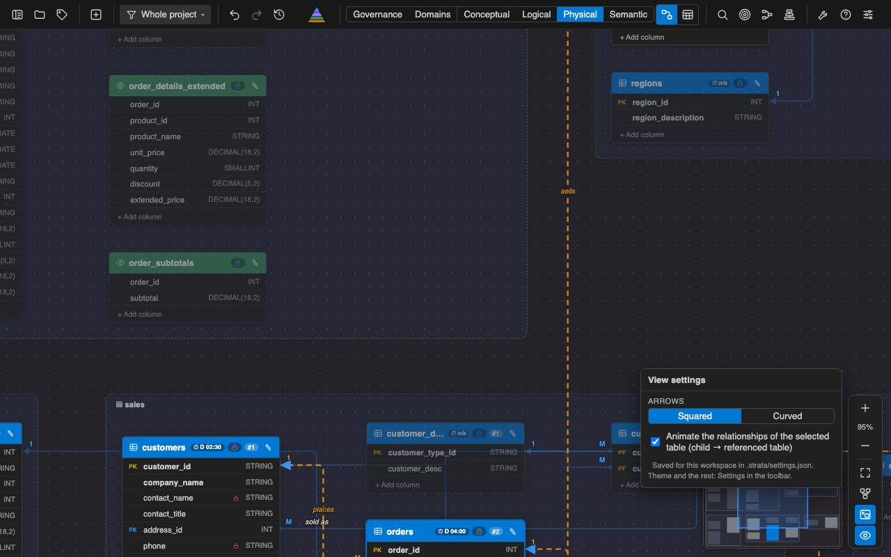

- **View settings** (eye) opens a small panel next to the controls; changes apply at once and are saved for the workspace in `.strata/settings.json`:
  - **Arrows:** *Squared* (default, rounded right angles) or *Curved*.
  - **Animate the relationships of the selected table:** the lines of the selected table flow from the child to the referenced table.

  Everything else (theme, your name, versioning, embeddings) stays in **Settings** in the toolbar.
- **Mini-map.** When part of the diagram is out of view, a small bird's-eye view appears **just left of the canvas controls**, in the bottom-right corner. The controls stay where they are whether the mini-map is shown or not. It shows every schema frame and card of the current level and view scope, and a blue rectangle for the part you are looking at. It follows your selection (highlighted), the dimming of unrelated tables, and the red / blue / green colours of impact analysis and load order.
  - **Click** anywhere on it to centre the view there; keep the button down and drag to keep moving.
  - **Drag the blue rectangle** to pan; it stays under the pointer.
  - **Scroll over it** to zoom the diagram in or out around the middle of the view.

  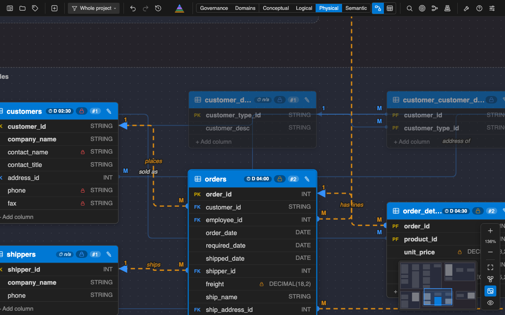

- The mini-map **hides by itself** while the whole diagram fits in the window (for example right after *Fit to view*). Zoom in or pan and it comes back. Its on / off switch is the same for all levels and is remembered per model in `.strata/layout.json`. There is no keyboard shortcut for it.
- In the **sample-data view** the controls and the mini-map are hidden (nothing there to zoom). In an **exported HTML file** the controls offer zoom, fit and the mini-map only (no auto layout, no view settings).
- Panels on the right (history, impact analysis, load order, alignment) sit beside the canvas, so the controls and the mini-map move left with its edge. On narrow editors (760 px or less) an open panel covers the right of the canvas: while it is open the controls move to the **bottom-left** corner and the mini-map waits until you close the panel.

### Levels: conceptual, logical, physical, semantic

Four levels: from the business down to the database, and back up to the numbers people use. Positions are stored separately for each level. Switch with the level buttons on the right of the toolbar (**Governance** and **Domains** first, both tabs that replace the canvas, then the four levels) or from the keyboard: **Cmd + Option** (Mac) or **Ctrl + Alt** (Windows, Linux) with **C**onceptual, **L**ogical, **P**hysical, **S**emantic, and **G** for the [Governance tab](#the-governance-tab). The button tooltips show the keys.

**Conceptual** shows business **concepts** (Customer, Order, Product) with their definition and how they relate, in business verbs ("Customer places Order"). Drag from the body of one concept onto another to relate them.

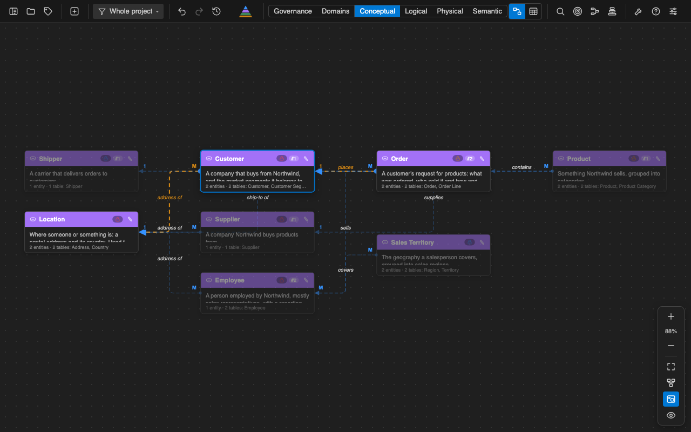

**Logical** shows **entities**, framed by their concept, with the attributes of the tables that realise them: display names, *generic* types (Integer, Decimal, Text, Timestamp…) and keys, and relationships with cardinality. Drag from the body of one entity onto another to add a logical relationship.

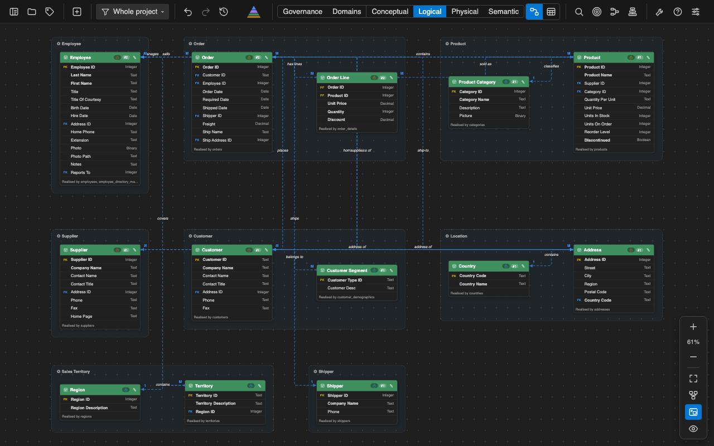

**Physical** shows table and column names with the real data types of your database.

**Semantic** shows **metrics** (Revenue, Order Count, …) next to the tables they are calculated from, with a dashed line from each input to its column. See [Semantic layer](#semantic-layer).

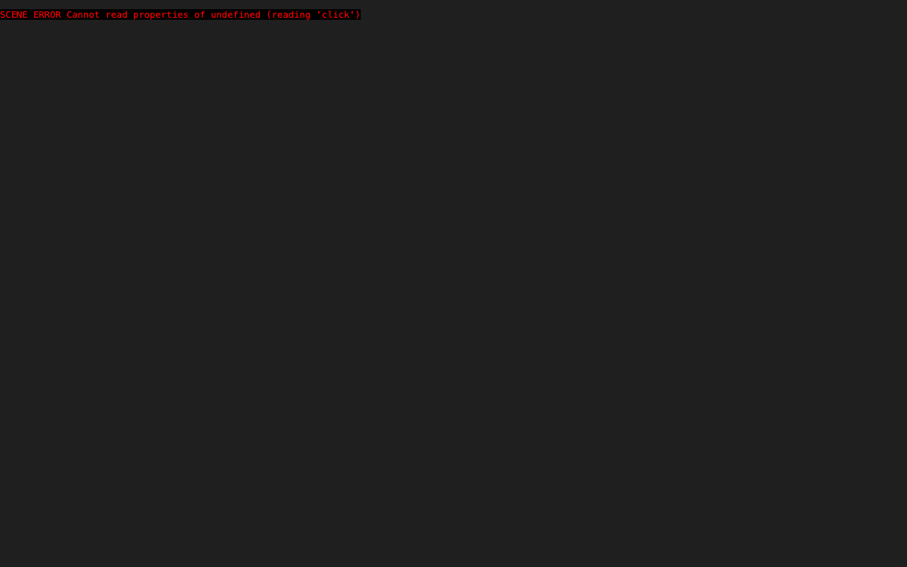

The conceptual and logical levels draw concepts and entities as soon as the model has them (see [Levels and alignment](#levels-and-alignment)). A model without them shows its **tables** on those levels instead, as before: the conceptual level as entities with their description, the logical level with display names and generic types. Either way, fill in the **display name** and **description** of tables and columns.

View scope and impact analysis work on every level, load order on every level but Semantic: on the conceptual and logical levels they are worked out from the tables behind each concept or entity (see [On the conceptual and logical levels](#on-the-conceptual-and-logical-levels)); on the Semantic level you select metrics, tables and columns directly.

**Each level remembers where you left it**: its pan and zoom, view scope, open panel (impact, load order or alignment) and selection. Switch to another level and back and you are exactly where you were. The first time you open a level it takes the scope and panel of the level you came from and fits the diagram. Version history, search and the sample-data view are shared by all levels.

### Tables, columns and views

- **Edit a table:** double-click its header or click the pencil. Change name, display name, schema, description, **data availability SLA**, tags and properties. A table can be turned into a view here.
- **Data availability SLA (optional):** how often the table's data is refreshed and by what time it is ready. Pick **Realtime, Minute, Hourly, Daily, Weekly, Biweekly, Monthly, Quarterly or Yearly**; from Daily up, also enter the time in **24-hour** format (for example `06:30`). Pick **Out of SLA** for static or reference tables that are not refreshed on a schedule; they stay in the load order but are left out of the time calculation. The SLA shows on the card as a small clock badge (for example `⏱ D 06:00`; RT, 1m, 1h, D, W, 2W, M, Q, Y) with the full text on hover.
- **Edit a column:** click its row. Set name (no spaces), display name, data type, description, *Primary key / Non null / Unique*, default value, foreign key with cardinality, tags and properties.

  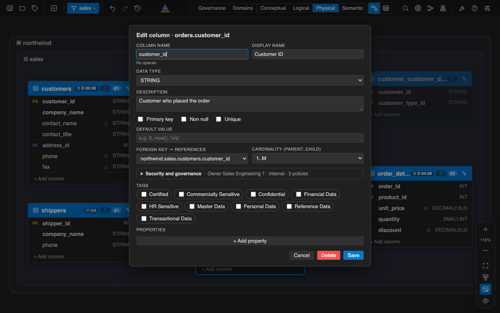

- **Views** have an eye icon, a green header and a dashed border. Choose *View*, *Temporary view* or *Materialized view* and write the SQL definition.

  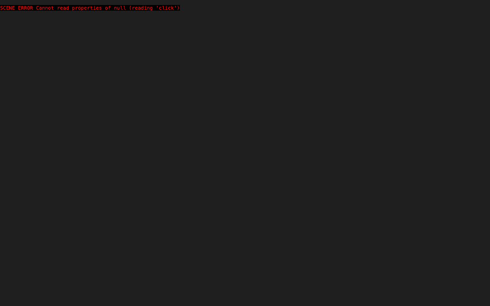

  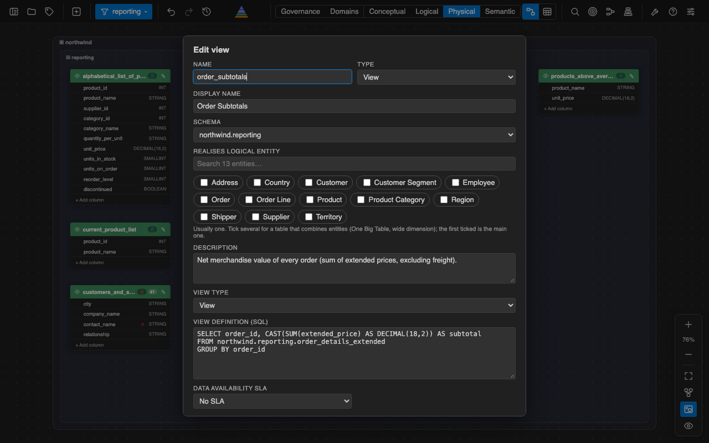

### Relationships

- **Foreign key:** drag a column row onto another column (or onto a table header to use its primary key). Default cardinality is `1..M` (parent..child).
- **Edit or delete:** click the line. Set a **label** (shown on the line) and a **description** (shown on hover and in search and the navigator).
- **Two relationships between the same pair** (a billing and a shipping address): give each its own **label**. On the conceptual and logical levels the dialog asks for a label as soon as a pair already has a relationship, and the lines run side by side, each with its label. Physically each foreign key is its own line; give them labels too (`billing`, `shipping`) and the levels above line up with them by label.
- **Many-to-many:** add a table-level relationship with the **+** menu (*Relationship*), drag entity to entity on the conceptual level of a model without concepts, or change a foreign key to `M..M`. In the relationship dialog choose **Create bridge table** to generate the bridge table with its two foreign keys; the physical and logical levels then show the bridge while the conceptual level keeps the M..M line.
- **Select a table** to focus: unrelated tables fade to 50% and its relationships are highlighted. With *Animate the relationships of the selected table* on (canvas controls → View settings), only the selected table's relationships flow from the child to the referenced table.

### View scope – show part of the model

The funnel button opens the **View scope** panel. Tick any number of catalogs, schemas and **concepts**; everything ticked is shown together, with a table count next to each. A ticked catalog includes all of its schemas; a ticked concept brings its entities and the tables that realise them. **Show whole project** clears the selection.

The scope works on every level and each level keeps its own: on the Physical level you see the tables, on the Logical level the entities those tables realise, on the Conceptual level their concepts. So ticking *sales* on the Logical level shows the entities realised by `sales` tables, and ticking the concept *Product* on the Physical level shows `products` and `categories`.

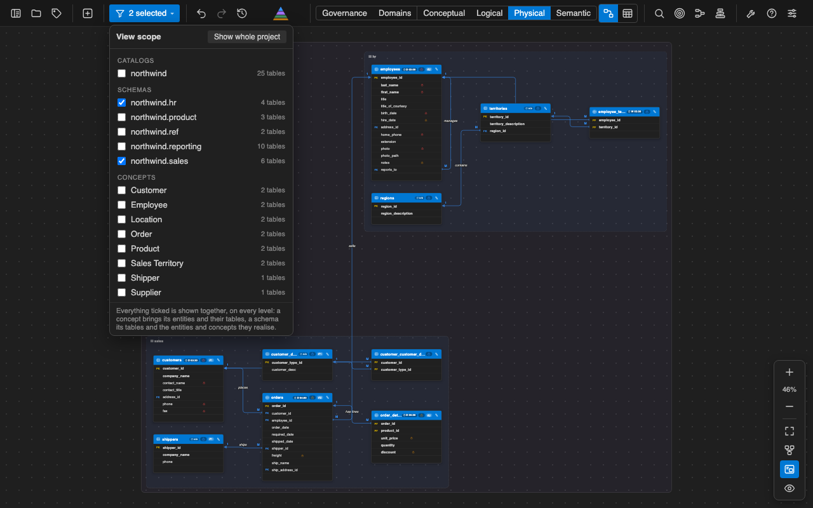

### Tags, properties and governance

Every object dialog ends with a collapsed **Security and governance** box (see [Governance](#governance)), then **tags** and user-defined **properties**.

The tag icon in the toolbar opens **Tags**: name, display name, description, owner, domain, *enabled* and the **policies the tag brings** (for example *Personal Data* → GDPR). A tag is just a label; you can put it on the project, catalogs, schemas, tables, columns, concepts, entities and metrics (disabled tags cannot be newly attached). Properties are free key/value pairs; the *Property keys* box suggests keys.

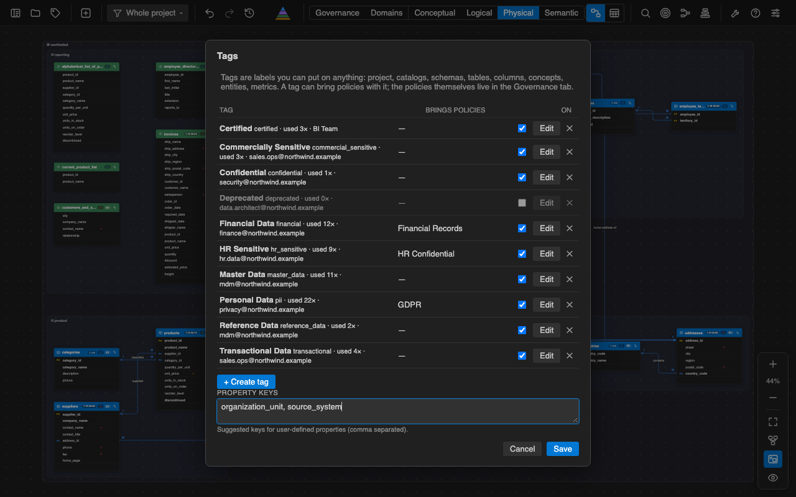

Hover a **catalog, schema, table, view, column, concept, entity or metric** for structured information, then its description:

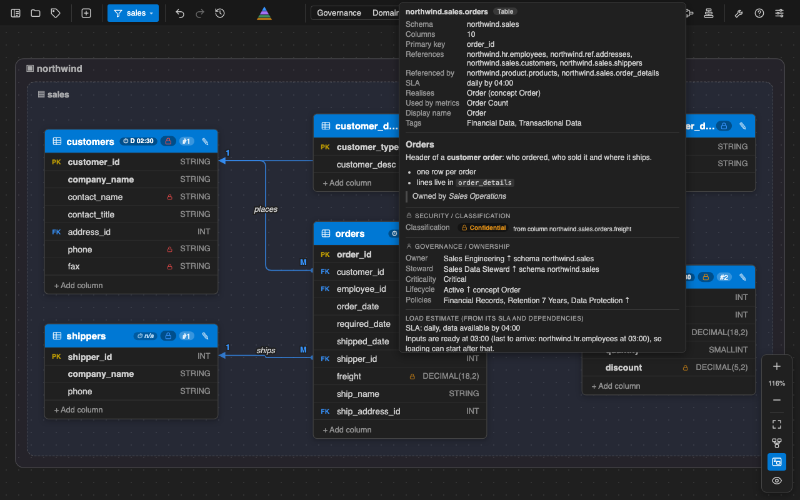

- **Catalog:** schemas, tables and views it holds. **Schema:** its catalog and how many tables and views it holds. **Table / view:** schema, column count, primary key, the tables it **references** and is **referenced by**, SLA, the **logical entity it realises** (and its concept), the **metrics that use it**, display name, tags, properties, a **Security / classification** section (the lock badge: the object's own classification and, on containers, what it rolls up from) and a **Governance / ownership** section (owner, steward, criticality, lifecycle and policies; inherited ones marked **↑** with their source), the load estimate when SLAs exist, and a view's SQL. **Concept / entity:** its entities or the tables that realise it, governance, and what it inherits. **Column:** table, data type, constraints (primary key, not null, unique), default, the column it references and the columns that reference it, the metrics that read it, its governance and policies. **Metric:** aggregation, grain, what it is computed from, the metrics built on it, its governance, and its calculation.
- **Move the pointer onto the tooltip** to scroll a long one or to **select and copy** text (double-click a word, triple-click a line, drag to select). It closes when you move away, or with **Esc**.
- The **description is shown with Markdown formatting**: `# headings`, `**bold**`, `*italic*`, `` `code` ``, `-` and `1.` lists, `>` quotes and fenced code blocks. Line breaks are kept. Links are shown as text (tooltips are not clickable) and raw HTML is never interpreted. Descriptions stay plain text in the editing dialogs; the formatting appears when you hover.

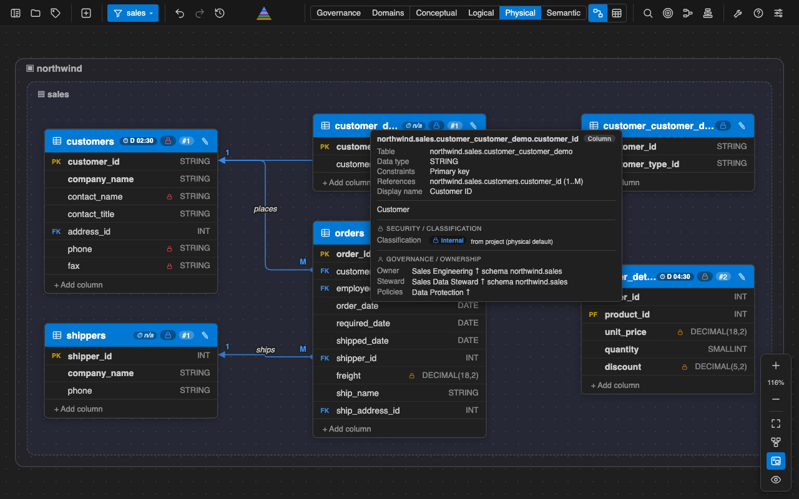

Tag badges and relationship lines also show their description on hover.

### Version history

Every change creates a version in one of three independent streams. Open the history drawer with **Cmd/Ctrl + Y**.

| Stream | Ids | What it records |
|---|---|---|
| **Modelling** | m1, m2, … | Catalogs, schemas, tables, views, columns, relationships, concepts, entities, mappings, accepted alignment warnings |
| **Governance** | g1, g2, … | Tags and the policies they bring, policies, owners and the other governance values, attachments, switch-offs, tags and properties (also of metrics), accepted governance warnings |
| **Semantic** | s1, s2, … | Metrics: definition, calculation, aggregation, grain; accepted metric warnings |

A change that touches two kinds of thing (for example a new metric with an owner) creates one version in each stream. Models made before the Semantic level have no semantic stream until their first metric; nothing changes for them.


- The newest **50 versions** are listed; **Show 50 more** adds the next page. This keeps the drawer quick on a long history of a large model; filters apply to the whole history.
- Versions are grouped by day. Each card shows **coloured action badges**: **green ＋ added**, **blue ~ updated**, **red − deleted**, with counts, and a plain-language line ("Added 1 table · Changed 2 columns").
- **Details** lists every change with its **action, the object, and the before and after values**: for an update each field shows `old → new` (the old value struck through); for an added or deleted object its content is listed. Each change has a coloured bar (green added, blue updated, red deleted). Governance versions show which object's tags or properties changed.
- The person is shown as just their **user name**; hover it for their **e-mail and host** (the computer name recorded with the change).
- **Undo to here / Redo to here** moves that stream back or forward; the other streams stay where they are. Hover the coloured stream label (modelling in the accent colour, governance purple, semantic orange) to see what it holds.
- **Preview** shows the model as it was at that point *temporarily* (read-only). **Apply this version** commits it as a new version; **Cancel** leaves everything unchanged.
- **Filter** by stream (All, Modelling, Governance, Semantic), by **action** (Added, Updated, Deleted; a version matches if it did that at least once), by text, or by a **From / To date and time** range (times are shown in the timezone set in Settings).
- **Cmd/Ctrl + Z** in the editor also rewinds: Strata SQL finds the version the model file now holds by its content, so the history follows (there are no version pointers in the model file any more).
- **Undoing and then editing never deletes anything.** The version you undid stays in the history file, marked *Undone*; the drawer hides such versions unless you tick **Undone** (dimmed; you can only *Preview* them). The history is only ever added to.
- If the model was edited outside Strata SQL, renamed, or copied without its history log (`history/<name>.history.jsonl`), Strata SQL shows *"history doesn't match this model"* (its content matches none of the recorded versions) and offers **Record as new version**. A model with no history file at all simply starts a new history from its current content.
- **The log shows if it was edited.** Every entry is chained to the one before it by a SHA-256 hash. If someone changed an entry (author, message, time, content) or removed one from the middle, a warning names the entry. It is a smoke alarm, not a lock: it cannot tell if the newest lines were cut off.
- **Two people, two branches.** After a Git merge the history holds both sides' versions. Strata SQL lists the objects **both** sides changed to different values and offers **Record the merge**: one more version that joins the branches, holding the model as it is on screen (see [Merging and conflicts](#merging-and-conflicts)). Ids can repeat after a merge (two `m4`s): they are labels; hover an id for the entry's hash.
- **A project split into domains** shows this drawer differently on the **project-index file's own tab**: a merged, read-only list of every part's own log (and `governance.json`'s), each version tagged by part and domain, with its own filter and its own cross-part Undo/Redo — see [Seeing the whole project](#seeing-the-whole-project-project-view). A change of **domain** (a table, concept, entity or metric that moved from one part to another) is listed as **Moved … from / to** that domain in both parts' entries (the action filter has a **Moved** choice), not as an unrelated deletion and addition. Opening a **part** directly still shows that part's own, ordinary drawer, exactly as above.
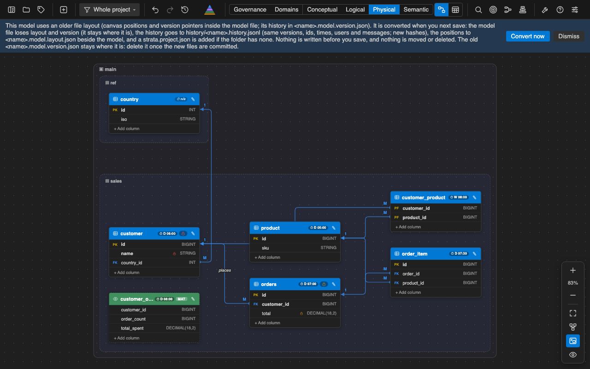

- **Older files.** A model with inline layout and version pointers and a `.model.version.json`, or a bare `x.model.json` with none of the project files, opens as it always did, as a one-model project of its own folder. A note says it is converted the next time you **save** (or click **Convert now**, then save): the model loses `layout` and `version` (**and stays exactly where it is**), the history goes to `history/<name>.history.jsonl` next to it, with the same versions, ids, times, users and messages (new hashes), the positions to `<name>.model.layout.json` beside the model, and a `strata.project.json` is added in the model's folder if there is none. Nothing is written before you save. **Nothing is moved, renamed or deleted:** the old `.model.version.json` stays where it is (delete it once the new files are committed) and an existing `<name>_model_data/` folder is still used for sample data. There is no *move to the standard layout* command yet; to get the foldered layout, create the project with **New Project** and copy your model in, or move the files by hand and edit the model's path in `strata.project.json`. A converted project has no `.gitattributes`: add the line `history/*.jsonl merge=union` yourself (see [Collaboration](#collaboration)).
- Auto layout is **not** a version by default (it, like moving a card, only writes the layout file); enable *Record auto layout as a version* in Settings if you want it as a version too.

### Search (Cmd/Ctrl + F)

A floating search box searches the whole model. Choose what to search: **All, Concept, Entity, Catalog, Schema, Table/view, Column, Relationship, Metric, Tag, Property / governance** (user properties and governance values such as an owner's name or *Restricted*), **Policy**. Use ↑ ↓ and **Enter** to jump to a result, **Esc** to close. **Drag the grip (⠿) at its left edge to move the box** out of the way.


### Model navigator (Cmd/Ctrl + L)

A side panel with the whole project as a sorted tree: **project → catalog → schema → table/view → column with data type**, then a **Concepts and entities** section (concept → its entities → the tables that realise them), a **Relationships** section, a **Metrics** section (the semantic level, with each metric's aggregation), a **Tags** section (open a tag to see everything it is attached to; hover shows the policies it brings) and a **Policies** section (policies under their parents, with everything each is attached to; click one to open its graph in the Governance tab). It has its own search box with the same kind filter. Click any item to reveal it on the canvas; hover for its description. The **tree icon** at the start of the toolbar opens and closes it too.

- **Ten items at a time.** Every list (the tables of a schema, the columns of a table, the relationships, the tags, the objects a tag is on) shows its first **10**; the last line says **View 25 more** (the number left). Click it to show everything, and **Show fewer** to fold it back. While you search, all matches are shown.
- **It remembers.** For each model, which branches are open, which sections are collapsed and which lists are expanded are saved in `.strata/layout.json`, so the tree is as you left it when you reopen the project or the panel.
- **Reset (the ⟲ button next to the search box)** clears all of it: sections and branches go back to their defaults and every list shows 10 again.
- **A project-index file** ([Domains](#domains), once a project has been split) shows the whole assembled project here too — every part's tables, concepts, relationships, tags and policies together — not the thin index file's own content; the navigator is a read-only tree either way, but clicking an item reveals it on the assembled canvas exactly as it does for an ordinary model.

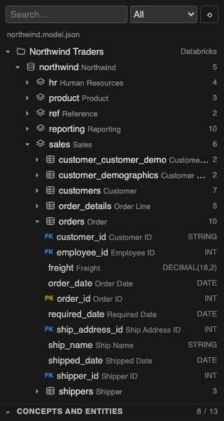

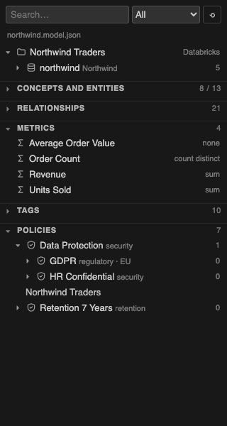

### Sample data

Switch to the grid icon to browse sample data. Each table's rows come from `data/<catalog.schema.table>.csv` in the model's folder (for example `data_models/orders/data/`; header = column names; an older project's `<model name>_model_data/` folder is used as it is). If a table has no file yet, *Create CSV with column headers* makes one. Columns missing from, or not in, the model are flagged. Renaming a table renames its CSV.

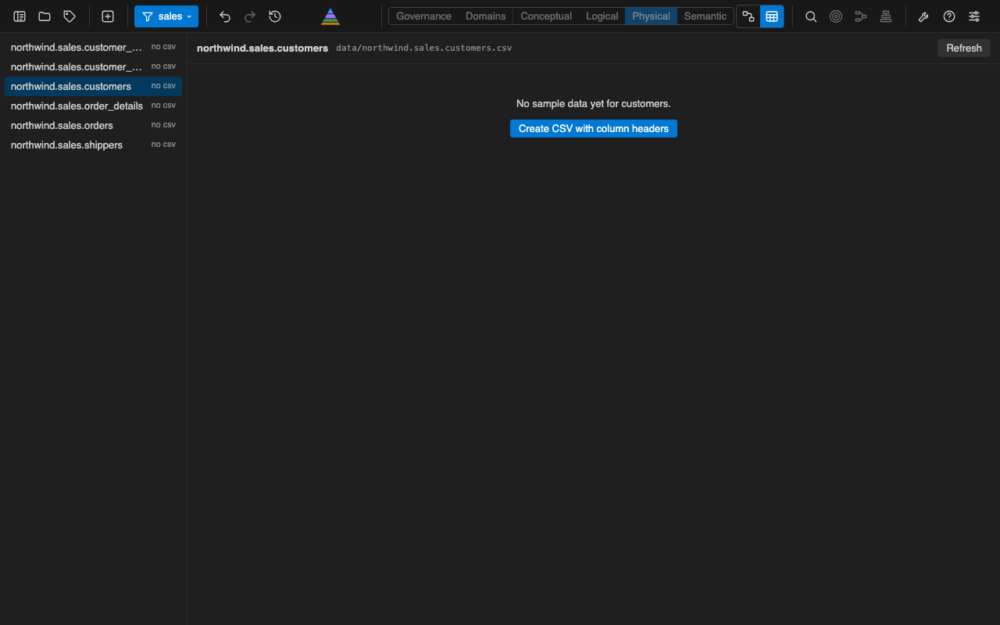

### Settings

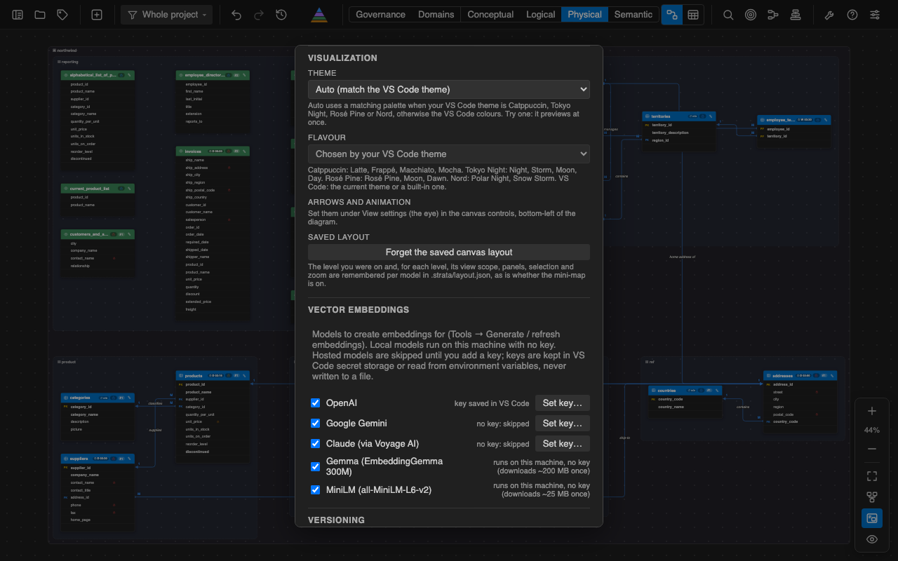

| Setting | Meaning |
|---|---|
| User name, e-mail | Recorded with each version. Default from `git config`. |
| Timezone, system | Used to display and record times. |
| Theme, Flavour | *Auto* (default), *VS Code*, *Catppuccin*, *Tokyo Night*, *Rosé Pine* or *Nord*, and the flavour of it (Latte, Mocha, Storm, Dawn, ...). See below. |
| Create versions | *Automatic* (a version for every change) or *On save* (one version per save). |
| Record auto layout as a version | Off by default. |
| Vector embeddings | Which models get embeddings (all on by default) and **Set key…** for the hosted ones. Local models need no key. See below. |

Settings are stored in `.strata/settings.json` in the workspace. The arrow style and the animation are set under **View settings** in the [canvas controls](#moving-around-canvas-controls-and-the-mini-map) and stored in the same file.

**Saved layout.** Strata SQL reopens each model as you left it: the level you were on, schema canvas or sample data, the history panel, and **for each level** its view scope, impact / load-order / alignment panel, selection, and pan and zoom (if you had moved the view; otherwise it fits the diagram), plus whether the mini-map is on. Layouts saved by an older Strata SQL still load: their scope and panel count for every level, their zoom and selection for the level they were saved on. It is kept per model in `.strata/layout.json`. *Forget the saved canvas layout* in Settings clears it (it is saved again as you work). The live view uses the same file.

#### Themes

Pick a colour theme for the canvas, panels, dialogs and the navigator, then a **flavour** of it. Every flavour is included; choosing a theme or flavour **previews it at once**, and *Cancel* puts the old one back.

| Theme | Flavours |
|---|---|
| **Catppuccin** | Latte (light), Frappé, Macchiato, Mocha |
| **Tokyo Night** | Night, Storm, Moon, Day (light) |
| **Rosé Pine** | Rosé Pine, Moon, Dawn (light) |
| **Nord** | Nord (Polar Night), Nord Light (Snow Storm) |
| **VS Code** | *Current VS Code theme* (your theme's own colours) or a built-in one: Dark Modern, Light Modern, Dark+, Light+, Monokai, Solarized Dark, Solarized Light, Abyss, Kimbie Dark, Quiet Light, Red, Tomorrow Night Blue, High Contrast Dark, High Contrast Light |

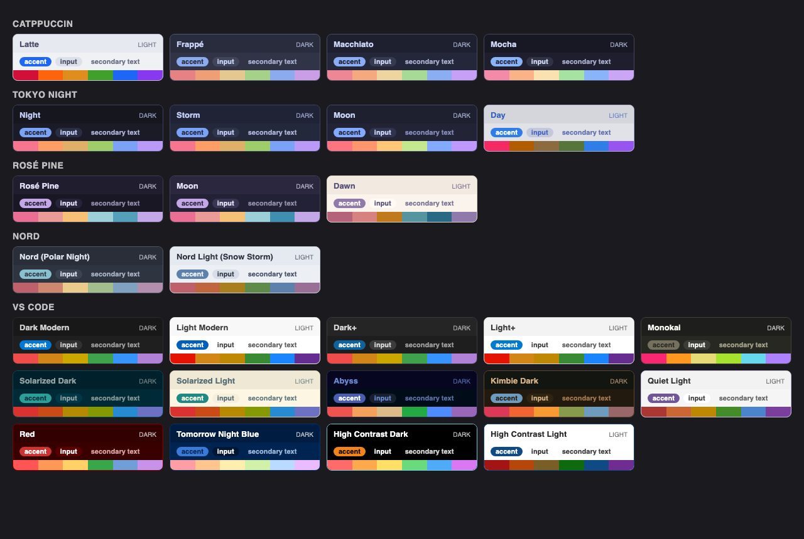

- **Theme = Auto** (default) follows your **current VS Code theme**. If its name is *Catppuccin*, *Tokyo Night*, *Rosé Pine* or *Nord*, Strata SQL uses that palette **and the same flavour** (for example *Catppuccin Frappé* gives Frappé, *Tokyo Night Storm* gives Storm); for any other theme it uses the VS Code colours as they are. It follows a theme change while Strata SQL is open. The flavour box is greyed out because VS Code decides.
- **Flavour = Auto** (for a named theme) picks the flavour your VS Code theme has, or the dark or light default (Mocha / Latte, Night / Day, Rosé Pine / Dawn, Nord / Nord Light) to match VS Code being dark or light. Choose a flavour to fix it: a light flavour stays light even in a dark VS Code.
- **VS Code** with *Current VS Code theme* always uses the colours of your VS Code theme.
- The palettes are close approximations of the official colours, not copies of the theme extensions.

| Catppuccin (Mocha) | Tokyo Night (Night) |
|---|---|
| 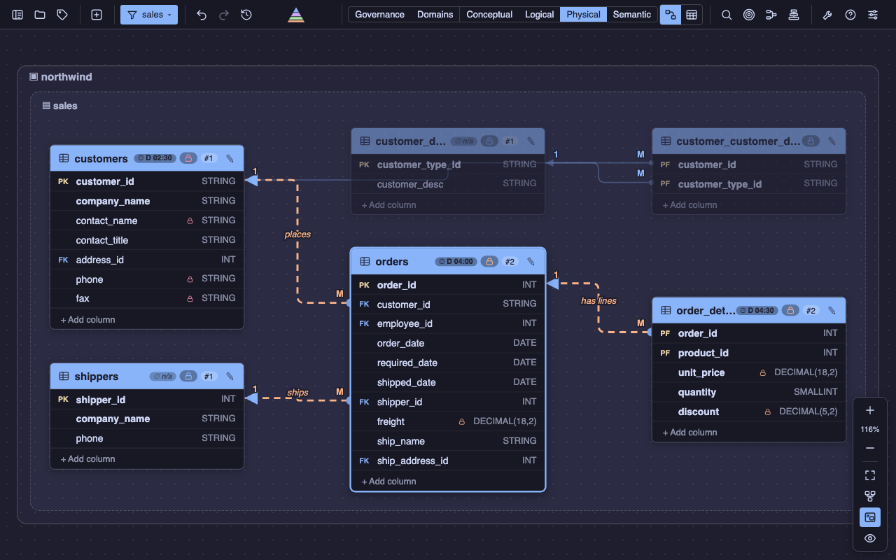 | 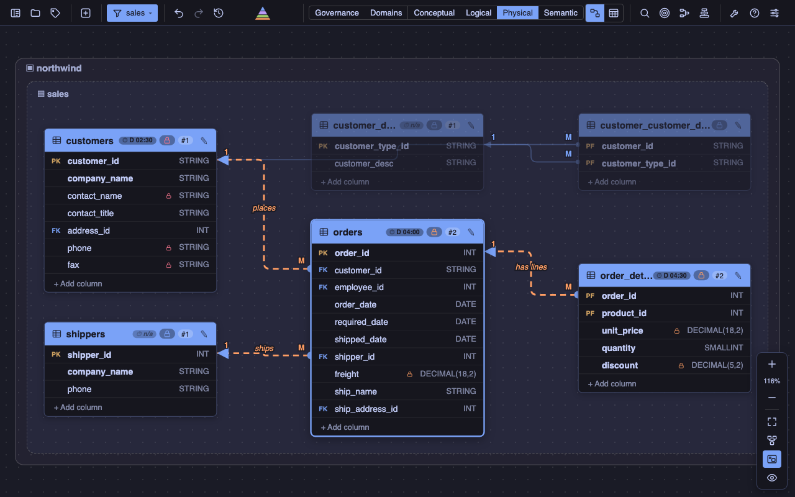 |
| **Rosé Pine** | **Nord** |
| 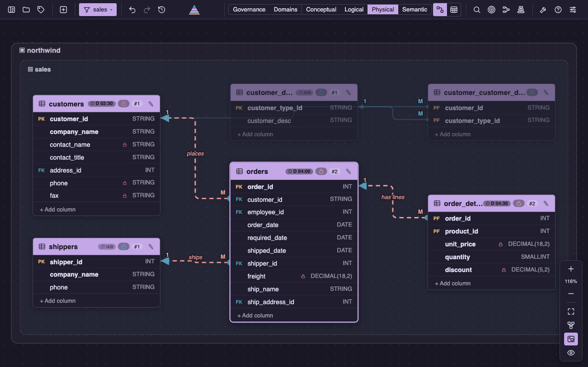 | 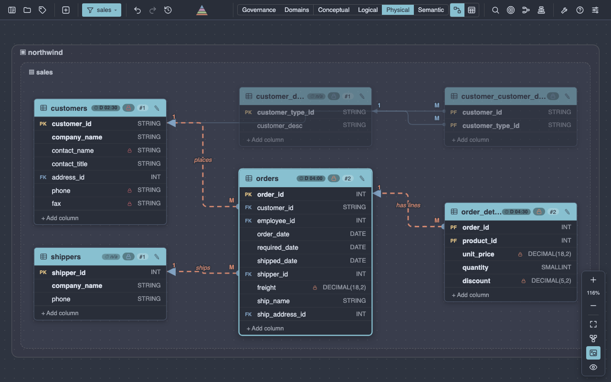 |

In the **live view** and in an **exported HTML file**, *Auto* and *VS Code* give you the colours of the VS Code session that opened or exported it (a named palette still applies), and the live view follows a theme change in VS Code. Started from a terminal there is no VS Code session, so it uses the browser's light or dark setting.

---

## Levels and alignment

Real models are not one-to-one across levels. A business **concept** such as *Customer* is described by one or more logical **entities** (Customer, Customer Segment), and each entity is realised by one or more physical **tables** (`customers`, `customer_demographics`, or `dim_customer` in a warehouse). Relationships get more abstract going up: tables have foreign keys, entities have relationships with cardinality, concepts have business verbs.

Strata SQL keeps all three levels in the same model file and links them from the bottom up: each table names the entity it realises, each entity names its concept. Descriptions, tags and properties flow **down**, so you describe and classify a concept once. The **Alignment** panel (the stacked-layers icon; a yellow number shows open warnings) tells you what does not line up and fixes most of it in one click.

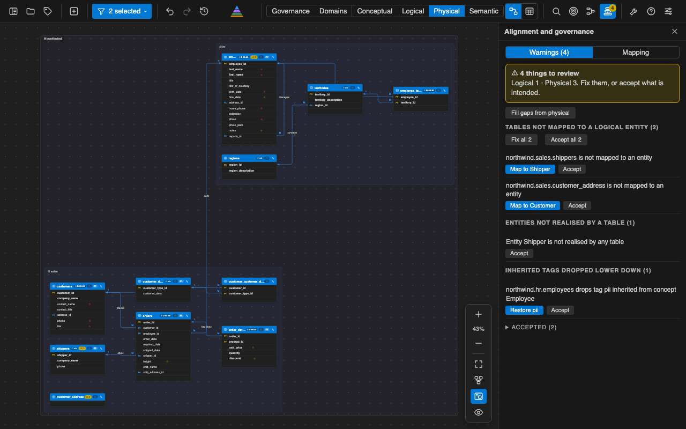

### Start: generate, then merge

A model with only tables shows this in the Alignment panel. Click **Generate logical and conceptual levels**:

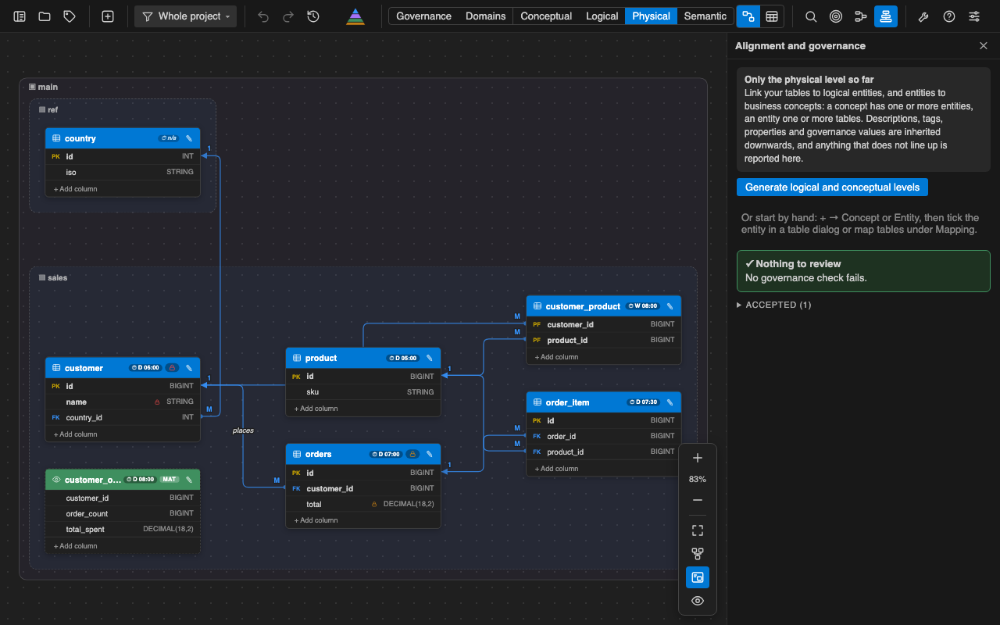

- It creates **one entity per table and one concept per entity**, named from the table names: prefixes and suffixes such as `dim_`, `fact_`, `stg_`, `hub_`, `sat_`, `_v` and `_hist` are dropped and plurals made singular, so `dim_customer` and `customers` both become **Customer** (and share it).
- It adds **logical relationships** from the foreign keys (same cardinality, label and description) and **conceptual relationships** between the concepts they connect.
- It leaves out **views** and **pure bridge tables** (only key columns): a bridge realises a many-to-many relationship, not an entity. A bridge with its own attributes, such as order lines with a quantity and a price, gets an entity.
- It **keeps what you have** and only fills gaps, so you can run it again after adding tables (**Fill gaps from physical**).

Then **merge** what belongs together: open an entity (double-click its header on the Logical level) and choose **Merge into another entity**. Its tables and relationships move over and it is removed. Concepts merge the same way. A merge leaves the old concept behind if it has no entity left: the panel tells you, so merge or delete it too.

### Concepts and entities

- Add them from the **+** menu (*Concept*, *Entity*), with **+ New …** in the Mapping lists, or by generating. Names are business names; spaces are fine.
- The **entity dialog** holds name, concept, description, tags, properties, **Merge into another entity** and Delete. It lists the tables that realise the entity and shows what it inherits from its concept. The concept dialog is the same one level up.

  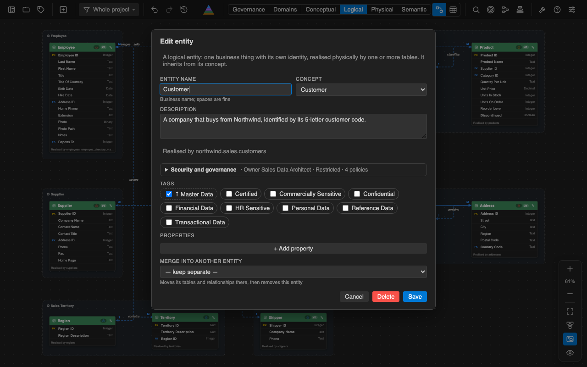

- Deleting a concept keeps its entities (without a concept); deleting an entity keeps its tables (unmapped). Their relationships are removed.
- An entity card on the Logical level lists the columns of the tables that realise it, each name once. Views count only when no table realises the entity.

### Map tables quickly

**Alignment → Mapping** lists every table and view by schema with the entity it realises. A yellow bar marks a table that still needs one.

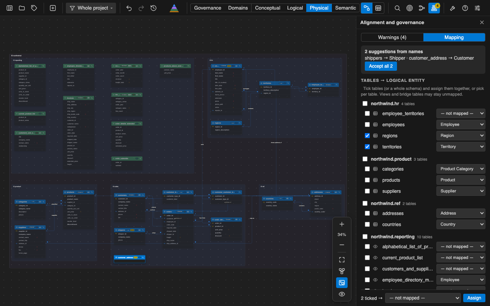

- **Per table:** pick the entity, or **+ New entity "…"** named after the table.
- **In bulk:** tick tables (or a whole schema with the box next to its name), choose the entity at the bottom and click **Assign**.
- **Suggestions from names:** `customer_address` → Customer, `dim_customer` → Customer. Click the **→ Customer** chip on a row, or **Accept all**.
- **Entities → concept** below works the same way.
- **One table, several entities** (One Big Table, a wide dimension): tick them in the table dialog under **Realises logical entity**. The first one ticked is the main one, used for the inherited description and display name. With more than six entities a search box sits above the list: type part of a name to filter (ticked entities stay visible), press **Enter** to tick the first match, **Esc** to clear the search.

  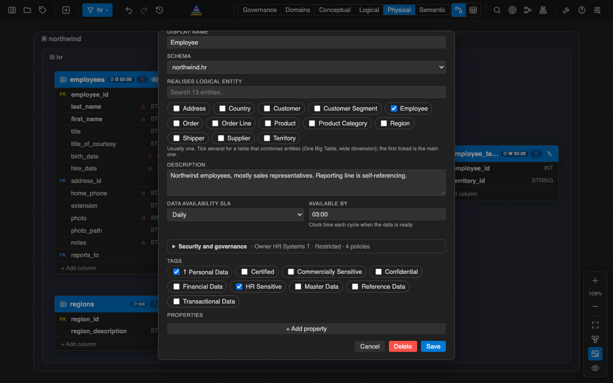

Every mapping is a normal version in the Modelling stream: undo, history and preview work as usual.

### What is inherited

Concept → entity → table or view. Columns do not inherit.

- **Description and display name:** when a table's own is empty, the one above shows (a table without a display name shows its entity's name). The dialog shows it as a greyed hint; type to override it.
- **Properties** (`organization_unit`, …): per key, the nearest level wins. The dialog lists the inherited ones; add the same key to override it.
- **Governance follows this chain too**: a table or view with no owner, steward, criticality or lifecycle of its own, and none above it in its schema or catalog, takes its entity's, then its concept's, before the project default of the Physical level; an entity takes its concept's before the Logical default. Policies attached to a concept or entity reach its entities and tables, and a policy switched off on a concept or entity is switched off below it. Each level can still say its own: a value set on the table always wins (see [Governance](#governance)). Tags follow the chain as well, and a tag can bring policies. **Classification is the exception**: it is never inherited, it is rolled up from the columns (see [Classification](#classification-what-the-data-is-rolls-up)).
- **Tags** (classifications such as *Personal Data*) add up: a concept tagged Personal Data makes its entities and tables Personal Data too. Inherited tags show as dashed **↑** chips. **Untick one to drop it** on that object, for example a masked view that is safe for everyone. A dropped tag is always reported as a warning until you accept it, so a classification never disappears silently.
- Hovering a table shows the effective values; inherited ones are marked **↑** with where they come from.

### Alignment warnings

| Warning | What to do |
|---|---|
| **Table not mapped to an entity** | **Map to …** when a name matches, pick one under Mapping, or accept. Views and pure bridge tables are not reported. |
| **Entity without a concept** | **Link to …** when a name matches, or pick one under Mapping. |
| **Concept without an entity** | Add or link an entity, merge or delete the concept, or accept it as not built yet. |
| **Entity not realised by a table** | Map a table to it, or accept it as planned. |
| **Physical relationship missing in the logical model** | **Add A → B** creates it with the same cardinality and label. Foreign keys between two tables of one entity are internal and not reported; a table that references itself is. |
| **Logical relationship missing in the conceptual model** | **Add X → Y**. Relationships inside one concept are not reported. |
| **Logical / conceptual relationship not realised below** | Add the foreign key or the logical relationship, or accept. |
| **Cardinality differs between levels** | **Use … in the logical (or conceptual) model** takes the lower level's cardinality. Conceptual cardinality is optional and only compared when set. |
| **Inherited tag dropped** | **Restore**, or accept when it is intended. |
| **References that point at nothing** | A relationship to a table or column that is not in this model (another team's table, one that was renamed), a second foreign key on one column, a table mapped to an entity that does not exist, an entity of a missing concept. Strata SQL **keeps it exactly as written** (nothing is lost when you save), draws a dashed red line out of the end that exists to the missing name, and lists it here on any model, with or without the conceptual and logical levels. **Delete this relationship** (or **Remove the link**) removes it, **Accept** leaves it; add the missing table and it resolves by itself the next time the file is opened. To point it somewhere else, edit the name in the JSON. |
| **Governance warnings** | Restricted data without a protection policy, items classified below the minimum of what contains them, High or Critical items without an owner on their level, retired items still in use, metrics that reference something missing, policy cycles, unknown policies or tags. See [Governance warnings](#governance-warnings). |

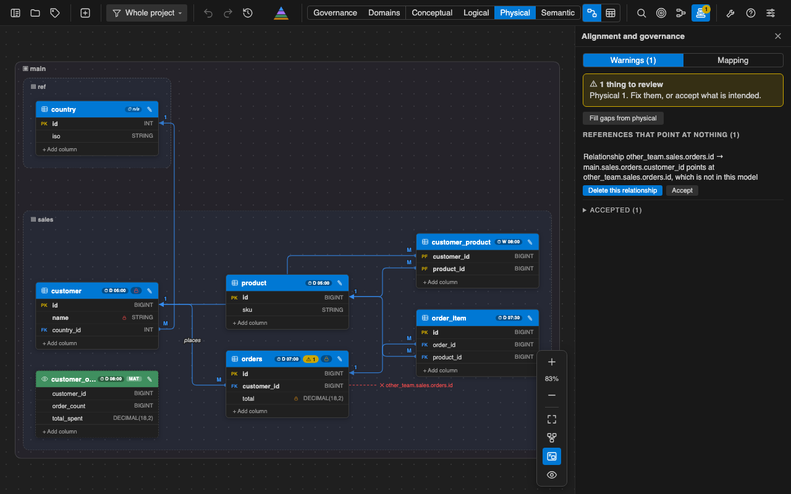

- A yellow **⚠ n** badge on a card counts its warnings; hover it for the list. Click a warning's text in the panel to jump to the object.
- **Fix all** and **Accept all** handle a whole group at once.
- **Accept** means "left like this on purpose". It is stored in the model (`alignment.acknowledged`, versioned like any change) and listed under **Accepted**, where **Undo** reports it again.
- Checks start once a level exists: a model with only tables gets no alignment warnings; with entities but no concepts only the logical checks run. Governance checks run on any model, once it has governance values, policies or metrics.

### On the conceptual and logical levels

View scope, impact analysis and load order also work on concepts and entities. None of them stores anything extra: each answer is worked out from the **tables that realise** the concept or entity (a concept through its entities).

- **View scope:** tick concepts next to catalogs and schemas (see [View scope](#view-scope--show-part-of-the-model)).
- **Impact analysis:** click concepts or entities to select them. Strata SQL runs the analysis on all their tables and rolls it up: another entity turns **red** when one of its tables or views depends on the selection, or when it shares a table with it; **blue** when the selection depends on one of its tables. The level's own relationships count too: the child side of a relationship of the selection is impacted, the parent side is upstream. The panel lists the entities and, under *Behind it*, the physical tables, views and columns.

  

- **Load order:** one concept or entity needs another when one of its tables needs one of the other's tables (through bridge tables too). **It is ready when all its tables are:** its ready time is the latest of its tables. Stages, pipeline and tree work as for tables; an entity or concept that no table realises yet is left out.

  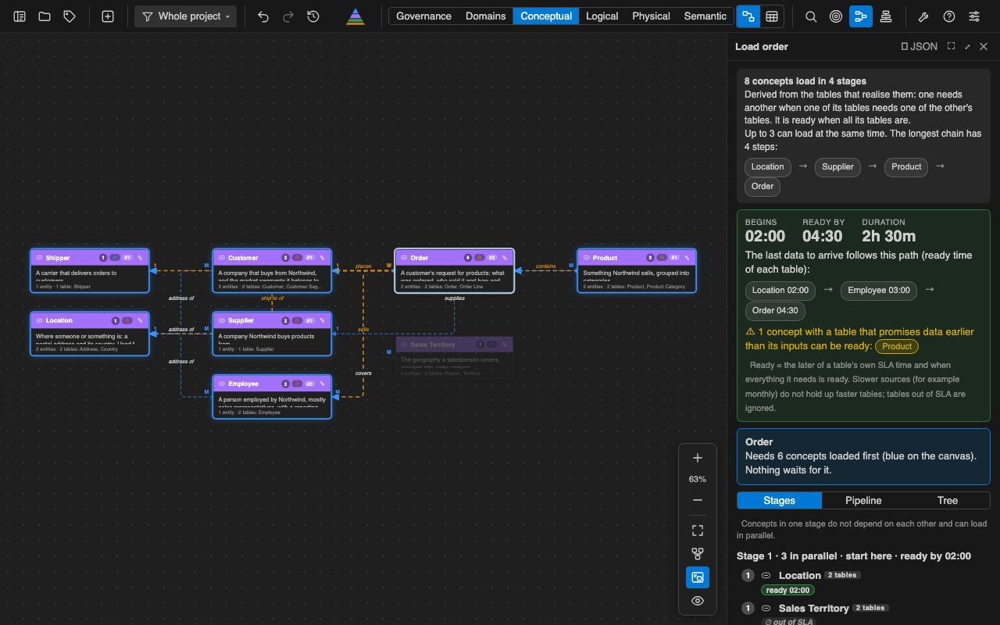

- **Cardinality:** an M..M on a higher level matches 1..M foreign keys below, because that is how a many-to-many is built through a bridge or associative table.

### Limits

- Which lower relationship realises which higher one is worked out from their ends and, when a pair has several relationships, their **labels** (case does not matter). A foreign key without a label matches any of them; a labelled one with no match in a pair that has several is reported as missing above. Relationships with the same label between the same pair are the same relationship.
- Entities have no attributes of their own yet: they show the columns of their tables, and the business key is picked from those. Column-level mapping is not supported.
- The ETL code export and the load-order JSON export are always table-level, and load order is not offered on the Semantic level; everything else works on every level.
- Renaming a concept or entity updates everything that points to it; an accepted warning that named it comes back.

---

## Governance

Governance answers three questions about your data: **who is responsible for it, how sensitive and important it is, and which rules apply to it**. Strata SQL keeps it simple with three ideas:

- A **tag** is a label you put on anything (Personal Data, Financial, Certified). It says *what kind of thing* it is. A tag can **bring policies** with it.
- A **policy** is a rule: GDPR, "Mask personal data", "Retention 7 years". It has a type (regulatory, protection, retention, security, business, …), optionally a jurisdiction, an owner of the rule, a description of what it requires, and optionally a **minimum classification** (GDPR → what it covers is Restricted). A policy can have **one or more parents**: it takes on their requirements.
- **Common properties** describe an object **on its own level**: owner (the one accountable person, role or team), steward (day-to-day care), criticality (Low < Medium < High < Critical), lifecycle (Proposed, Active, Deprecated, Retired) and **classification** (Public < Internal < Confidential < Restricted).

There are two kinds of governance information, and they flow in opposite directions:

| | What it is about | Examples | Direction |
|---|---|---|---|
| **Security: what the data is** | The data itself | Classification | **Bottom-up.** A column owns it; everything above shows the highest of what it holds. |
| **Governance: how it is managed** | The management of the data | Owner, steward, criticality, lifecycle, policies | **Top-down.** Set once on a concept, entity, schema or table and everything below takes it. |

That is why an owner can sit on a concept without making every column *Restricted*: managing something does not change how sensitive it is. In the dialogs, the hover and on the cards the two are shown side by side, in one view.

### How a policy reaches an object

A policy applies to an object when it is **attached** to it, **attached above it on the same level**, or **brought by a tag** the object carries. Attaching a policy also applies **all its parents** (and theirs): attach *Customer Data*, whose parents are *GDPR* and *Retention 7 years*, and all three apply.

| Level | "Above it" means |
|---|---|
| Physical | project → catalog → schema → table or view → column. A policy on a schema covers its tables and their columns. |
| Conceptual | project → concept |
| Logical | project → entity |
| Semantic | project → metric |

The levels are linked, so a policy also flows **down the links**: a policy on the concept *Customer* reaches its entities and the tables that realise them (shown as *inherited from concept Customer*), and their columns through the table. It never flows up or sideways. **Tags** flow the same way and bring their policies wherever they go: tagging the concept Employee *Personal Data* brings GDPR to every table that realises it. A tag dropped lower down (see [What is inherited](#what-is-inherited)) stays dropped. Inside one level the table above applies first, then the links, then the project. A policy that reaches an object this way **manages** it (masking, retention, who may read it); it does not change its classification (see below).

### Owners per level

The owner of a business concept is often not the owner of the tables behind it, so owner, steward, criticality and lifecycle can be **set per level**. Where a level sets nothing, the level above it fills the gap:

- Set them on an object in its dialog (the **Security and governance** box). Empty means inherited, shown greyed with where it comes from. The order is: the object itself; above it **on the same level** (a column from its table, a table from its schema and catalog); then what it is **realised from** (a table from the entities it realises, an entity from its concept; with several entities the first owner, but the highest criticality); then, for a concept (and what realises it), its **domain** if it belongs to one (see below); then the project default of its level.
- The **project** holds a **default per level** (Project settings → Governance): for example conceptual owner *Chief Data Officer*, physical owner *Data Platform Team*, and, for classification, the value an unclassified object takes. Everything on a level that finds nothing above it, in a domain, or in the levels it is realised from uses it. Set a value on the table (or the entity) when it should differ from what flows down.
- The project's classification default for a level is what an unclassified object takes (see below).

### Domains

A **domain** is an optional named group of concepts — Sales, Finance, Customer Success — that gives owner, steward, criticality, lifecycle and policies to everyone in it. It sits **above the concept** in the ownership chain (project → domain → concept → entity → table): a concept with no owner of its own takes its domain's, and that flows down to its entities and tables the same way a concept's own value already does. A concept's own value still overrides its domain's.

Domains are not part of the model file: they live in the project's **manifest**, `strata.project.json`, next to the list of parts:

```json
"domains": [ { "name": "Sales", "description": "Selling to customers", "owner": "Head of Sales", "criticality": "High", "concepts": ["Customer", "Order"] } ]
```

Fields: `name` (unique), `description` (free text: what the domain covers), `owner`, `steward`, `criticality`, `lifecycle`, `policies` (a list of names, same as an object's own) and `concepts` (the concept names it groups; a concept belongs to at most one domain). Classification is never part of a domain: it stays bottom-up (see below), and a domain is never a floor for it.

Defining domains is entirely optional and changes nothing else: a project with none behaves exactly as before. Domains group and give ownership to concepts long before the project splits into files — the governance chain above works the same whether it has one part or many.

#### Editing domains

Open the **Domains** tab, the second button of the level switch, right next to **Governance** (it is its own tab, not a view inside Governance: a domain is a way to group and split the project, ownership is only one thing it carries). It lists every domain (name, owner, description, member concepts):


- **+ New domain** opens a form: name, description, owner, steward, criticality, lifecycle, policies (the same picker as a policy's own attachments) and concepts, ticked per concept. A concept already in another domain is shown greyed out and cannot be ticked here — a concept can only ever be in one domain, and the dialog stops you creating a second one rather than warning about it afterwards. (If a hand-edited manifest already has a concept in two domains, it stays exactly as it is when you open the dialog — nothing is silently untangled — but you can untick it from either domain to fix it.)
- Click a domain's name, or its ✎, to edit or delete it. The form keeps the ownership fields (owner, steward, criticality, lifecycle, policies): they still flow down to the domain's concepts (an inherited value in a concept's, entity's or table's **Security and governance** box and in the [Governance tab](#the-governance-tab)'s policy reach) unless the concept sets its own.

  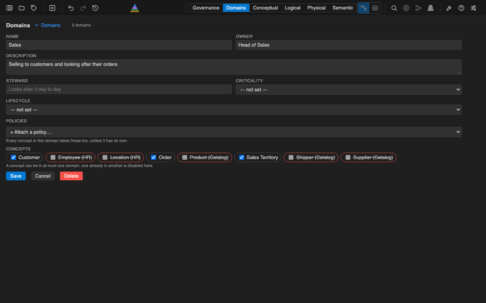
- Editing here writes straight to the manifest (`strata.project.json`) — there is nothing to undo with Cmd/Ctrl+Z, the same as a Settings change, since a domain is project metadata, not modelled content.
- **In a project that is already split**, do this from the **project-index file's own tab** (*Open Project View*): the Domains tab is editable there, and read-only when you open a single part (it says so). Changing which concepts a domain holds moves those concepts — and the entities and tables that follow them — into that domain's part, and **a domain that gets its first concepts gets its own part created** (folder, version log, manifest entry, and the project-index file's part list). Each such move is recorded as a **move** in both parts' version history, not as a delete in one and an add in the other. A split project's domain keeps its name (its files are named after it), so the name field is locked when editing; deleting a domain sends its concepts to `_unassigned` and leaves its own file behind, empty.
- **Split into Domains…**, next to "+ New domain", runs the same split as the Command Palette (below) once at least one domain exists and every domain has at least one concept; it is greyed out with a tooltip saying why otherwise (no domains yet, an empty domain, or the project is already split).

The manifest shape shown above is exactly what the dialog writes and reads — useful as a reference if you ever script it directly.

**Northwind and FpML ship with domains already defined** (New Project wizard or *Open Sample Model*): Northwind groups Sales {Customer, Order, Sales Territory}, Catalog {Product, Supplier, Shipper} and HR {Employee, Location}; FpML groups Front Office {Trade, Product, Portfolio}, Risk {Valuation}, Middle Office {Market Data} and Operations {Party, Legal Agreement, Message, Reference Data}. Open either sample, open the Domains tab, and *Split into Domains* is ready to use with no manifest editing at all.

#### Splitting into one file per domain

Once a project has domains, **Strata SQL: Split into Domains** (Command Palette or the Domains tab's own button, or `strata-sql split --model <path>` on the command line) turns it from one model file into several: one part per domain, plus `_shared` (a metric that reads tables in more than one domain, or one you mark company-wide by giving it `"homeDomain": "_shared"`) and `_unassigned` (a table, concept or entity mapped to no domain — nothing is ever dropped, an unclear case is routed here instead of blocked). A table whose entities span more than one domain needs a tie-breaker: give it its own `"homeDomain": "<domain name>"` (an ordinary extra key, kept next to its other fields); without one it goes to `_unassigned` too, with a warning.

The command:

- Moves the shared **tags, policies and allowed property keys** out of the one model file into a new **`governance.json`** at the project root, with its own fresh version log (`governance.history.jsonl`). Each object's *own* governance values (owner, classification, …) stay exactly where they are, on the object, in whichever part it lands in.
- Writes one `<part>.model.json` per domain (plus `_shared` / `_unassigned` as needed), each a complete, self-contained project part with its own `data_models/<project>/<part>/` folder — nested under the *project's own* folder, so every part of one project still groups together on disk — layout and sample data, and a **fresh** version log (`history/<part>.history.jsonl`, at the project root: version logs are not nested) that starts from the split — the detailed edit-by-edit history before the split is not carried forward into each part; the original file's log still has it.
- Updates `strata.project.json` so it lists the new parts instead of the one it split, and adds `index` — the path of the project-index file below; `domains` is unchanged.
- Writes **`CODEOWNERS`** at the project root, one line per domain that has an owner (`/data_models/orders/sales/ @Head of Sales`). It is not enforced by Strata SQL — a plain file for GitHub/GitLab to act on; regenerate it by running the split's CODEOWNERS step again (or edit it by hand) if an owner changes later.
- **Archives the original file, in place, rather than leaving it as a plain, confusing duplicate next to the new parts.** It is renamed to `<name>.archived.model.json` (byte-for-byte what it was — nothing is rewritten, only renamed) in the same folder; its layout file is renamed to match (`<name>.archived.model.layout.json`, so the two stay paired in the Explorer); its version log, sample data and everything else stay exactly where they were. **Never deleted, and never touched again** — not by *Join Parts* either (see below). Opening it shows a persistent, read-only banner naming the parts it split into, with a button to open each one and a button to open the Project View; every editing tool is unavailable, the same as any other read-only view in Strata SQL. It is never re-added as a live part of the project, even if you resave it, and it is never scanned for the cross-part checks above (it fully duplicates the live parts by design, so it would otherwise trigger a false "defined in two parts" warning against them).
- **A small, regenerable project-index file takes over the vacated path** (`data_models/orders/orders.model.json`, exactly where the pre-split model used to be) — see [Seeing the whole project](#seeing-the-whole-project-project-view) below.
- Reassembling every part plus `governance.json` reproduces the pre-split model exactly (aside from diagram positions, which were never versioned). If anything fails partway through writing the new files, the error names exactly which files were written and which were not — nothing is silently half-done.

Once split, **opening one part shows only that part's own tables, concepts, entities and metrics** — nothing from the other parts is drawn. A relationship, metric calculation or grain entry that names an object in another part is still valid (Strata SQL resolves it against the whole project, so it is not flagged as broken); it is simply not on this canvas. Metric and entity names, like domain names, must be unique across every part — Strata SQL checks this project-wide, not just within the open file.

Where a relationship crosses into another part, its card still shows a short dashed **stub** — **click its name to open that part** — running off the edge of the canvas — but not the red "broken" one. A cross-part reference gets a neutral, theme-coloured stub labelled with what it points at and which domain holds it, e.g. **"→ Shippers (Catalog)"**, and its hover says so ("shippers is a real table, in the Catalog domain — the reference is fine, only not drawn here"). A genuinely broken reference (one that resolves nowhere at all, in this part or any other) still gets the red "✕ name" stub exactly as before:

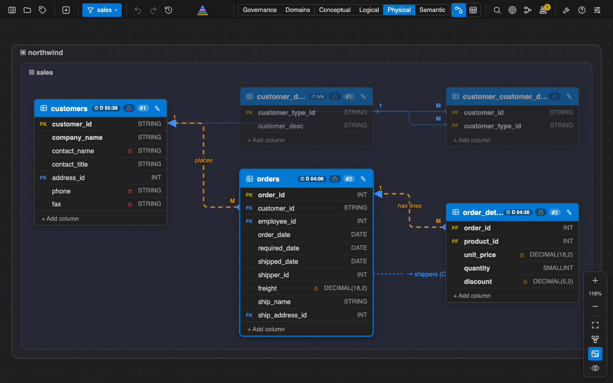

#### The archived file

Opening `<name>.archived.model.json` — the pre-split model, renamed in place — shows this banner instead of the ordinary toolbar tools:

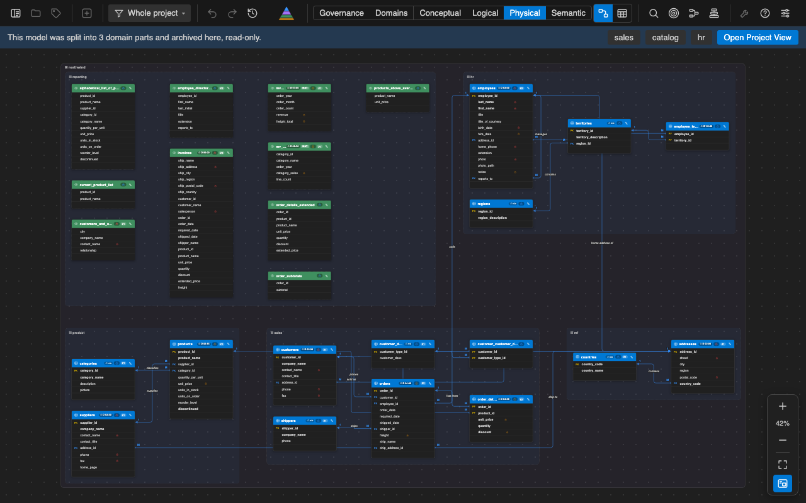

It is **strictly read-only**: dragging, Auto Layout, every editing dialog and the Tools menu are unavailable, exactly like an exported HTML file (the Project View's Tools menu partly works — see below; the archived file's does not, since it is one real file that must stay untouched, not an assembled project export). Click a part's name to open it, or **Open Project View** to see the whole thing assembled (below). It stays on disk, untouched, for as long as you keep the project — it is never deleted, and Strata SQL never edits it or writes back to it.

**Strata SQL: Join Parts** (`strata-sql join`) is the reverse of a split: it reassembles every part and `governance.json` back into one model, and writes it at the **project-index file's own path** — turning the thin index file back into a real, full model, with a fresh version log recording the join. **The archived file is left exactly as it is** — Join does not touch it, restore from it, or delete it; it stays on disk as a second, now doubly-historical copy, alongside the freshly rejoined model. (Its own version log keeps its name too, so joining never overwrites it: the rejoined part's fresh log gets a different file name instead, e.g. `history/orders-joined.history.jsonl`, if `history/orders.history.jsonl` is already taken by the archived file.)

**Limits of this release:** joining parts back together (*Strata SQL: Join Parts*, above) is a Command Palette action only, not offered from the Domains tab. Opening a single **split part** in the ordinary editor shows and lets you attach that project's shared tags and policies, but **creating or editing** a tag or policy while a part is open still saves it into that part's own file, not into `governance.json` — promoting a part-local one to a shared one is a manual edit of `governance.json` for now. (Creating or editing a tag or policy from the **project-index file's own tab** instead — see [Seeing the whole project](#seeing-the-whole-project-project-view) below — is built: it saves straight to `governance.json`.) A relationship's bridge table (an M..M "via" table) that ends up in a different part than the two tables it joins is kept by name in the part that holds the relationship, and survives opening and resaving it. The split itself is a one-time action, refused a second time on an already-split project; to change domains afterwards, use the Domains tab of the project-index file (above).

**Warnings** (Alignment, and `strata.js validate`): a domain name defined more than once, and a concept listed in more than one domain.

#### Seeing the whole project: Project View

Once a project has been split, `data_models/<name>/<name>.model.json` — the exact path the pre-split model used to have — is a small, regenerable **project-index file**, not a model. **Opening it** (like any `.model.json`) assembles every part into one canvas: every table, concept, entity and metric from every part, side by side. This is where a cross-part relationship you saw as a stub in one part becomes a real edge — Shippers and Orders both on screen, with the actual line between them:

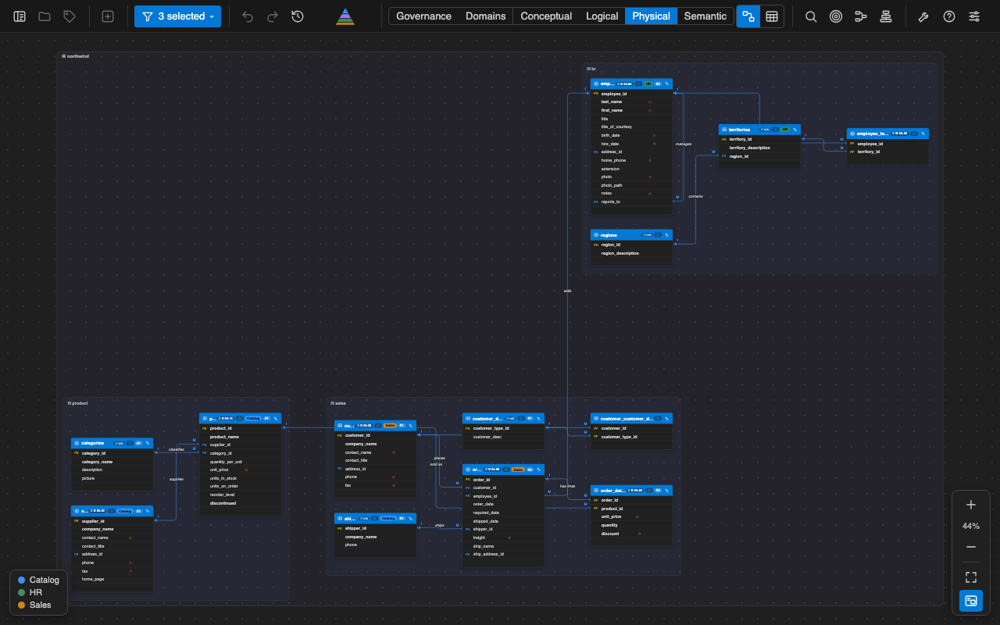

Every card is badged with the domain it came from (a small coloured pill on its header) and a legend, bottom-left, lists what each colour means. A table, concept or entity that split into `_unassigned`/`_shared`, or that a project without domains never assigned to one, carries no badge.

**Strata SQL: Open Project View** (Command Palette, or the **Project View…** button next to Split on the Domains tab) is the same view, opened the same way as any command: for a split project it opens the project-index file above (a normal, closeable, reopenable tab); for an ad hoc multi-part project that was never split (two models added to one manifest by hand — rarer, but always been possible) there is no index file to open, so it still opens as a one-off view instead.

**Editable on the project-index file's own tab — the whole point of splitting was never meant to stop you working on the project.** Adding, editing and deleting tables, columns, relationships (foreign keys, table-level, conceptual and logical), catalogs, schemas, concepts, entities and metrics all work here, exactly the same dialogs as an ordinary part's editor. Every change is routed straight to the **correct part's own file**, with that part's own new version — the same rules *Split into Domains* itself uses (a table's own `homeDomain`, an entity's, a metric's, or otherwise whatever it is linked to), so an edit here never invents a file and never loses anything. **Saving anything from this tab — a table/column/relationship/concept/entity/metric edit, Project settings, or a new tag/policy — refreshes the tab itself at once**, showing the change on the canvas without closing and reopening it. The **ad hoc, never-split Project View** (no project-index file — see above) has no manifest of parts to route any of this into, and stays entirely read-only, exactly as before this release. Dragging a table to reposition it still snaps back (there is no single, shared layout file for a whole project); Domains stays unavailable here too (that is what *Split into Domains* and the Domains tab are for).

- **Adding a new table, concept, entity or metric** offers a **Domain** field — which part it is saved into. Leave it as "the usual rule" and it is routed exactly like *Split into Domains* would (a table by the entity it realises, an entity by its concept, a metric by what it reads), or pick a domain explicitly. Only domains that already have their own part on disk are offered; a domain added since the split (with no part of its own yet) is not — move a concept into it from the Domains tab first, which creates its part. A concept's domain is manifest metadata (the same `domains` list the Domains tab edits), not a field on the concept itself; an entity's, a table's and a metric's own "Domain" choice is stored on the object (the same `homeDomain` `Split into Domains` already reads), so it also shows, and can be changed, when editing an EXISTING one, whether or not it already has a domain of its own:

  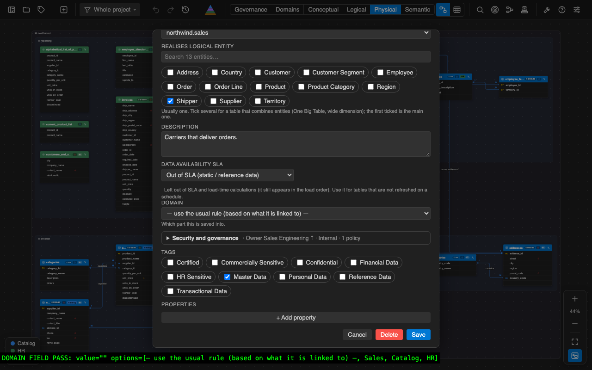
- **Adding a catalog or schema** works here too — the same dialog as any part's editor, with no Domain field of its own: a catalog or schema is a shared structural container, not owned by one domain the way a table is, so it simply travels with whichever tables use it (exactly like *Split into Domains* already derives a part's own catalogs and schemas from the tables it carries). A brand-new one with no table yet is kept in **`_unassigned`** until a table starts using it, then it moves there for free on the next edit — if the project has no `_unassigned` part, adding one is refused (naming it) rather than silently dropped.
- **A relationship between two tables in different domains** is written into whichever end's part actually owns it (a foreign key or table-level relationship: the child's part; a conceptual or logical relationship: the parent's part — the same split already uses) as the same neutral, labelled stub described above, resolving cleanly rather than warning `broken-ref`.
- **Renaming an object that another part refers to** rewrites that other part's own reference to the new name too, with its own new version there — for free, since every edit here re-derives every part fresh from the whole, currently edited project, the same machinery *Split into Domains* itself already proves.
- **Undo/redo**: native Cmd/Ctrl+Z on this tab does nothing, permanently — there is nothing in the project-index file's own (thin, unchanging) text to undo. The **Version history** drawer, opened the same way as for any model, instead shows a **merged, read-only list of every part's own version log** (and `governance.json`'s), merged chronologically, each version tagged with the part — and domain, when it has one — it belongs to:

  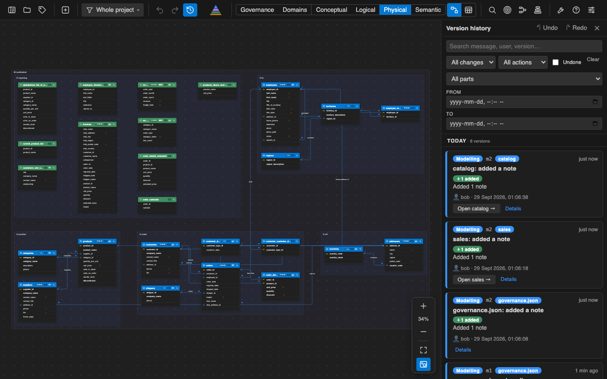

  A **part / domain filter** joins the usual stream filter (Modelling / Governance / Semantic), search and date range. Each version's own **"Open \<part\> →"** button opens that part directly, where its own, full History drawer offers Preview and Undo/Redo-to-here for any of its versions (this merged list does not preview or jump to an arbitrary older version of one part in place — a materially bigger feature, not built here). The drawer's own **Undo** and **Redo** buttons, above the filters, are the one exception: they undo, or redo, the single most recent (or most recently undone) change **anywhere in the project** — whichever part and stream it happens to be in — the same way as if you had opened that part and clicked its own Undo/Redo; neither writes a new version, they only move which recorded content that one part's file holds, exactly like an ordinary part's own Undo/Redo. Each part keeps its own independent version log throughout — nothing here merges, rewrites or deletes an entry.
- **If an edit cannot be routed** (it would need a part that does not exist yet — a domain that has no concepts and so no part of its own), nothing at all is saved and Strata SQL says so; a later part failing to write (a real disk error) leaves the earlier ones written and names exactly which.
- **Project settings** (the toolbar's Project settings button) is editable. Saving writes the same project block — name, description, technology, methodology, stakeholders, and any tags/policies attached to the project itself — into **every part's own model file**, each its own real, versioned edit (not one shared edit: if a later part somehow fails to write, Strata SQL says exactly which parts got the update and which did not).
- **Tools → Generate / refresh embeddings** is enabled, and runs once **per domain part** — not one project-wide file — saving each part's own `<part>.model.embeddings.json`, exactly as if you had opened each part and generated its own. The Tools popover shows how many parts are up to date rather than one status that would not honestly describe several files at once.
- **Creating or editing a tag or policy** (the tag icon, or "+ New policy" / the pencil next to a policy on the Governance tab) saves straight to `governance.json`, with its own version in `governance.history.jsonl` — and is then visible from any part's own editor too, since every part already reads `governance.json` in for display. Renaming a tag here does not update every object elsewhere that already carries it, and attaching a tag or policy to one specific table, concept, etc. (or deleting a tag/policy outright) still needs that object's own part, opened directly — this stays a narrower, single-file operation for now.

Saving from this tab refreshes it at once (above); it is otherwise a snapshot of every part's file **as of the last time it refreshed** — it does not watch the parts for changes made *elsewhere* (a part opened and edited directly in its own tab, or a Split/Join run from the Command Palette) and does not refresh live for those; close and reopen it to see files changed that way. Impact analysis, load order, search, the navigator and hover all work as normal on either kind of Project View (they only read); the **Model Navigator**, in particular, shows the whole assembled project too, not the project-index file's own thin marker, and clicking an item there reveals it on this canvas. **Live view is available for the project-index file's own tab** — Tools → Open live view in browser, or the Command Palette — the same assembled, editable view, full page in your browser; see [Live view in the browser](#live-view-in-the-browser) below. The ad hoc, never-split Project View still has no live view (its own Tools menu, below, explains why).

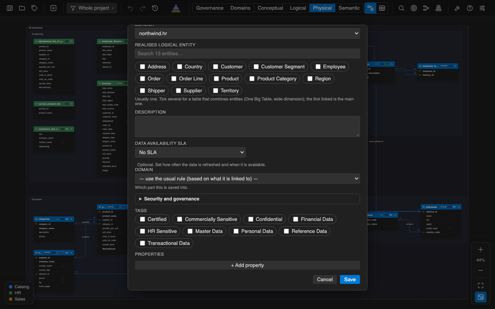

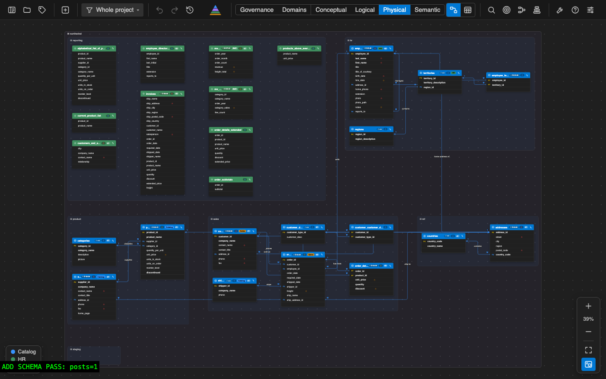

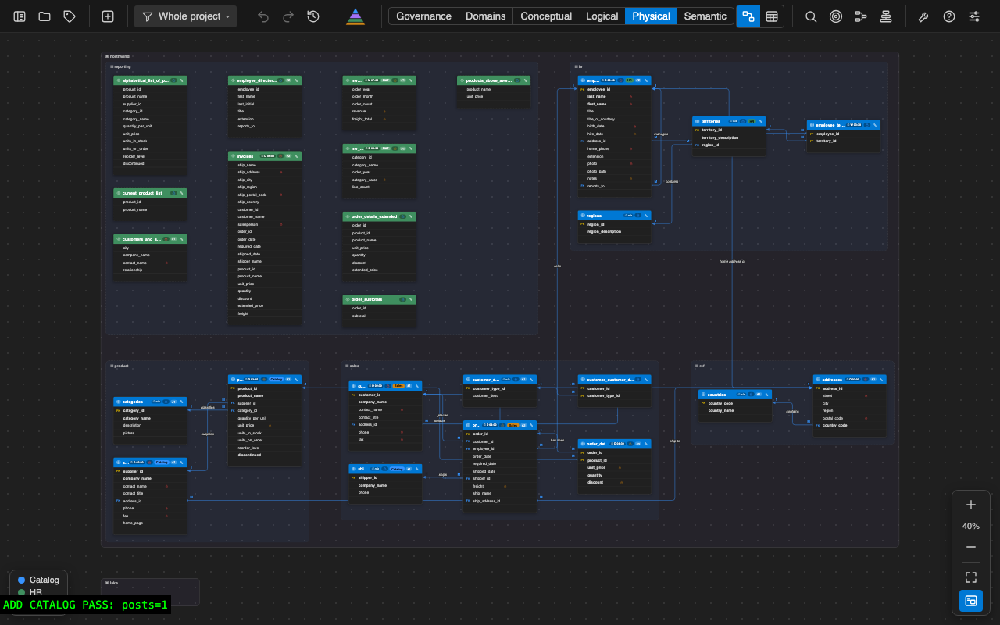

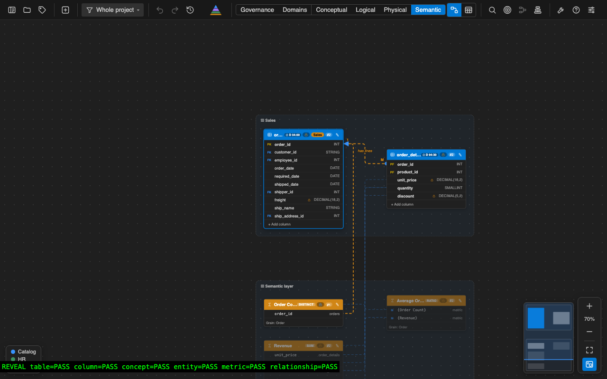

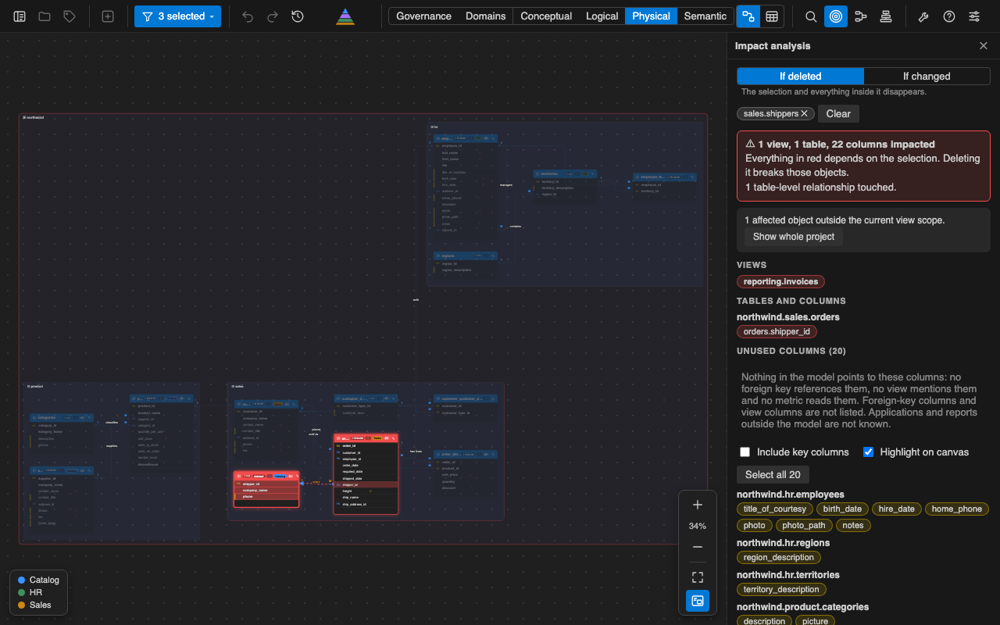

**The Tools menu, on the ad hoc, never-split Project View:** Export ETL / ELT code and Export interactive HTML are pure reads of the whole assembled project — pick a file to save them to, exactly like anywhere else. Generate / refresh embeddings and Open live view in browser stay unavailable there, with their own reason rather than the generic "read-only" one: an ad hoc view has no manifest of parts to save a per-part embeddings file into, and the live view serves and saves one model file directly, which an assembled project is not.

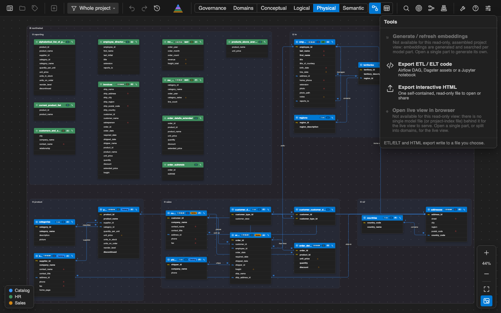

**The same Tools menu, on the project-index file's own tab:** embeddings are enabled (per domain part, above), and so is **Open live view in browser** — the same assembled, editable view, full page, in your default browser (see [Live view in the browser](#live-view-in-the-browser)).

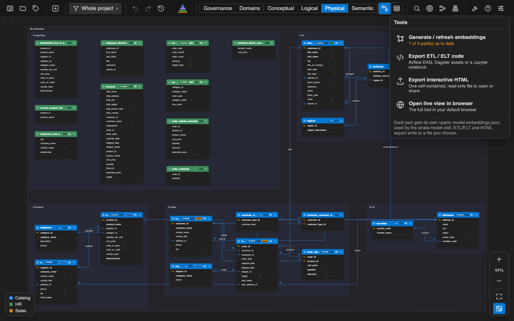

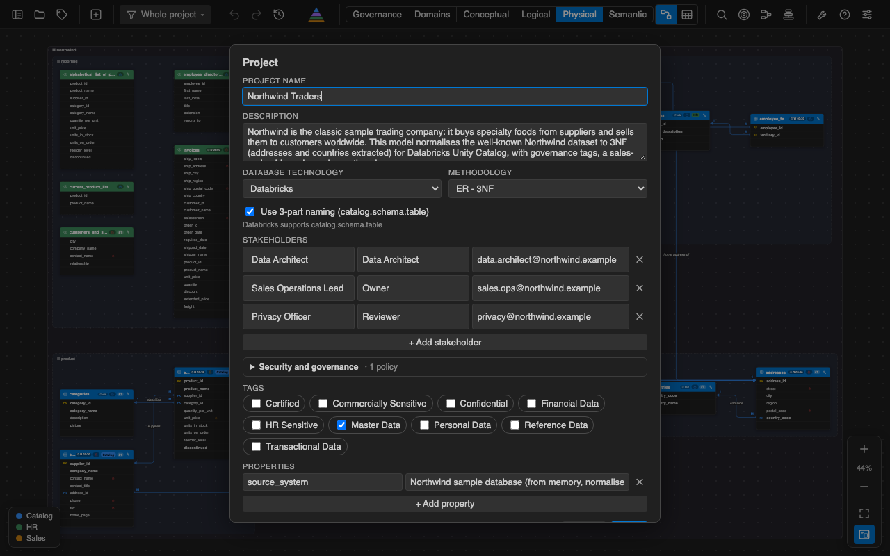

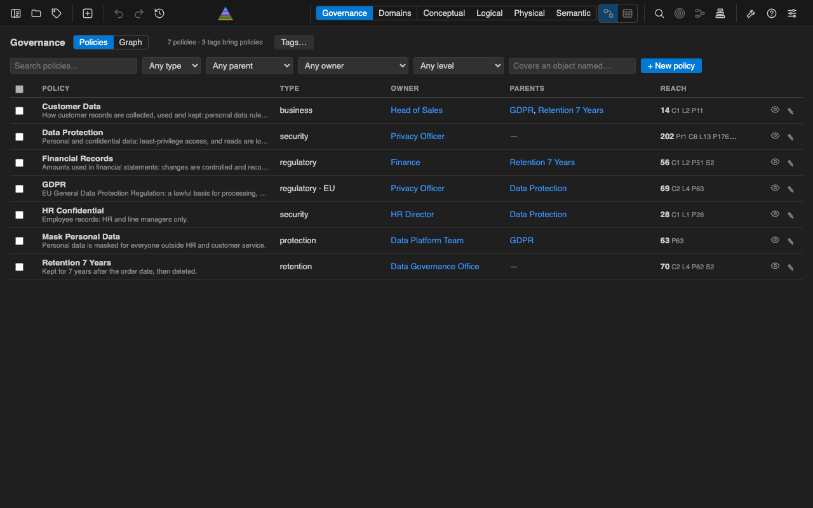

Not available for a project of one part (there is nothing to assemble): the command and the button both say so instead of opening an empty view. A project that has domains but has never been split has neither an archived file nor a project-index file — nothing here applies until *Split into Domains* actually runs.

### Classification: what the data is, rolls up

Classification says how sensitive the data is. It is information about the data itself, so it is set **where the data is, on the column**, and everything above shows the **highest of what it holds**:

- **A column owns its classification.** Set it in the column dialog, or let a policy do it: a column that has a policy with a minimum classification attached, or carries a tag that brings one, is at least that (a column tagged Personal Data is Restricted when Personal Data brings GDPR). Nothing is inherited from its table, schema or concepts, and a policy attached to a table or schema does not classify the columns below.
- **Everything above rolls up.** A table shows the highest of its columns, a schema and a catalog the highest of their tables, an entity the highest of the tables that realise it, a concept the highest of its entities, and a metric the highest of the columns and metrics its calculation reads. The hover and dialog say where it comes from ("Restricted, from column northwind.sales.customers.contact_name").
- **A value on a container is a minimum.** Setting *Confidential* on a table, schema, entity, concept or metric says "at least Confidential"; it shows as the object's own value and is never pushed down, so the table can be Confidential without every column being so. Models saved before this change keep such values; they now mean "minimum", which removes the old effect of a table marked Restricted turning every column Restricted.
- **Unclassified is allowed.** A column without a value is simply unclassified. To give everything a baseline, set a classification default for the Physical level in Project settings: unclassified columns take it.
- **Only a lower value below a minimum is reported.** A column that is classified *lower* than the minimum of its table, schema or catalog is a warning (below); it keeps its own value.

### The Governance tab

**Governance** is the first button of the level switch. It replaces the canvas with two views: **Policies** and **Graph**. Domains have their own tab right next to it (see [Domains](#domains) above); the policies a domain gives its concepts show up in a policy's reach here like any other inherited value.

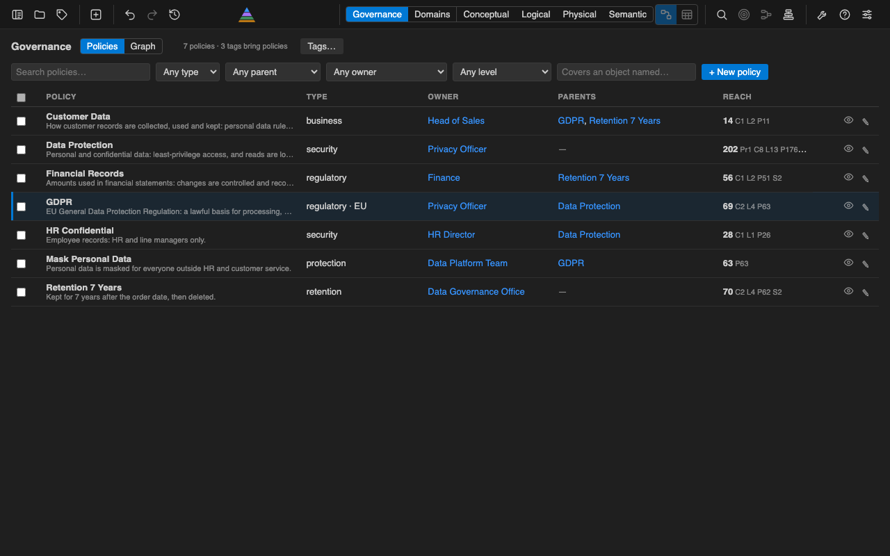

**Policies** is a table of every policy: a tick box, the name with the first line of its description, type, owner, parents, **reach** (how many objects it reaches, with a per-level breakdown: **Pr**oject, **C**onceptual, **L**ogical, **P**hysical, **S**emantic) and two icons.

- **Hover a name** for the full description (formatted like other descriptions) with type, jurisdiction, minimum classification, owner, parents and the tags that bring it.
- **Click a row** to mark it with a thin bar and a light tint (the text keeps its colours). The mark stays while you filter (as long as the policy is shown), when you switch to the graph and back, and next time you open the model (kept in `.strata/layout.json`).
- **Links** in a row: the **owner** filters the list to that owner's policies; a **parent** clears the filters, highlights the parent and scrolls to it.
- **View** (eye) opens the policy read-only: description, type, jurisdiction, minimum classification, owner, parents, child policies, tags that bring it, where it is attached (click an object to open it on its level) and how much it reaches per level, with **Open graph** and **Edit**.
- **Edit** (pencil) opens the policy editor in place of the table; **New policy** opens an empty one. Name, type, owner of the rule, jurisdiction, minimum classification, description, **parents** (several; choices that would create a loop are not offered), **tags that bring it**, and **where it is attached**: the project, concepts, entities, metrics, catalogs, schemas, tables and views, and columns (open a table's columns, or type in the filter). **Save** returns to the list with the policy highlighted; **← Policies** leaves without saving. Every save is one version in the Governance stream.
- **Filters:** text, type, parent (policies below it), owner, level covered, and the name of an object it covers.
- **Tick several** (the box in the header ticks every policy shown) and a bar offers **View graph** (those policies together) and **Delete…**. **Esc** clears the ticks.
- **Delete** (from the bar, or in the editor) first lists what refers to each policy: the policies that have it as a parent, the tags that bring it, the objects it is attached to or switched off on. Deleting removes those references too, as **one version** in the Governance stream, so **Undo** brings everything back.
- On narrow editors the list keeps name, owner, reach and the icons; type and parents stay in the hover and in View.


**Graph** draws one or more policies: their **parents** on the left, the policies themselves, the **child policies and tags that bring them**, and on the right **every object they reach**, grouped by level. Choose the policies in the **Policies ▾** dropdown (search, **Select all**, **None**; the chosen ones show as chips, ✕ removes one) or tick them in the list and click **View graph**. Only the chosen policies are marked (a coloured border and bar); the other boxes and the lines stay grey. With several policies each gets its own colour: its lines and a coloured dot on every object it reaches. An object reached by several is drawn once, with one dot per policy. Solid lines mean attached, through a child policy or brought by a tag (the line starts at the tag box), dashed lines mean inherited from above, red crossed-out objects have it switched off. Filter by level, kind of object and how it is reached; inherited objects are off at first because there can be many. **Click an object** to open it on its level, a chosen policy to view it, a parent or child policy to draw that one instead.

### Switching a policy off lower down

Sometimes a policy that reaches an object from above, or through a tag, should not apply there: a masked view that everyone may read, a test schema. Open the object's **Governance** box: every policy under **Also applies** has a **switch off** link. Switched-off policies show as crossed-out chips (**✕** switches one on again).

- It applies to the object **and everything below it**: on its level, and down the links (a policy switched off on an entity is off on its tables too), like an attachment.
- The policy is gone **however it arrives** there: from above, through a child policy, or via a tag. Its **parents** go too, unless they also arrive another way. A **child policy** that brings it stays on (switch that off separately if needed).
- It is **always reported** under Alignment ("GDPR is switched off on northwind.sales.customers.phone") until you **Accept** it, so a rule never disappears silently. The fix **Switch … on again** undoes it.
- The Graph shows those objects in red, crossed out, with where the policy was switched off (filter: *Switched off*).

### In the object dialogs

Each dialog has one collapsed **Security and governance** box. Its title line summarises the owner, classification and how many policies apply. Open it to see two sections under the name, type and description at the top of the dialog:

- **Security / classification** (lock icon): the object's own classification (on a container it is labelled *Own minimum*) and, next to it, the effective value as a coloured lock badge (Public green, Internal blue, Confidential orange, Restricted red) with where it comes from: *from column …* for a container, *raised by policy GDPR* for a column.
- **Governance / ownership** (person icon): owner, steward, criticality and lifecycle (inherited values greyed), the attached policies, and what else applies and why ("from schema northwind.sales", "via tag Personal Data", "through Customer Data"). **Open the Governance tab** jumps there.

The same lock badge sits on the header of every table, view, concept, entity and metric card (the rolled-up value; hover it for the source) and, on the Physical level, on each column that has a classification of its own. The hover shows the same two sections.

### Governance warnings

The **Alignment and governance** panel (stacked-layers icon) lists what needs attention, with **Accept** (stored in `alignment.acknowledged`) and jump-to links:

| Warning | When |
|---|---|
| **Restricted data without a protection policy** | A column (or a catalog, schema or table with a minimum of Restricted) is Restricted in its own right but no policy of type *protection* reaches it. Tables and schemas that only show Restricted because of their columns are not reported again. |
| **Items classified below the minimum of what contains them** | A column is classified lower than the minimum set on its table, schema or catalog. The column keeps its value; correct one of the two, or accept it when it is intended. |
| **High or critical items without an owner on their level** | A concept, entity, table, view or metric is High or Critical but has no owner, not even a level default. |
| **Retired items still in use** | Lifecycle *Retired*, but foreign keys, views or metrics that are not retired still use it. |
| **Metrics that reference something missing** | A calculation names a table, column or `{metric}` that does not exist, or the grain is unknown. |
| **Policies that are their own ancestor** | A loop through parents. **Remove … from the parents of …** fixes it. |
| **Policies switched off lower down** | Every switch-off, until you accept it. **Switch … on again** undoes it. |
| **Unknown policies or tags** | An object, tag or policy names a policy or tag that is not defined (for example after editing the file by hand). |
| **Domain names defined more than once** | Two domains in the manifest share a name (case does not matter). |
| **Concepts listed in more than one domain** | A concept's name appears in more than one domain's `concepts` list. |

A model without governance gets no governance warning. A project without domains gets no domain warning.

### Good to know

- A policy describes what is required; Strata SQL does not enforce it in the database. Masking, retention and access still have to be implemented on your platform.
- Retention, masking, access, residency and certification are expressed as **policies** or **tags**, not as separate fields.

---

## Semantic layer

The **Semantic** level holds **metrics**: what a number means for the business, how it is calculated from the physical columns and at which level of detail it is valid. It is where the model meets reports, dashboards and AI assistants asking "how is revenue calculated?".


- **Add a metric:** **+** → *Metric*, or **Add a metric** on the empty Semantic level. Edit one by double-clicking its header or the pencil.
- **Definition:** the business meaning, in words (Markdown is fine).
- **Calculation:** an expression over **qualified** column names: `table.column`, `schema.table.column` when a table name is not unique, or the full reference. Use other metrics as `{Metric name}`, for example `{Revenue} / {Order Count}`. Bare column names are not linked. The dialog shows what it reads and what it cannot find as you type.
- **Aggregation:** Sum, Count, Count distinct, Average, Minimum, Maximum, or **None** for non-additive metrics such as ratios. It is applied to the calculation: *Revenue* = `SUM(unit_price * quantity * (1 - discount))`.
- **Grain:** the entities (or tables) the metric is valid at, for example *Order Line*.
- **Governance:** the metric's owner, steward, criticality and lifecycle on the semantic level, its policies and tags, and its classification, which rolls up from the columns and metrics it reads (see [Governance](#governance)). Use a tag such as *Certified* to mark metrics approved for reporting.

On the canvas each metric card shows its aggregation (SUM, COUNT, DISTINCT, AVG, MIN, MAX, RATIO), how many tags it carries, one row per input column (with its table) or input metric, and its grain. **Dashed lines** lead from each input to the column it reads, or to the metric it builds on. The tables it reads are drawn next to it as on the Physical level. Select a metric to highlight what it reads.

- **Renaming follows.** Renaming a metric updates the `{…}` references in the metrics built on it. Renaming a **column, table, schema or catalog** rewrites the calculations that read it, in the same version: `orders.total` becomes `sales_orders.total`, `schema.table.column` and full references change the parts that were renamed, and quotes are kept. A toast and the version message name the metrics that were updated (the calculation is in the Semantic stream, the rename in the Modelling stream). References that did not resolve before, comments and text in quotes are left alone. Deleting a column or table is not a rename: impact analysis tells you which metrics it breaks, and the Alignment panel reports a reference that no longer resolves. Grain entries are not rewritten.
- View scope works here too: ticking a schema shows its tables and the metrics that read them. Load order is not available on this level (it is about loading tables).
- Metrics, their calculations and their governance go into the [embeddings](#vector-embeddings-and-ai-assistants), so an assistant can answer "how is Average Order Value calculated?" or "who owns Revenue?".
- Not built yet: exporting the semantic layer to dbt MetricFlow, LookML or Cube, and semantic dimensions (entities and tables play that role).

---

## Impact analysis

Before you delete or change something, find out **what depends on it**. Open the **target icon** in the toolbar. This section describes the Physical level; on the conceptual and logical levels you select concepts and entities instead (see [On the conceptual and logical levels](#on-the-conceptual-and-logical-levels)). The impact panel opens on the right and the canvas switches to selection mode: **click** a table, view, column, or a schema or catalog label to select it, click again to deselect. **Select as many columns as you like.**


- **Downstream, red = impacted.** Everything that **depends on** the selection is drawn in red: the rows, the cards and the dashed lineage lines that lead into views. Everything unaffected fades into the background, so the chain of dependencies stands out.
- **Upstream, blue.** Everything the selection **depends on** (the tables its foreign keys point to, the tables and columns a view reads, the parent side of a table-level relationship) is drawn in blue and listed under *Upstream*.
- **Amber = not safe without a review.** If **nothing depends on it but it depends on something** (for example a table with foreign keys, or a view), the selection turns **amber** and the panel says *Not safe to delete without a review*: deleting it would remove those relationships and lineage.

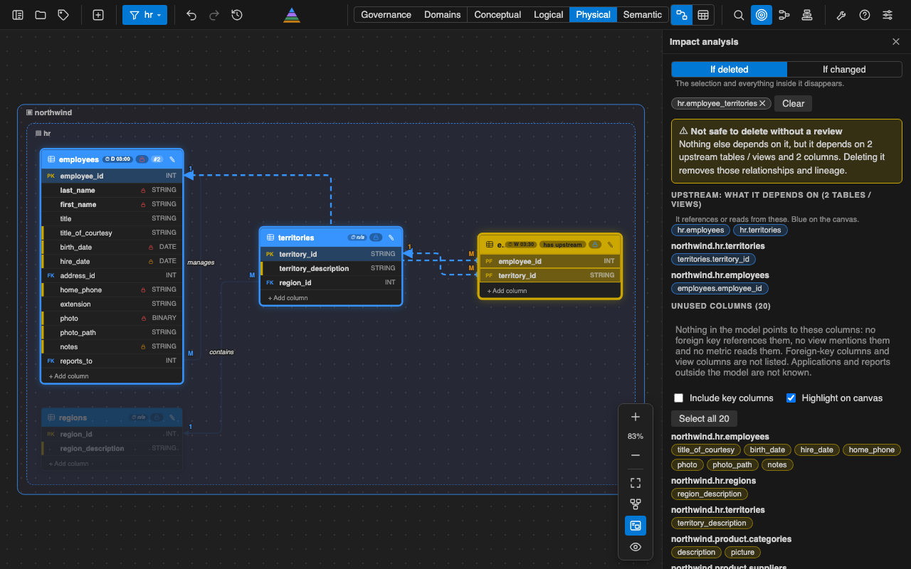

- **Green = safe.** Only when **nothing depends on the selection and it depends on nothing** (no foreign key, no view, no table-level relationship) does the selection turn **green** and the panel say *Safe to delete*. A plain column that no key or view uses is safe; a table almost never is.

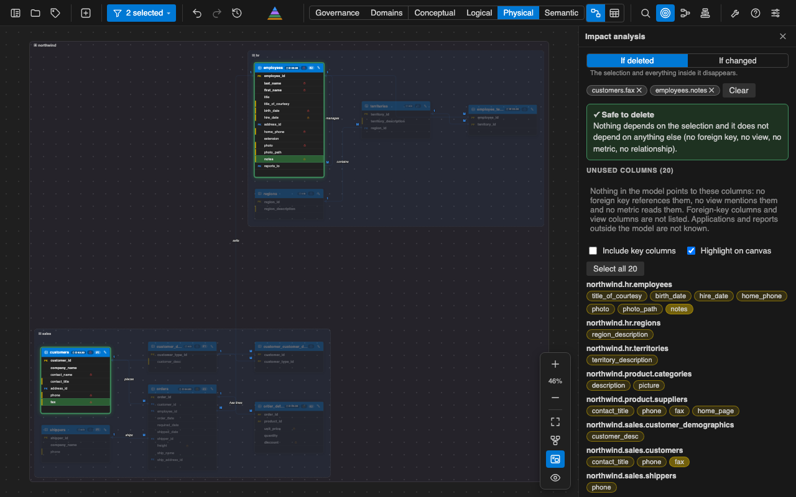

- **If deleted / If changed.** *If deleted* removes the selection and everything inside it (deleting a schema deletes its tables and columns). *If changed* means renamed, retyped or redefined: it stays, but its dependants may break. The lists in the panel are clickable and jump to the object.
- **What counts as a dependency** (both directions):
  - a column that is a **foreign key** depends on the column it references (that column is *upstream* of the foreign key);
  - a **view** depends on every table it reads and every column its SQL mentions. If a view loses something it uses, the **whole view** is treated as broken, and so are views built on top of it;
  - a **metric** depends on the columns its calculation reads and on the metrics it builds on. On every level the panel lists the **metrics that break** when you delete or change a column or table. On the Semantic level you can also click metrics: the metrics built on them turn red, the columns and metrics they read blue.

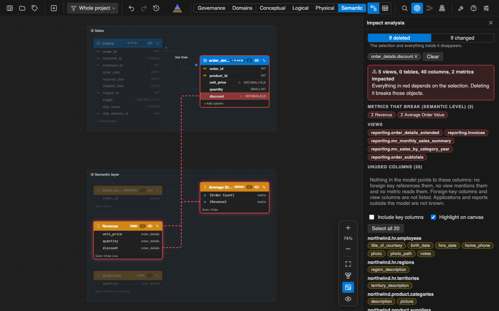
- **Outside the current view.** If some impacted objects are hidden by the view scope, the panel says so and offers **Show whole project**.

### Unused columns

The panel also lists **unused columns**: columns that nothing in the model points to. No foreign key references them, no view mentions them and no metric reads them. Foreign-key columns (they carry a relationship) and view columns are not listed. **Key columns** (primary key, unique) are left out unless you tick *Include key columns*. Unused columns are marked with an amber stripe on the canvas (untick *Highlight on canvas* to hide it).

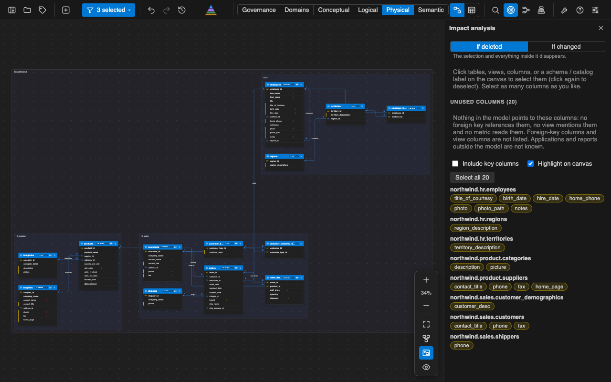

Click a column chip to select it and jump to it; **Select all** puts every unused column into the selection so you can confirm that deleting them is safe.

### How reliable is it?

- The analysis knows only what is **in the model**: relationships and view definitions. Applications, reports, pipelines and other databases that use your tables are **not known**, so "unused" means *unreferenced in this model*, not *dead*. Check with the owners before deleting.
- View SQL is **not fully parsed**. Strata SQL reads table and column names from the definition (ignoring comments and text in quotes). That errs on the safe side: a view is reported as impacted when its SQL mentions a name, even if it only appears in a `WHERE`, and a column that merely shares a name with something in a view counts as used.
- Sample data and tags are not part of the analysis.
- The tool only reports; it never changes the model.

---

## Load order

Which tables must be loaded first, which can load **at the same time**, and what has to wait? Open the **stacked-boxes icon** in the toolbar. On the conceptual and logical levels the panel shows the same for concepts and entities, worked out from their tables (see [On the conceptual and logical levels](#on-the-conceptual-and-logical-levels)); the JSON export is always table by table. The **Load order** panel opens on the right, every card gets a numbered **stage badge**, and the model's loading sequence is worked out for you.


- **Stages.** Stage 1 is everything that needs nothing else (reference data, lookups). Stage 2 needs only stage 1, and so on. **Tables in the same stage do not depend on each other, so they can load in parallel**; each stage waits for the one before. The summary at the top gives the number of stages, the widest stage (most tables in parallel) and the **longest chain**, which is the minimum number of sequential steps.
- **Needs.** Every row lists the tables it needs first. A table can start as soon as *its own* prerequisites are loaded; it does not have to wait for the whole earlier stage.
- **Click a table** on the canvas or in the list. The selected table gets a white outline, everything that must load **before** it turns **blue**, everything that has to **wait for it** turns **orange**, and the rest fades. Dashed lines show which tables a view reads.
- **Stages, Pipeline or Tree.** *Stages* is the list above. *Pipeline* draws the stages as columns **left to right** and the dependencies as a **DAG**: an arrow goes from a table to each table that needs it (solid = foreign key, dashed = a view reads it). Tables in one column load in parallel. Click a table to highlight what it needs (blue) and what waits for it (orange); tick *Hide tables that are out of SLA* to drop static reference tables and their arrows on big models. Scroll sideways and down for long pipelines. *Tree* nests each table under the prerequisite that loads last, so children always load after their parent; any other prerequisite is listed as "also needs". Use the arrows to collapse a branch. In the tree every table appears exactly once.
- **Views** are placed after the tables they read (refresh them once those are loaded). Views over views are handled.
- **Circular dependencies** (tables that reference each other) have no valid order with foreign keys enforced. They are flagged with a red *cycle* tag and listed in the panel: load them together, then add the foreign keys. A table that only references **itself** (for example `employee.manager_id`) is marked *self-ref* and does not change the order.


### SLA: when is the data ready?

Give tables a **data availability SLA** (see *Tables, columns and views*) and the panel shows, for every table, its own SLA and a green **ready** time, the **cumulative** time its data is available:

- **Ready = the later of the table's own SLA time and the ready time of everything it needs.** A view or table without an SLA of its own gets the time its inputs are ready (marked *derived* in the tooltip).
- The summary shows three numbers: **Begins** (when the first data feeding the last table is available), **Ready by** (when the last data is available) and **Duration** between them, plus the **path of the last data to arrive**, table by table with each ready time. Every stage shows the time by which all its tables are ready.
- A **yellow ⚠ ready** time means the table promises data **earlier than its inputs can be ready** (for example SLA 02:15 for a table that needs data arriving at 02:30). Fix the SLA or the upstream schedule.
- **Slower sources do not hold up faster tables:** a monthly table feeding a daily one does not delay it. Tables marked *Out of SLA* are ignored, and Realtime / Minute / Hourly tables have no clock time, so they add none.

- **Hover a table or view** (on the canvas, in the panel lists, or on a pipeline box) for its **load estimate**: its own SLA, when its inputs are ready (and which one arrives last), when its data can be expected, a warning if its SLA is too early, and how many tables it needs and how many wait for it.


On a larger model the same view stays readable with the reference tables hidden (FpML, 67 tables):


### Bigger panel and JSON export

- **Make the panel bigger:** drag its left edge, click the expand arrows (⤢) to widen or shrink it, or click **⛶** for **full screen**, which uses the whole editor (click **⛶ Exit** to go back). The tree and the pipeline scroll instead of wrapping.
- **Export to JSON:** click **⭳ JSON** in the panel header to save the load sequence (stages, what each table needs, its SLA, when it can start and when its data is ready, cycles, and the pipeline's begin, ready time and duration) next to the model as `<model>.load-order.json`. The same file can be printed by an assistant with `strata.js order <file> --json`.

### How reliable is it?

- The order comes from what is **in the model**: foreign-key columns and view definitions (table and column names are read from the SQL, comments and quoted text ignored). Table-level relationships without a foreign-key column, business rules, and dependencies between jobs or files outside the model are **not known**, so treat the result as the technical minimum.
- On platforms that do not enforce foreign keys (Databricks, BigQuery, Snowflake) the order still matters for data consistency and for downstream joins, not for errors.
- In the DAG, an arrow that skips one or more stages is drawn straight across the columns and can pass behind other boxes; click a table to follow its arrows. **Begins** ignores tables that do not feed the last table (for example a yearly calendar), so the duration describes the pipeline that produces the last data.
- SLA times are clock times of **one refresh cycle**: weekdays, days of the month and time zones are not modelled, and a table's real run time is not measured. Treat the ready times as a plan, not a forecast.
- The panel only reports; it never changes the model (only the SLA you enter is stored, in the model file). It looks at the **whole model**, whatever the view scope is; the canvas shows the tables in scope. An assistant can print the same result with `strata.js order <file>`.

---

## Export ETL / ELT code

Start a pipeline from your model instead of a blank file. Strata SQL turns the **load order** into boilerplate code for **Apache Airflow**, **Dagster** or a **Jupyter notebook**. Wrench (**Tools**) → **Export ETL / ELT code**, or the Command Palette → **Strata SQL: Export ETL / ELT Code**.


- **Choose the target:** an Airflow DAG (`<model>_dag.py`), Dagster assets (`<model>_dagster.py`) or a notebook (`<model>_load.ipynb`). The file is saved next to the model (the live view downloads it; from the Project View or the project-index file it exports the whole assembled project, and a save dialog asks where).
- **Load mode:** *Append* (`INSERT ... SELECT`) or *Replace* (`DELETE`, then `INSERT ... SELECT`). **Staging schema** (default `staging`): every table loads from `<staging>.<table>`, in the same catalog for three-part naming. Point it at where your raw data lands.
- **What you get:**
  - **One task per table and view**, ordered by the load order: a foreign key or a view read means *runs after*. Tables in the same stage can run in parallel.
  - **The SQL of each load** for your database (quoting and three-part names follow the model's technology): an `INSERT ... SELECT` with the table's columns, the definition of a view as `CREATE OR REPLACE VIEW` (`CREATE OR ALTER VIEW` on SQL Server), a refresh for a materialized view, and nothing to load for a temporary view.
  - **Schedule and SLAs:** the cron schedule follows the fastest cadence among the table SLAs and starts when the pipeline's first data is due; each Airflow task gets an `sla` in minutes after the start, Dagster assets carry the SLA and ready time as metadata, and the notebook lists them in a table. Tables marked **out of SLA** are flagged as reference data: Airflow has a `SKIP_REFERENCE` switch, Dagster puts them in their own `strata_reference_load` job.
  - **Airflow:** a data-driven `LOADS` list plus a small loop that creates `SQLExecuteQueryOperator` tasks (set `CONN_ID`). **Dagster:** one `@asset` per table with `deps`, a `Warehouse` resource (set `WAREHOUSE_URL`), jobs and a schedule. **Notebook:** a setup cell with `DRY_RUN = True` (prints the SQL), then one markdown + code cell per stage that runs its tables in parallel.
- **Circular dependencies** have no edge between their members and are noted in the file; load them together and add the foreign keys afterwards.
- An assistant can produce the same files with `strata.js codegen <file> --target airflow|dagster|notebook`.

### What it does not do

- It is **boilerplate**, not a finished pipeline: the `INSERT ... SELECT` reads a staging table you must fill (extract and transform logic is yours), connection ids and credentials are placeholders, and nothing is run.
- Only foreign keys and view reads decide the order (as in Load order). The schedule uses one cadence for the whole pipeline: tables with slower SLAs (weekly, monthly) are noted, but they run as often as the DAG does unless you split them out.
- SLA times are when data must be **ready**: start the DAG earlier. Airflow's `sla` is an Airflow 2 feature (remove those lines on Airflow 3). Times are one cycle's time of day; weekdays and time zones are not modelled.
- The output was checked to be valid Python and a valid notebook, but not run against Airflow, Dagster or a database.

---

## Live view in the browser

The **whole tool in your default web browser**, as a full page: the canvas, the navigator, version history, impact analysis, load order, settings, sample data, search and this help. Everything you do is saved to the same files as in VS Code.

**It opens where you are in VS Code:** the same level and, for each level, the same pan and zoom, view scope, open panel (impact, load order, alignment, history), selection and mini-map on / off, read from `.strata/layout.json`. What you change in the browser is written back there, so VS Code opens the model that way next time. (Pan and zoom are kept in screen pixels, so a browser window of another size shows a slightly different part of the diagram.)


**Start it**

- In VS Code: wrench (**Tools**) → **Open live view in browser**, or the Command Palette → **Strata SQL: Open Live View in Browser**. Strata SQL saves the model first, starts a small local server and opens your browser.
- From a terminal, without VS Code: `strata-sql live path/to/model.model.json` (or `node cli.js live ...` from the Strata SQL folder; `node live.js` and `npm run live -- <model>` do the same). With no file it opens the project in the current folder (`--dir` names another). `--port 8787` chooses a port, `--no-open` only prints the link. The server listens on this computer only; `--host 0.0.0.0` listens on every address (the Docker image does this inside its container), and then anyone who can reach the port and has the link can edit, over plain HTTP, so publish the port to localhost only or put TLS in front. `STRATA_TOKEN` (16 or more letters, digits, `-` or `_`) keeps the same link between runs.

**Try it without a project: the demo.** `strata-sql live --demo` (or the Docker image with `STRATA_DEMO=1`, no folder mounted) opens the **sample models** (Northwind, FpML, the dimensional star) for anyone to explore: every level, governance, impact, history, sample data. Nothing is saved to disk and nothing is kept on the server. Your changes, their versions and edited sample data live in **this browser tab only** (session storage) and are **discarded when you close the tab or leave the page**; a reload keeps them. The **Demo** bar at the bottom left switches sample (each keeps its own changes while the tab lives) and **Reset** throws away the open sample's changes. Not available in the demo: vector embeddings and *Export interactive HTML* (both need files on disk; the ETL / ELT export downloads as usual), and creating a project. To work on your own model use `strata-sql live` (see above). The demo is for the command line and Docker only; the VS Code extension has *Open Sample Model*.

**What works**

- Everything the editor does: add and edit objects, drag tables and relationships, levels, view scope, the canvas controls and mini-map, governance, SLA, load order, impact analysis, history with undo, redo and preview, settings, sample data (CSV) and embeddings.
- The **same shortcuts** (Cmd/Ctrl + 1, Y, L, ., F, F1, Z, Shift + Z, and Cmd/Ctrl + Alt + G / C / L / P / S for the levels) and **Cmd/Ctrl + S** to save. In *auto* versioning mode changes are saved about a second after you stop; in *version on save* mode press **Cmd/Ctrl + S** (the tab title shows **●** while there are unsaved changes and the browser warns before you close it).
- The **navigator** opens on the left with the navigator button or **Cmd/Ctrl + L**. It starts closed, as in VS Code, where it is a separate side view; once you open or close it in the browser, the live view remembers that for this model (in `.strata/layout.json`), and its collapsed sections are the same as in VS Code. **?** and Cmd/Ctrl + F1 open this help in a new tab. **Export interactive HTML** downloads a file instead of opening a save dialog.
- Changes made to the model file outside the live view (VS Code, git) appear in the browser when there are no unsaved changes there.

**A split project's project-index file** opens in the live view too, the same way any `.model.json` does (Tools → Open live view in browser, the Command Palette, or `node live.js path/to/<name>.model.json` pointed at the project-index file's path) — the whole assembled project, full page, editable exactly as its own VS Code tab is: add, edit and delete tables, columns, relationships, catalogs, schemas, concepts, entities and metrics, each routed to the correct part; Project settings; per-domain embeddings; creating or editing a tag or policy (routed to `governance.json`); and the merged History drawer with its own cross-part Undo/Redo — see [Seeing the whole project](#seeing-the-whole-project-project-view) for what each of these does. Every write goes to the correct part's own file, over the same functions the VS Code host uses, so an edit made in the browser and one made in VS Code produce identical results.


**Two things stay exactly as read-only / unavailable as in VS Code:** the **archived file** (the pre-split model) opens in the live view too, but strictly to look, never to edit; the **ad hoc, never-split Project View** (two models added to one manifest by hand, never split) has no project-index file for a live server to be pointed at in the first place, so it has no live view at all. **File watching is scoped down** for the assembled project specifically: saving from the live view itself refreshes the page at once (the same way the VS Code tab refreshes), but a change made to a part's file from *elsewhere* — VS Code, `git pull`, editing it directly — is only picked up the next time the page is reloaded, not pushed live; this matches the "close and reopen to see files changed elsewhere" limit the project-index file's own VS Code tab already has, not a new one.

**Good to know**

- **It only listens on your own computer** (127.0.0.1). The link contains a random access token; anyone who has the link on your machine can edit the model, so do not paste it into chats.
- One live view serves one model file — or, for a split project's project-index file, the whole assembled project (above). Do not edit the same file in the live view and in a VS Code editor with unsaved changes at the same time: the last save wins.
- **Embeddings:** the local models work as usual. API keys for hosted models are read from the environment (`OPENAI_API_KEY`, `GEMINI_API_KEY`, `VOYAGE_API_KEY`) when the live view starts, because there is no VS Code secret storage.
- *Open the CSV in an editor* shows the file path instead of opening it. The native VS Code Markdown preview is replaced by this help page.
- Stop it with Ctrl + C in the terminal, or **Stop live view** in the VS Code message.

---

## Export as interactive HTML

Save the model as **one self-contained `.html` file** that anyone can open in a browser, offline, with nothing to install. Wrench (**Tools**) → **Export interactive HTML**, or the Command Palette → **Strata SQL: Export Interactive HTML** (the live view downloads the file).


- **Interactive, read-only.** Pan and zoom (canvas controls and the mini-map), switch level, view scope, hover for structured details, search, the navigator, **impact analysis**, **load order** (stages, pipeline, tree, SLA, JSON export), and **version history** (browse and preview any version). Nothing can be edited or saved, so it is safe to share; a *Read-only export* label is shown.
- **What is inside:** the model and its version log. That includes the **names and e-mail addresses** recorded with each version, so check before you send it outside your organisation. **Not included:** sample data, embeddings and settings.
- The file is a snapshot of the moment you exported (including unsaved changes in the editor). Export again after the model changes.
- The file is roughly 300-700 KB for the example models and needs a current browser (Chrome, Edge, Firefox, Safari). It follows your system's light or dark setting.

---

## Vector embeddings and AI assistants

Strata SQL can turn your model into **embeddings**: searchable vectors of every table, view, schema, relationship and tag. An AI assistant that uses the `strata-model` skill can then look up only the few chunks a question needs instead of reading the whole model, the version log and the sample data. That is faster, cheaper, and keeps assistants focused.

### Generate or refresh

Open the wrench (**Tools**) and choose **Generate / refresh embeddings**. Strata SQL shows exactly what runs where and what (if anything) is sent, then creates `<model name>.model.embeddings.json` next to the model. **No API key is needed**: the local models create the embeddings on your computer.


The Tools menu tells you the state: **Up to date**, **Out of date** (the model changed since the last run) or **Not generated yet**. Refreshing is incremental: only tables, views, relationships and tags that changed are sent again. Embeddings describe the model as it is now, including unsaved edits.

### Which models

| Choice in Settings | Model | Where it runs | Needs |
|---|---|---|---|
| **Gemma** | EmbeddingGemma 300M (`onnx-community/embeddinggemma-300m-ONNX`) | **On your computer** | Nothing. About 200 MB downloaded once. |
| **MiniLM** | `all-MiniLM-L6-v2` | **On your computer** | Nothing. About 25 MB downloaded once. Smallest and fastest. |
| OpenAI | `text-embedding-3-small` | OpenAI's servers | `OPENAI_API_KEY` or a key set in Settings |
| Google Gemini | `gemini-embedding-001` | Google's servers | `GEMINI_API_KEY` (or `GOOGLE_API_KEY`) or a key set in Settings |
| Claude (via Voyage AI) | `voyage-3.5` | Voyage AI's servers | `VOYAGE_API_KEY` or a key set in Settings. Anthropic offers no embeddings model of its own and recommends Voyage AI, so this slot uses it. |

**OpenAI, Gemini and Voyage AI embeddings exist only as hosted services; they cannot be created on your computer.** That is why they need a key, and why they are simply *skipped* (not an error) when no key is set. **Gemma and MiniLM are open models that run locally through the `@huggingface/transformers` library**, so with no keys at all you still get working embeddings. All are on by default; untick any you do not want under **Settings → Vector embeddings**.

The first time a local model is used, its files are downloaded once from Hugging Face (nothing of your model is sent, it is only a download) and kept in `~/.cache/strata/models` (set `STRATA_MODEL_CACHE` to move it). After that, generating works **offline**. A progress message shows the download.

**Set key…** (hosted models only) stores a key in VS Code's secret storage on your machine; keys are never written to a file or shown in the editor.


### What is sent (and what is not)

Only model **metadata** is embedded: names, display names, descriptions, view definitions, column lists, relationship text, tags, properties, governance values (owners and stewards by the names you entered), policies, and metrics with their calculations. **Sample data is never included**, e-mail addresses are removed and stakeholder names are left out.

- **Local models (Gemma, MiniLM): nothing is sent anywhere.** Your model text never leaves your computer.
- **Hosted models:** only used when you added a key for them. The confirmation names exactly which providers will receive the metadata.
- Generating is always a deliberate click, after a confirmation. If your model descriptions are confidential, simply leave the hosted providers without keys.

### Using the `strata-model` skill efficiently

With embeddings in place, an assistant (for example Claude Code with the `strata-model` skill from `.claude/skills`) works like this:

1. **A markdown file you name comes first.** Say "use `docs/glossary.md`" (or any `.md`) and the assistant reads it as authoritative context for what it covers.
2. **Otherwise it uses the cheapest lookup that fits:** `path` for "how are A and B related?", `show` for one table, `search` for fuzzy questions (using the `.model.embeddings.json` next to the model), `summary --schema` to orient itself. Without embeddings, `search` still works as a keyword search over the model; embeddings just improve recall.
3. **It avoids reading everything.** The whole `.model.json`, the version log, sample CSVs and the embeddings file itself are only opened when editing or when you ask.

To get the best results:

- **Refresh before you ask.** Regenerate after changing the model. The assistant is told when embeddings are out of date, but a refresh takes seconds.
- **Ask specific questions in plain words**: "which columns hold personal data?", "how is an order linked to a shipper?", "which views use freight?".
- **Name the model** when a folder has several (`sales.model.json`), so the matching embeddings are used.
- **Point at your own notes** with a `.md` file when a question needs business context that is not in the model.
- **No key needed.** The assistant embeds your question with the same model that created the file: a local one (Gemma or MiniLM) on your computer, or a hosted one if its key is set in the assistant's environment (`OPENAI_API_KEY`, `GEMINI_API_KEY`, `VOYAGE_API_KEY`). If nothing works (for example `npm install` was not run) it falls back to keyword search over the same chunks and tells you.
- **Editing still goes through the model file.** For a change the assistant reads only the affected objects, edits them, and runs the validator; Strata SQL then offers **Record as new version**.

You can also run the lookups yourself:

```bash
node .claude/skills/strata-model/scripts/strata.js search sales.model.json "which columns hold personal data" --k 8
node .claude/skills/strata-model/scripts/strata.js show   sales.model.json orders                 # short table names work when unique
node .claude/skills/strata-model/scripts/strata.js path   sales.model.json customer product      # how two tables are related
node .claude/skills/strata-model/scripts/strata.js order  sales.model.json                        # load sequence: stages, what runs in parallel
node .claude/skills/strata-model/scripts/strata.js align  sales.model.json                        # concept > entity > tables, and what is not aligned
node .claude/skills/strata-model/scripts/strata.js summary sales.model.json --schema sales.public --brief
```

---

## Shortcuts

| Shortcut (Mac / Windows & Linux) | Action |
|---|---|
| **Cmd/Ctrl + 1** | Auto layout |
| **Cmd/Ctrl + Y** | Toggle version history |
| **Cmd/Ctrl + L** | Toggle the navigator (focuses its search) |
| **Cmd/Ctrl + .** | Hide all open panels; press again to bring them back |
| **Cmd/Ctrl + F** | Search the model (drag the grip to move the box) |
| **Cmd/Ctrl + F1** | This help page |
| **Cmd + Option + G / C / L / P / S** (Mac), **Ctrl + Alt + G / C / L / P / S** | Switch to Governance, Conceptual, Logical, Physical or Semantic (also from the sample-data view) |
| Command Palette → **Strata SQL: Open Sample Model** | Create the Northwind or FpML sample project in the workspace and open it (no key binding) |
| **Cmd/Ctrl + S** | Save model and version log (also in the live view) |
| **Cmd/Ctrl + Z** / **Shift + Cmd/Ctrl + Z** | Undo / redo (rewinds the model; Strata SQL finds the matching version by content) |
| **↑ ↓ Enter Esc** (in search) | Move, open, close |
| **Esc** | Close the open dialog, popup or search |
| Mouse wheel / trackpad | Pan |
| **Cmd/Ctrl + wheel**, pinch | Zoom |
| Drag the background | Pan |
| **+** / **−** / zoom level in the canvas controls | Zoom in / out around the middle of the view / back to 100 % |
| Click / drag on the mini-map | Centre the view there / pan (no keyboard shortcut to toggle it) |
| Wheel over the mini-map | Zoom around the middle of the view |
| Drag a table header | Move the table |
| Drag a column row | Create a relationship |
| Drag from a concept or entity body | Relate two concepts / entities |
| Double-click a card header | Edit the table, concept, entity or metric |

Shortcuts work while a Strata SQL editor is active (Cmd/Ctrl + L, . and F1 also while the navigator has focus; the level keys only while the focus is in the editor, so the Explorer, the terminal and the chat keep their own keys). While the Strata SQL editor has the focus, its level keys take the place of two VS Code defaults: **Copy Path of Active File** (Cmd/Ctrl + Alt + C, Mac and Linux) and **Save All** (Cmd + Option + S on Mac; Ctrl + Alt + S is *Share* on Windows and Linux); both stay available from the Command Palette, and Save All from the File menu. Keyboards that use Ctrl + Alt as AltGr (some European layouts) may type a character instead: use the level buttons there. The **live view** in the browser supports the same shortcuts, and the exported HTML the level keys.

---

## Tips and tricks

- **Big model? Use scope.** Tick one or two schemas in the funnel to work on a slice; the view refits automatically.
- **Zoomed far out** the diagram shows names only; zoom in for columns and types.
- **Zoom in, steer with the mini-map.** On a big model, zoom in until the columns are readable and move around by clicking or dragging in the mini-map instead of zooming out and in again. Selected tables and impact results show in it, so you can see where they are.
- **Let descriptions do the work.** A good display name and description on every table, column and relationship makes the conceptual and logical levels readable and powers hover help, search and the navigator. Use Markdown (lists, `code`, **bold**) in descriptions: it is formatted on hover.
- **Generate, then merge.** On an existing model, *Alignment → Generate logical and conceptual levels* gives you a 1:1 start in one click; merging a few entities and concepts is usually all that is left.
- **Tag once, at the top.** Tag a concept Personal Data and every entity and table under it is Personal Data too (and gets its policies); the Alignment panel tells you where someone dropped it.
- **Classify the columns that hold the data.** Give GDPR a minimum classification of Restricted and tag the personal columns: those columns are Restricted, and their table, schema, entity and concept show it, without marking the columns that are not personal.
- **Govern schemas, not tables.** An owner, steward or policy on a schema covers all its tables and columns; set per-level defaults on the project for everything else. (Classification is the exception: it comes from the columns.)
- **Compose policies.** Give a policy such as *Customer Data* the parents *GDPR* and *Retention 7 years*: attaching it applies all three.
- **Let tags bring the rules.** Give the *Personal Data* tag the GDPR policy once; everything tagged gets it, on every level the tag reaches.
- **Check a policy's reach before you change it:** the Graph view shows everything it covers, and how.
- **Write metric calculations with table names** (`order_details.quantity`): that is what links a metric to its columns, lights it up in impact analysis and lets an assistant explain it.
- **Name your relationships** ("places", "supplies") and describe them ("A customer places many orders"). Search finds them, the navigator lists them.
- **Preview before you restore.** Use *Preview* in history, look around, then *Apply this version* only if it is what you want.
- **Version on save** (Settings) keeps history tidy: many edits become one version when you save.
- **Auto layout adapts to your window.** Run it again after resizing a lot; use *Fit to view* (canvas controls) to just re-centre.
- **Present at 100 %.** Click the zoom level in the canvas controls to jump to actual size, then steer with the mini-map.
- **Cmd/Ctrl + .** clears the screen (history, search, navigator) for a clean look or a screenshot.
- **Set SLAs, then read the pipeline.** Mark reference tables *Out of SLA*, give the rest a frequency and time, and Load order shows when the last table is ready and which tables promise too early.
- **Plan a load or a migration with Load order.** Open it before you write a pipeline: stage 1 can start immediately, and every stage is a set of tables you can load in parallel.
- **Start a pipeline from the model.** Set SLAs, check Load order, then *Export ETL / ELT code*: the tasks, their order and the schedule are already there.
- **Share without risk.** Send stakeholders an *Export interactive HTML* file: they can explore, search and run impact analysis, but cannot change anything.
- **Match your editor.** Leave the theme on *Auto*: with Catppuccin, Tokyo Night, Rosé Pine or Nord in VS Code, Strata SQL, the live view and exports use the same palette and flavour.
- **Work on a bigger screen.** The live view puts the whole tool in a full browser page.
- **Ask "what breaks?" before you delete.** Use Impact analysis, then *Select all* in the unused list to check a clean-up is safe.
- **Search by tag or property** to answer "what is personal data?" or "who owns this?" quickly.
- **Bridge tables in one click** for many-to-many: model it conceptually, then *Create bridge table*.
- **Ask an AI assistant.** With the `strata-model` skill (in `.claude/skills`) an assistant can explain the model, review normalisation, suggest changes and generate `CREATE TABLE`/view SQL. **Refresh embeddings first** (wrench → Generate / refresh embeddings) so it looks up only what it needs.
- **Generate SQL yourself:** `node .claude/skills/strata-model/scripts/strata.js ddl <file> --dialect databricks`.
- **Two-part vs three-part naming** is decided by the project's technology; change the technology in the project dialog and the naming option follows.

---

## Collaboration

Strata SQL has no live co-editing: work is shared through files and version control (Git). Everything is plain text, so the usual pull-request flow works well.

### What to commit

| Commit | Notes |
|---|---|
| `data_models/` | The models (`*.model.json`), each with its `*.model.layout.json` and its `data/` folder. |
| `history/*.history.jsonl` | The history of each model: who changed what and when. One entry per line; commit it with the model. |
| `*.model.layout.json` | Diagram positions. Commit it if you want everyone to see the same picture; otherwise add `*.model.layout.json` to `.gitignore` (the wizard's *Team setup* does this for you). |
| `strata.project.json` | The project manifest (a few lines; the `dbt` and `sql` blocks, if any, hold paths relative to it, so keep the dbt project and the SQL scripts where they point). |
| `governance.json`, `governance.history.jsonl` | Only in a split project (see [Domains](#domains)): the shared tags, policies and their version log. Commit them like any other model file. |
| `CODEOWNERS` | Only in a split project with domain owners; a plain file for GitHub/GitLab, not read by Strata SQL itself. |
| `*.archived.model.json`, its renamed layout, and `*.model.json` (the project-index file) | Only after *Split into Domains* (see [Domains](#domains)): the archived pre-split file and the small index file that replaced it at its old path. Commit both like any other model file — neither is personal, and the index file is what *Strata SQL: Open Project View* opens. |
| `.gitattributes` | Must contain `history/*.jsonl merge=union` (the wizard writes it) and, in a split project, `governance.history.jsonl merge=union` (the split adds it): what lets Git merge each version log without conflicts. |
| `*.load-order.json` | Optional exported load sequence, if you want it in the repository (regenerate it after model changes). |
| `data/` (beside each model; an older project's `*_model_data/`) | Sample data (leave out anything sensitive). |
| `*.model.embeddings.json` | Generated and large (search vectors). Either commit it so teammates' assistants work offline, or add it to `.gitignore` and let each person generate their own. Never review it by hand. |
| `.strata/layout.json` | Your personal window layout (level, panels, zoom). Do not commit it (it is inside `.strata/`, see below). |
| `.strata/cache/` | A rebuildable speed-up for long histories. Do not commit it. |
| `.strata/settings.json` | Contains each person's name and e-mail. Prefer **not** committing it (add `.strata/` to `.gitignore`); Strata SQL falls back to `git config` for the name and e-mail. |

### A workable team flow

1. Create a branch for each change (for example `feature/add-returns`).
2. Model in Strata SQL; save. Strata SQL writes the history first, then the model.
3. Commit and open a pull request. Reviewers can read the JSON diff: the model is sorted and compact, so a new table or column shows up as a few added lines. The **History** drawer shows every version with user, system and time.
4. Merge. Governance owners review changes to tags, governance values and policies; the *Governance* stream keeps them separate from structural changes (metric calculations are in the *Semantic* stream, their owners, policies and tags in *Governance*).

### Merging and conflicts

- **Different tables edited on different branches usually merge cleanly**, because entries are sorted by name.
- **The history does not conflict.** each `history/<name>.history.jsonl` is one entry per line and every save only adds lines, so with `history/*.jsonl merge=union` in `.gitattributes` (the New Project wizard writes it) Git keeps both sides' lines and never puts conflict markers in it. Without that line Git may leave markers; Strata SQL skips them, since every line is an entry of its own, but add the attribute.
- **The model has no `layout` and no `version` pointers any more**, so two people who each saved a version no longer touch the same lines. Only what both really changed can conflict, in the model file, and Git resolves it there as usual.
- **`alignment.acknowledged`** (accepted warnings of every kind) is a sorted list: keep the entries from both sides. In the log each accepted warning belongs to the stream of what it is about (alignment → modelling, governance → governance, metrics → semantic).
- **`*.model.layout.json`** (diagram positions) can conflict if two people move the same tables and you commit it. Take either side, or keep it out of Git (`.gitignore`); it is not versioned.


- **When you open the merged model**, Strata SQL reads the log, finds the version the model file holds by its content and checks for branches. If the log has two live branches it shows a note: *"2 branches of the history (m4 by ada and m4 by bob); changed differently on both sides: table:main.sales.orders (✓ ada / bob)"*. The ✓ marks the side the model on screen has. That list is what to review; **Record the merge** adds one version that joins the branches, with the model as it is (nothing is written before you save). If you edit instead of clicking, your next version joins them too. Objects only one side changed, or that both changed to the same value, are not conflicts.
- **What it does not do:** it does not merge the model file itself (Git does, and you resolve conflicts there) and it does not choose between two versions of an object for you: the model file is what Git and you made of it. If a history file cannot be read at all (broken JSON that is not a merge marker), Strata SQL says so and stays read-only instead of starting a new history.
- Keep model and history together: never commit one without the other, and never move or rename a model without updating its `model` path in `strata.project.json`. Its log is `history/<part name>.history.jsonl` (the part name is in the manifest; a part may name another log with `history`).
- **An older `.model.version.json`** that Git left with conflict markers is still read (Strata SQL puts both sides in timestamp order, then converts them, see [Version history](#version-history)).

### Avoiding conflicts when working simultaneously

The history merges by itself, so conflicts are now mostly about the model file. These workflows keep them rare:

**Sequential workflow (recommended for small teams):**
1. Person A finishes their edits, commits, and **pushes** to the shared branch.
2. Person B **pulls** the latest changes before starting their edits.
3. Person B makes changes, commits, and pushes.
4. Repeat. Only one person commits at a time, so conflicts are avoided.

**Feature branch workflow (recommended for larger teams):**
1. Each person creates their own **feature branch** from `main` (for example `feature/add-returns`, `feature/governance-update`).
2. Each person works on their branch independently in Strata SQL.
3. When finished, commit and **push the feature branch** (not to main).
4. Open a pull request on GitHub (or your Git platform).
5. One reviewer merges into `main`. If conflicts occur, resolve as described in the [Merging and conflicts](#merging-and-conflicts) section.
6. The next person **pulls main** and creates a new feature branch from it.

**If conflicts do happen anyway:**
1. Resolve the conflicts in `*.model.json` in Git (the accepted-warnings list: keep everything). If Git also left markers in an older `*.model.version.json`, leave them.
2. Open the model in Strata SQL. If the history has two branches it lists what both sides changed (see [Merging and conflicts](#merging-and-conflicts)).
3. Click **Record the merge** (or **Record this model as the merge** if Strata SQL also says the history doesn't match), then **Save** (Cmd/Ctrl + S).
4. `git add` the model, its history and finish the merge.

### Working with AI assistants

An assistant can edit `*.model.json` directly (follow the rules in `.claude/skills/strata-model/SKILL.md`: keep entries sorted, never remove keys you do not recognise, leave the history and layout files alone, run the `validate` helper). When you open the changed file, Strata SQL shows the history mismatch banner; **Record as new version** puts the assistant's change into the history under your name.

### Roles that fit the tools

| Who | Uses |
|---|---|
| Data modellers | Canvas, three levels, alignment, relationships, history |
| Data stewards, governance and privacy teams | The Governance tab (policies, what they cover), tags that bring policies, owners per level, the governance warnings, search by tag / property / policy |
| Analysts, BI developers, business users | Conceptual and logical levels, the Semantic level (metric definitions, owners, Certified tags), hover descriptions, navigator, sample data |
| Developers | Physical level, views with definitions, SQL generation, Git |

### Not supported (yet)

Reading a dbt project without a compiled `manifest.json` (run `dbt parse`), importing dbt exposures, conversion metrics, saved queries and unit tests, reading seed CSV files, following a dbt rename or move automatically, and importing into a project split into domains. From SQL scripts: stored procedures, functions, triggers and other procedural code are listed, not read; nothing is read from a live database connection; renames in `ALTER TABLE ... RENAME` are not followed. Real-time multi-user editing, comments inside the editor, and merging the model file itself (Git does it; the version log is merged by Strata SQL as described above).
